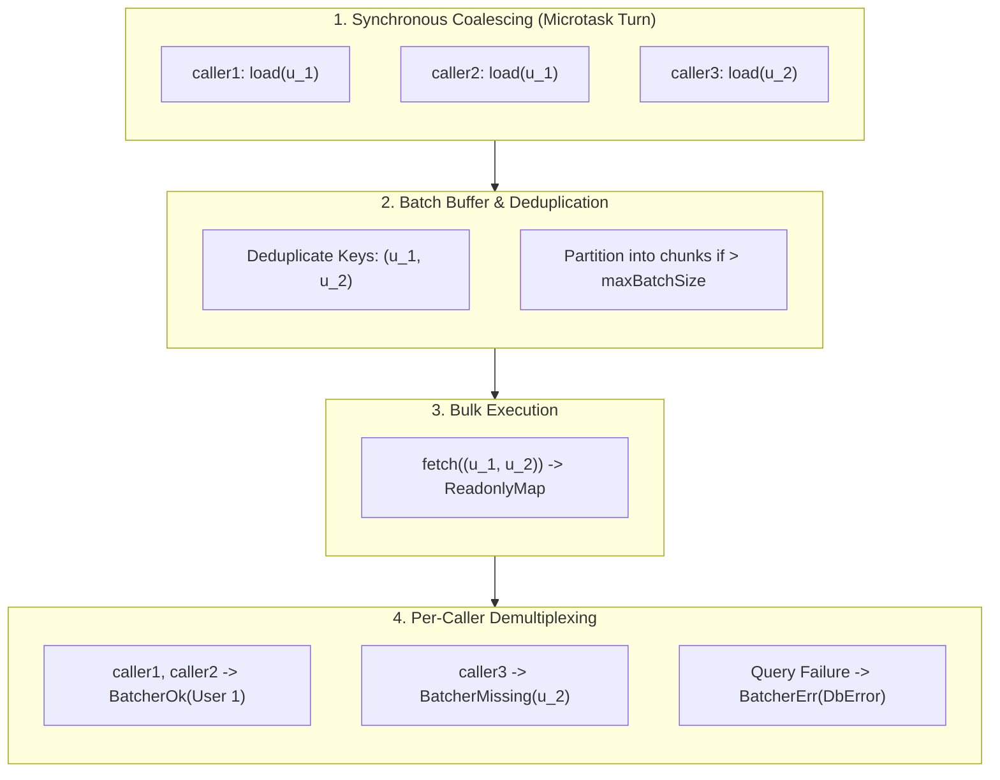

<!-- BUNDLE_SIZE:START -->

> 2.87 kB minified + gzipped

<!-- BUNDLE_SIZE:END -->

When rendering relational data — such as a list of posts displaying each author's profile or an
order feed resolving item details — naive implementations fetch child records inside iterative
loops. Each parent item issues an independent database query or HTTP request.

```ts
// Iterative database queries in a loop: N+1 queries for N parent records
async function getPostsWithAuthors(): Promise<PostWithAuthor[]> {
  const posts = await db.posts.findRecent();

  const results: PostWithAuthor[] = [];
  for (const post of posts) {
    // Issues a separate SELECT query for every single post
    const author = await db.users.findById(post.authorId);
    results.push({ ...post, author });
  }

  return results;
}
```

This pattern produces three severe runtime hazards:

1. **Connection Pool Exhaustion**: A page of 50 posts sends 50 sequential round trips to the
   database, saturating connection pools and serializing I/O.
2. **Redundant Key Lookups**: If 20 posts are written by the same author, the database receives 20
   identical queries for that author ID within the same execution turn.
3. **GraphQL Resolver Fragmentation**: In GraphQL schemas, field resolvers execute independently. An
   `author` field resolver on a `Post` type has no native knowledge of sibling resolvers running in
   the same query tree.

---

## 1. The Minimal Atomic Fix

`Batcher` collects individual key lookups called synchronously in the same event loop tick,
deduplicates redundant keys, and dispatches a single bulk query.

```ts
import { Batcher, pipe, Task } from "@pplnd/core";
import { Arr } from "@pplnd/data";

const userBatcher = Batcher.make({
  fetch: (ids: readonly string[]) =>
    pipe(
      db.users.findMany({ where: { id: { in: ids } } }),
      Task.Result.map(Arr.indexBy((u: User) => u.id)),
    ),
});

// Multiple callers invoke .load() synchronously in the same turn:
const [userA, userB, userC] = await Promise.all([
  userBatcher.load("u_1"),
  userBatcher.load("u_1"), // Deduplicated: fetch receives "u_1" only once
  userBatcher.load("u_2"),
]);

// Or coalesce a known collection of keys without loops:
const batchOutcomes = await userBatcher.loadMany(["u_1", "u_2", "u_3"]);
```

`Batcher.make` returns a stateless loader. Once the active microtask turn finishes and its pending
callers settle, the batch buffer clears. The batcher can safely live as a long-lived application
singleton without memory leaks or cross-request stale state.



---

## 2. Tri-State Outcomes (`Batcher.Outcome`)

When querying a database for a collection of IDs (`WHERE id IN ('u_1', 'u_2')`), missing rows are a
normal domain reality, not an unexpected query failure.

`Batcher` separates discovery into a tri-state discriminated union:

```ts
export namespace Batcher {
  export type Ok<V> = WithKind<"BatcherOk"> & WithValue<V>;
  export type Missing<K> = WithKind<"BatcherMissing"> & { readonly key: K };
  export type Err<E> = WithKind<"BatcherErr"> & WithError<E>;

  export type Outcome<E, V, K> = Ok<V> | Missing<K> | Err<E>;
}
```

- **`BatcherOk`**: The key was found in the returned map. Carries `value: V`.
- **`BatcherMissing`**: The batch query succeeded, but the requested key was absent from the map.
  Carries `key: K`.
- **`BatcherErr`**: The batch query itself failed (e.g., database network timeout). Carries
  `error: E`.

---

## 3. Pattern Matching & Elimination

Eliminate a `Batcher.Outcome` using `Batcher.Outcome.match` to handle all three branches explicitly:

```ts
import { Batcher, pipe } from "@pplnd/core";

const outcome = await userBatcher.load("u_99");

const response = pipe(
  outcome,
  Batcher.Outcome.match({
    ok: (user) => ({ status: 200, body: user }),
    missing: (id) => ({ status: 404, body: `User ${id} does not exist` }),
    err: (err) => ({ status: 500, body: `Database error: ${err.message}` }),
  }),
);
```

### Transforming & Extracting Values

When you only need to transform the successful value or extract it with a fallback:

```ts
// Transform the found value while leaving Missing and Err untouched:
const userDisplayName = pipe(
  outcome,
  Batcher.Outcome.map((user) => `${user.name} (${user.email})`),
);

// Fallback to a default guest object:
const activeUser = pipe(
  outcome,
  Batcher.Outcome.getOrElse(() => defaultGuestUser),
);
```

### Direct Domain Conversions

`Batcher.Outcome.to` provides standard adapters to convert outcomes into primary core types:

```ts
// 1. Convert to Result by projecting missing keys into a domain error:
const userResult = pipe(
  outcome,
  Batcher.Outcome.to.Result((missingId) => new UserNotFoundError(missingId)),
); // Result<UserNotFoundError | DbError, User>

// 2. Convert to Maybe (mapping Missing and Err to None):
const userMaybe = pipe(
  outcome,
  Batcher.Outcome.to.Maybe,
); // Maybe<User>

// 3. Convert to nullable (ideal for GraphQL resolvers):
const userNullable = pipe(
  outcome,
  Batcher.Outcome.to.nullable,
); // User | null
```

---

## 4. Operational Controls

### Bounded Chunks (`maxBatchSize`)

Relational databases impose limits on query parameters (SQLite allows up to 999 parameters; Postgres
allows up to 65,535). If an application queues 5,000 keys in a single tick, sending them in one
query causes database drivers to throw parameter overflow errors.

Setting `maxBatchSize` automatically partitions oversized batches into bounded chunks:

```ts
const userBatcher = Batcher.make({
  fetch: (ids) => db.users.findManyByIds(ids),
  maxBatchSize: 100, // Partitions 250 keys into chunks of [100, 100, 50]
});
```

### Concurrency Limiting (`concurrency`)

When a large batch is split into multiple chunks, executing all chunks in parallel can saturate
database connection pools. Use `concurrency` to bound in-flight database dispatches:

```ts
const userBatcher = Batcher.make({
  fetch: (ids) => db.users.findManyByIds(ids),
  maxBatchSize: 100,
  concurrency: 2, // At most 2 chunk queries execute in flight simultaneously
});
```

### Delayed Coalescing Windows (`window`)

By default, `Batcher` flushes on the next microtask turn (`queueMicrotask`). When coordinating
asynchronous message queues, background workers, or high-throughput event consumers, buffering over
a fixed time window yields higher coalescing ratios:

```ts
import { Batcher, Duration } from "@pplnd/core";

const analyticsBatcher = Batcher.make({
  fetch: (events) => sendAnalyticsBatch(events),
  window: Duration.milliseconds(25), // Buffers incoming events across 25ms
  maxBatchSize: 500,                 // Flushes early if buffer hits 500
});
```

### Caller Abort Isolation (`AbortSignal`)

When client requests disconnect or reach gateway timeouts, individual callers can cancel their
lookup without interrupting sibling requests sharing the same batch:

```ts
const controller = new AbortController();

const p1 = userBatcher.load("u_1", controller.signal);
const p2 = userBatcher.load("u_2"); // No signal attached

// Abort caller 1 mid-flight:
controller.abort(new Error("Request timed out"));

const [res1, res2] = await Promise.all([p1, p2]);

// res1 settles immediately with BatcherErr:
expect(Batcher.Outcome.is.err(res1)).toBe(true);

// res2 proceeds and settles normally with BatcherOk:
expect(Batcher.Outcome.is.ok(res2)).toBe(true);
```

If every caller in a pending batch aborts before the query dispatches, the batcher cancels the
pending batch and skips calling `fetch` entirely.

---

## 5. Real-World Architectural Patterns

### Relational Database Entity Access (1-to-1 Mapping)

When fetching entities by primary key, pair `fetch` with `Arr.indexBy`:

```ts
import { Batcher, pipe, Task } from "@pplnd/core";
import { Arr } from "@pplnd/data";

type User = { readonly id: string; readonly name: string; readonly email: string };

export const userBatcher = Batcher.make<string, DbError, User>({
  fetch: (ids: readonly string[]) =>
    pipe(
      db.query<User>("SELECT * FROM users WHERE id = ANY($1)", [ids]),
      Task.Result.map(Arr.indexBy((u) => u.id)),
    ),
  maxBatchSize: 200,
});
```

### One-to-Many Relation Aggregation (1-to-N Mapping)

When fetching child records grouped under a parent ID (such as blog post comments or order line
items), pair `fetch` with `Dict.groupBy`:

```ts
import { Batcher, pipe, Task } from "@pplnd/core";
import { Dict } from "@pplnd/data";

type Comment = { readonly id: string; readonly postId: string; readonly text: string };

export const commentsByPostBatcher = Batcher.make<string, DbError, readonly Comment[]>({
  fetch: (postIds: readonly string[]) =>
    pipe(
      db.query<Comment>("SELECT * FROM comments WHERE post_id = ANY($1)", [postIds]),
      Task.Result.map(Dict.groupBy((c) => c.postId)),
    ),
});

// Each post ID resolves to an array of comments:
const comments = await commentsByPostBatcher.load("post_42");
// BatcherOk([ { id: "c_1", postId: "post_42", text: "..." }, ... ])
```

### GraphQL Field Resolvers

In GraphQL servers (GraphQL Yoga, Apollo, Mercurius), field resolvers execute independently across
sibling nodes in the selection set. Return `Deferred` lookups directly, mapped through
`to.nullable`:

```ts
import { Deferred, pipe } from "@pplnd/core";
import { userBatcher } from "./loaders";

export const resolvers = {
  Post: {
    author: (parent: { authorId: string }) =>
      pipe(
        userBatcher.load(parent.authorId),
        Deferred.map(Batcher.Outcome.to.nullable),
      ),
  },
};
```

---

## 6. Deterministic Testing (`flush`)

Unit testing microtask batchers often leads to flaky tests with arbitrary `setTimeout` delays.
`batcher.flush()` drains and settles all active and in-flight batches deterministically:

```ts
import { Batcher } from "@pplnd/core";
import { expect, test } from "vitest";

test("processes pending lookups before assertions", async () => {
  const batcher = Batcher.make({ ... });

  const loadPromise = batcher.load("item_1");

  // Force all buffered operations to settle immediately:
  await batcher.flush();

  const outcome = await loadPromise;
  expect(Batcher.Outcome.is.ok(outcome)).toBe(true);
});
```

---

## Problems it solves

- **N+1 Query Elimination**: Consolidates independent `.load()` invocations across loops or GraphQL
  trees into single bulk queries.
- **Microtask Key Deduplication**: Collapses duplicate key requests within the same tick so backend
  databases never fetch the same entity twice.
- **Parameter Overflow Shielding**: Automatically splits large batches exceeding database parameter
  limits (`maxBatchSize`) without manual chunking code.
- **Tri-State Domain Clarity**: Distinguishes between successful values, missing keys, and execution
  errors without throwing exceptions or overloading error channels.
- **Memory-Leak Free Singletons**: Retains zero state across execution turns, allowing safe
  long-lived application singleton instances.
