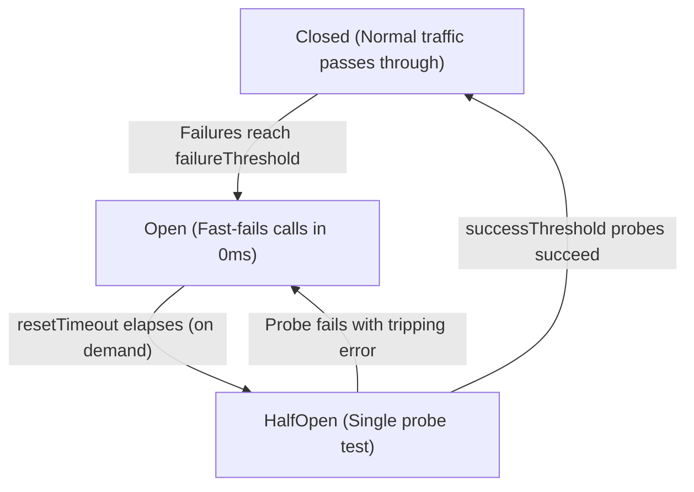

<!-- BUNDLE_SIZE:START -->

> 2.80 kB minified + gzipped

<!-- BUNDLE_SIZE:END -->

When an external dependency — a payment gateway, third-party webhook receiver, or database replica —
suffers a sustained outage, client applications retrying failed calls trigger a retry storm.
Hundreds of concurrent requests repeatedly attempt TCP handshakes, execute database transactions,
and wait for connection timeouts. This exhausts server connection pools, starves the Node.js event
loop, and causes cascading failures across otherwise healthy upstream services.

```ts
// Manual retry loops and boolean flags during downstream degradation
let failureCount = 0;
let isServiceDown = false;
let downSince = 0;

async function executeCharge(payload: ChargeInput): Promise<ChargeResult> {
  if (isServiceDown) {
    if (Date.now() - downSince < 30_000) {
      throw new Error("Downstream service is currently unavailable");
    }
    // Cooldown elapsed, attempt probe without mutex protection
    isServiceDown = false;
  }

  try {
    const res = await callStripeApi(payload);
    failureCount = 0;
    return res;
  } catch (err) {
    failureCount++;
    if (failureCount >= 5) {
      isServiceDown = true;
      downSince = Date.now();
    }
    throw err;
  }
}
```

This manual coordination introduces three dangerous runtime failure modes:

1. **The Thundering Probe Herd**: When the cooldown timer expires, multiple concurrent requests
   simultaneously attempt probe requests against the recovering service, immediately knocking it
   back offline before it can stabilize.
2. **False Outage Triggers**: Client-side domain errors (such as `400 Bad Request` or
   `404 Not Found`) increment failure counters, incorrectly opening the circuit breaker for healthy
   external APIs.
3. **Timer Handle Leaks**: Background `setInterval` or `setTimeout` timers keep Node.js serverless
   invocations and CLI scripts hanging, preventing clean process exit.

`CircuitBreaker` replaces this boilerplate with a demand-driven state machine. It tracks task
failures, fast-fails subsequent calls in 0ms with `CircuitBreaker.OpenError` once failures exceed a
threshold, and coordinates isolated single-probe trials during recovery without running persistent
background timers.



---

## Operating States & Mental Model

A `CircuitBreaker` operates as a discriminated union over three distinct states:

```ts
export type State<E = unknown> =
  | { readonly kind: "Closed"; readonly failures: number }
  | { readonly kind: "Open"; readonly openedAt: number; readonly retryAfterMs: number; readonly lastError: E }
  | { readonly kind: "HalfOpen"; readonly probeInFlight: boolean; readonly consecutiveSuccesses: number };
```

- **`Closed`**: The downstream dependency is healthy. Calls execute normally. Any success resets
  consecutive failure counters to `0`. If failures reach `failureThreshold`, the breaker transitions
  to `Open`.
- **`Open`**: The downstream dependency is failing. All protected tasks immediately short-circuit in
  0ms with `Result.make.err(CircuitBreaker.OpenError<E>)`. Zero network I/O or downstream
  allocations occur.
- **`HalfOpen`**: The `resetTimeout` cooldown has elapsed. The breaker allows a single probe request
  through to test downstream health (`probeInFlight: true`). Concurrent requests arriving while the
  probe is active continue to fast-fail. If `successThreshold` consecutive probes succeed, the
  circuit returns to `Closed`. If any probe fails, the circuit immediately trips back to `Open`.

---

## Creating a CircuitBreaker

Initialize a circuit breaker with `CircuitBreaker.make`, providing the failure threshold and
cooldown timeout:

```ts
import { CircuitBreaker } from "@nlozgachev/pipelined/core";
import { Duration } from "@nlozgachev/pipelined/types";

type StripeError = {
  readonly status: number;
  readonly message: string;
};

const stripeBreaker = CircuitBreaker.make<StripeError>({
  failureThreshold: 5,
  resetTimeout: Duration.seconds(30),
  successThreshold: 2,
  shouldTrip: (err) => err.status >= 500,
});
```

### Configuration Options

- **`failureThreshold`**: The number of failures required to trip the circuit to `Open`.
- **`resetTimeout`**: The cooldown duration the breaker remains in `Open` before permitting trial
  probes.
- **`successThreshold`**: The number of consecutive successful probes required in `HalfOpen` to
  declare the service recovered and reset the circuit to `Closed`. Defaults to `1`.
- **`shouldTrip`**: Optional filter predicate. Non-tripping errors (such as validation failures or
  `404 Not Found`) return their `Err` outcome normally without incrementing failure counters or
  tripping the circuit.
- **`failureWindow`**: Optional sliding duration window for tracking failures. When specified, only
  failures occurring within the window are counted towards `failureThreshold`.

---

## Protecting Fallible Tasks

The `breaker.protect` combinator wraps any `Task.Result<EIn, A>` computation. Because it accepts the
task as its sole argument, it integrates directly into `pipe`:

```ts
import { pipe } from "@nlozgachev/pipelined/composition";
import { Result, Task } from "@nlozgachev/pipelined/core";

type ChargeInput = {
  readonly customerId: string;
  readonly amountCents: number;
};
type ChargeResult = { readonly transactionId: string };
declare const callPaymentGateway: (payload: ChargeInput) => Task.Result<StripeError, ChargeResult>;

const processPayment = (payload: ChargeInput) =>
  pipe(
    callPaymentGateway(payload),
    stripeBreaker.protect,
  );

// Execution:
const outcome = await processPayment({ customerId: "cust_123", amountCents: 4500 })();

if (Result.is.err(outcome)) {
  if (CircuitBreaker.is.openError(outcome.error)) {
    console.warn(`Payment gateway cooling down. Retry in ${outcome.error.retryAfterMs}ms`);
  } else {
    console.error(`Payment failed due to gateway error:`, outcome.error);
  }
}
```

The protected task preserves the exact narrowed error type `EIn` of the input task while appending
`CircuitBreaker.OpenError<E>` to the error channel.

---

## Sliding Failure Windows

By default, `CircuitBreaker` counts consecutive failures: any successful execution resets the
counter to `0`.

To detect partial degradation patterns — where a service fails 50% of requests in an alternating
pattern — specify `failureWindow`:

```ts
const analyticsBreaker = CircuitBreaker.make<AnalyticsError>({
  failureThreshold: 10,
  resetTimeout: Duration.seconds(45),
  failureWindow: Duration.minutes(1),
});
```

With `failureWindow` configured, failures are tracked within a sliding timestamp window. Intervening
successes do not erase recorded failures. If 10 failures occur within any rolling 60-second window,
the circuit trips to `Open`.

---

## Observing State & Health Checks

Query the current lifecycle state synchronously with `breaker.state()`:

```ts
const state = stripeBreaker.state();

switch (state.kind) {
  case "Closed":
    console.log(`Healthy (${state.failures} failures recorded)`);
    break;
  case "Open":
    console.log(`Open cooldown active (${state.retryAfterMs}ms remaining)`);
    break;
  case "HalfOpen":
    console.log(`Recovery probe in progress: ${state.probeInFlight}`);
    break;
}
```

### Telemetry Subscriptions

Attach listener callbacks to observe state transitions using `breaker.subscribe`:

```ts
const unsubscribe = stripeBreaker.subscribe((state) => {
  metrics.gauge("circuit_breaker.state", state.kind === "Closed" ? 1 : 0);

  if (state.kind === "Open") {
    alertSystem.notify("stripe_breaker_tripped", {
      lastError: state.lastError,
      cooldownMs: state.retryAfterMs,
    });
  }
});

// Clean up when shutting down service:
unsubscribe();
```

Subscriber exceptions are isolated with `try/catch` blocks, guaranteeing that an observer error
never disrupts ongoing task execution.

---

## Manual Resets

To force an open or half-open circuit breaker back to `Closed` with zero recorded failures (for
instance, after an operational administrator confirms recovery via an admin dashboard):

```ts
stripeBreaker.reset();
```

---

## End-to-End Pipeline Workflow

The following example demonstrates protecting an order fulfillment pipeline against downstream
inventory service outages while isolating customer notifications:

```ts
import { pipe } from "@nlozgachev/pipelined/composition";
import { CircuitBreaker, Result, Task } from "@nlozgachev/pipelined/core";
import { Duration } from "@nlozgachev/pipelined/types";

type InventoryError = { readonly code: "OUT_OF_STOCK" | "SERVICE_UNAVAILABLE" };
type EmailError = { readonly reason: string };

const inventoryBreaker = CircuitBreaker.make<InventoryError>({
  failureThreshold: 3,
  resetTimeout: Duration.seconds(15),
  shouldTrip: (err) => err.code === "SERVICE_UNAVAILABLE",
});

const reserveInventory = (orderId: string, sku: string): Task.Result<InventoryError, string> =>
  Task.Result.tryCatch(
    async () => api.reserve(orderId, sku),
    { onError: (e) => ({ code: "SERVICE_UNAVAILABLE" as const }) },
  );

const sendConfirmationEmail = (orderId: string): Task.Result<EmailError, void> =>
  Task.Result.tryCatch(
    async () => mailer.send(orderId),
    { onError: (e) => ({ reason: String(e) }) },
  );

const checkoutOrder = (orderId: string, sku: string) =>
  pipe(
    reserveInventory(orderId, sku),
    inventoryBreaker.protect,
    Task.Result.chain((reservationId) =>
      pipe(
        sendConfirmationEmail(orderId),
        Task.Result.map(() => reservationId),
      )
    ),
  );

const result = await checkoutOrder("ord_99", "item_42")();

if (Result.is.ok(result)) {
  console.log("Order confirmed with reservation:", result.value);
} else if (CircuitBreaker.is.openError(result.error)) {
  console.warn("Inventory service temporarily offline. Backing off:", result.error.retryAfterMs);
}
```

---

## Problems it solves

- **Preventing cascading failures from retry storms**: During sustained downstream outages, retrying
  every incoming call saturates connection pools and starves CPU resources. `CircuitBreaker`
  fast-fails requests in 0ms when `Open`, freeing system resources for unaffected workflows.
- **Single-probe mutex locks during service recovery**: When an outage ends, allowing hundreds of
  concurrent callers to test a recovering service triggers immediate relapse. `CircuitBreaker`
  allows exactly one trial probe through during `HalfOpen`, rejecting concurrent callers until
  recovery is proven.
- **Demand-driven time accounting without timer leaks**: Traditional implementations run background
  `setTimeout` handles to transition from Open to HalfOpen, causing memory leaks in serverless
  functions and preventing Node.js processes from exiting. `CircuitBreaker` evaluates expiration
  lazily on incoming calls and state queries without background intervals.
- **Selective error filtering**: Domain errors (such as validation rejections or missing records)
  should never be conflated with infrastructure downtime. The `shouldTrip` predicate filters errors
  so only genuine service outages increment failure counters.
- **Preserving task error channels in pipelines**: Wrapping fallible tasks often erases specific
  error unions. `CircuitBreaker.protect` preserves the exact input error type `EIn` while cleanly
  appending `CircuitBreaker.OpenError<E>` to the return type.
