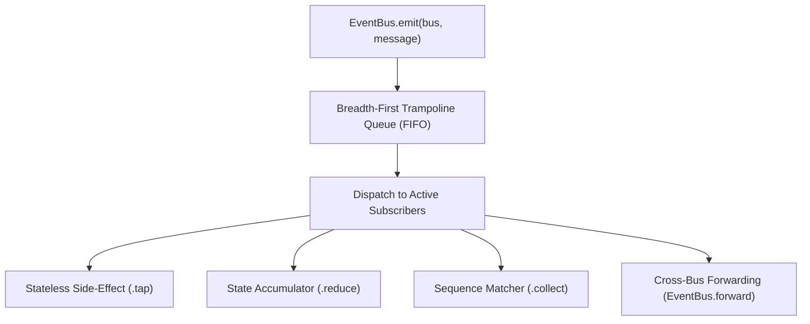
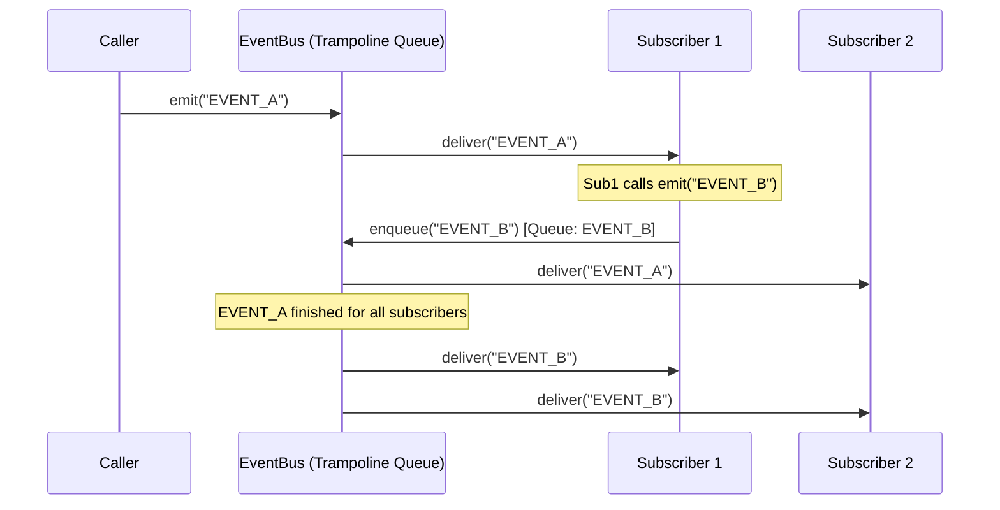

<!-- BUNDLE_SIZE:START -->

> 1.11 kB minified + gzipped (1,106 B)

<!-- BUNDLE_SIZE:END -->

Coordinating multi-step workflows like order checkouts, multi-factor authentication, or data import
pipelines across decoupled modules with raw event emitters quickly leads to fragile code:

```ts
// Raw event emitters with manual sequence tracking and mutable flags
import EventEmitter from "node:events";

const emitter = new EventEmitter();

let hasAddress = false;
let addressPayload: { street: string; zip: string } | null = null;
let hasPayment = false;
let paymentPayload: { transactionId: string } | null = null;

emitter.on("shippingAddressEntered", (payload: any) => {
  hasAddress = true;
  addressPayload = payload;
});

emitter.on("paymentAuthorized", (payload: any) => {
  if (!hasAddress) {
    // Out-of-order payment arrived before shipping address
    return;
  }
  hasPayment = true;
  paymentPayload = payload;
  finalizeOrder(addressPayload!, paymentPayload!);
});
```

This pattern introduces four failure modes:

- **Zero payload type safety**: Event names are untyped strings (`"shippingAddressEntered"`).
  Misspelled keys fail silently at runtime, and payloads collapse to `any`.
- **Fragile manual sequence state**: Every multi-step sequence requires independent mutable flags
  (`hasAddress`, `hasPayment`) and manual cleanup. If a step is cancelled or times out, flags remain
  stuck in partial states.
- **Re-entrant call stack corruption**: When a listener reacts to an incoming event by immediately
  emitting a new event, standard event emitters execute listeners recursively on the call stack.
  This scrambles chronological dispatch order and causes stack overflow crashes during event
  cascades.
- **Memory leaks**: Listeners must be manually tracked and detached on component unmount; missing a
  `.off()` call leaks closures and retains large object graphs.

`EventBus` models events as a typed schema map. It couples strongly typed payloads with native
sequence matching, pure state reduction, and breadth-first trampoline dispatching.



---

## Type Structure

An `EventBus<S>` represents a message pipeline constrained to a schema map `S`. Each schema map
defines message kind string keys paired with payload types:

```ts
import { EventBus } from "@nlozgachev/pipelined/core";

type CheckoutMessages = {
  addressValidated: { shippingAddress: string };
  paymentAuthorized: { transactionId: string; amount: number };
  orderConfirmed: { orderId: string };
};

// EventBus.Message<CheckoutMessages> evaluates to:
// | { kind: "addressValidated"; value: { shippingAddress: string } }
// | { kind: "paymentAuthorized"; value: { transactionId: string; amount: number } }
// | { kind: "orderConfirmed"; value: { orderId: string } }
```

Every message emitted through an event bus is structured as a plain discriminated union containing
`kind` (the message identifier) and `value` (the payload).

---

## Creating Event Buses

Event buses are constructed using `EventBus.make`. An optional configuration object allows naming
the bus for debugging or attaching an error boundary callback to isolate subscriber exceptions from
halting sibling listeners:

```ts
import { EventBus } from "@nlozgachev/pipelined/core";

// Create an isolated event bus with an error boundary
const authBus = EventBus.make<CheckoutMessages>({
  name: "checkout-pipeline",
  onError: (error) => {
    console.error("EventBus subscriber exception:", error);
  },
});
```

---

## Emitting Messages

Messages are published using `EventBus.emit`, which accepts the target event bus (or an array of
buses for broadcasting) and the message object. The compiler enforces that `value` matches the
payload type declared for that `kind`:

```ts
import { EventBus } from "@nlozgachev/pipelined/core";

// Emit to a single event bus
EventBus.emit(authBus, {
  kind: "addressValidated",
  value: { shippingAddress: "123 Market St" },
});

// Broadcast to multiple event buses simultaneously
EventBus.emit([authBus, analyticsBus], {
  kind: "paymentAuthorized",
  value: { transactionId: "tx-491", amount: 89.50 },
});
```

---

## Subscribing to Events

`EventBus.subscribe` registers subscribers on an event bus. Omitting the event filter subscribes to
all events defined on the bus schema, while providing a key or array of keys targets specific events
or sequences.

Each call to `.reduce()`, `.tap()`, or `.collect()` registers an independent subscription with its
own sequence tracking state and disposal function.

### Schema-Wide Subscriptions

When building telemetry collectors, audit loggers, or global metrics sinks across an entire bus,
call `EventBus.subscribe(bus)` without specifying event keys. The callback receives a discriminated
union of all messages defined on the bus schema:

```ts
import { EventBus } from "@nlozgachev/pipelined/core";

// Observe all events emitted on the bus
const unsubscribe = EventBus.subscribe(authBus).tap((msg) => {
  console.log("Telemetry event:", msg.kind, msg.value);
});

// Accumulate total event count across the entire bus
const eventCount = EventBus.subscribe(authBus).reduce((_msg, count) => count + 1, 0);
```

### Targeted Subscriptions

When targeting specific event keys, `EventBus.subscribe` narrows the message payload directly in the
handler:

```ts
import { EventBus } from "@nlozgachev/pipelined/core";

type TelemetryMessages = {
  pageViewed: { path: string };
  buttonClicked: { buttonId: string };
};

const analyticsBus = EventBus.make<TelemetryMessages>();

// msg.value is strictly typed as { buttonId: string }
const unsubscribe = EventBus.subscribe(analyticsBus, "buttonClicked").tap((msg) => {
  console.log("Button clicked:", msg.value.buttonId);
});

// Stop listening when the view unmounts
unsubscribe();
```

---

## Handling Events

`EventBus.subscribe` provides three consumption methods depending on whether you need stateless
side-effects, accumulated state, or aggregated sequence payloads.

### Stateless Side-Effects (`.tap`)

`.tap(effect)` executes a side-effect callback when a matching event arrives. It returns a cleanup
function to remove the subscriber:

```ts
import { EventBus } from "@nlozgachev/pipelined/core";

const unsubscribe = EventBus.subscribe(analyticsBus, "pageViewed").tap((msg) => {
  trackPageView(msg.value.path);
});

// Remove subscriber
unsubscribe();
```

### Stateful Accumulation (`.reduce`)

`.reduce(reducer, initialState)` accumulates derived state over incoming events using a pure reducer
function. It returns a `Subscription<State>` handle with `.getState()` and `.unsubscribe()`:

```ts
import { EventBus } from "@nlozgachev/pipelined/core";

type CartMessages = {
  itemAdded: { price: number; quantity: number };
  itemRemoved: { price: number; quantity: number };
  cartCleared: void;
};

const cartBus = EventBus.make<CartMessages>();

type CartSummary = {
  totalItems: number;
  totalCost: number;
};

const cartSubscription = EventBus.subscribe(
  cartBus,
  ["itemAdded", "itemRemoved", "cartCleared"],
).reduce(
  (msg, state) => {
    if (msg.kind === "itemAdded") {
      return {
        totalItems: state.totalItems + msg.value.quantity,
        totalCost: state.totalCost + (msg.value.price * msg.value.quantity),
      };
    }
    if (msg.kind === "itemRemoved") {
      return {
        totalItems: Math.max(0, state.totalItems - msg.value.quantity),
        totalCost: Math.max(0, state.totalCost - (msg.value.price * msg.value.quantity)),
      };
    }
    return { totalItems: 0, totalCost: 0 };
  },
  { totalItems: 0, totalCost: 0 },
);

// Inspect live accumulated state
console.log(cartSubscription.getState());

// Stop subscription
cartSubscription.unsubscribe();
```

### Sequence Payload Aggregation (`.collect`)

`.collect(callback)` registers a terminal subscriber that aggregates payloads from multiple steps
into a single keyed record (`{ [Event]: Payload }`). The callback executes once all required events
have arrived, recurring on every completion unless `{ once: true }` is configured:

```ts
import { EventBus } from "@nlozgachev/pipelined/core";

const checkoutBus = EventBus.make<CheckoutMessages>();

// Listen for the complete checkout sequence:
const unsubscribe = EventBus.subscribe(
  checkoutBus,
  ["addressValidated", "paymentAuthorized", "orderConfirmed"],
  { ordered: true, strict: true },
).collect((payloads) => {
  // payloads is strictly typed:
  // {
  //   addressValidated: { shippingAddress: string };
  //   paymentAuthorized: { transactionId: string; amount: number };
  //   orderConfirmed: { orderId: string };
  // }
  console.log("Order confirmed:", payloads.orderConfirmed.orderId);
  console.log("Shipped to:", payloads.addressValidated.shippingAddress);
});
```

---

## Sequence Matching Options

When subscribing to multiple event keys, pass a `SequenceOptions` record to configure order,
strictness, and reset conditions:

```ts
import { EventBus } from "@nlozgachev/pipelined/core";

type UserOnboardingMessages = {
  accountCreated: { userId: string };
  profileCompleted: { displayName: string };
  mfaEnrolled: { method: "totp" | "sms" };
  onboardingFinished: { completedAt: number };
  flowReset: { reason: string };
};

const onboardingBus = EventBus.make<UserOnboardingMessages>();

const sub = EventBus.subscribe(
  onboardingBus,
  ["accountCreated", "profileCompleted", "mfaEnrolled", "onboardingFinished"],
  {
    ordered: true,
    strict: false,
    optional: ["mfaEnrolled"],
    reset: "flowReset",
    once: true,
  },
).collect((payloads) => {
  console.log("User ready:", payloads.accountCreated.userId);

  // Optional steps evaluate to T | undefined
  if (payloads.mfaEnrolled !== undefined) {
    console.log("MFA configured via:", payloads.mfaEnrolled.method);
  }
});
```

Matching behavior follows these rules:

- **`ordered: true`**: Events must arrive in the exact order specified in the array. In relaxed mode
  (`strict: false`), intervening irrelevant events are ignored.
- **`strict: true`**: In ordered sequences, events must arrive consecutively without any intervening
  events from the schema. An unexpected event immediately resets sequence tracking to index 0.
- **`optional: [...]`**: Configures events that may be skipped without breaking sequence progress.
  In `.collect()`, skipped optional steps evaluate to `undefined`, and TypeScript types them as
  `T | undefined` to enforce safe narrowing.
- **`reset: [...]`**: Specifies one or more event kinds that immediately reset sequence progress and
  clear partially aggregated payloads when emitted.
- **`once: true`**: Automatically detaches the subscriber before executing the callback upon the
  first match, preventing re-entrant cycles and duplicate firings.

---

## Structural Event Bus Forwarding

`EventBus.forward` routes messages from a source event bus to one or more target buses. Using the
`only` filter permits forwarding shared event keys between buses with distinct domain schemas:

```ts
import { EventBus } from "@nlozgachev/pipelined/core";

type OrderMessages = {
  cartUpdated: { count: number };
  checkoutSubmitted: { total: number };
};

type AuditMessages = {
  checkoutSubmitted: { total: number };
  userLoggedOut: { userId: string };
};

const uiBus = EventBus.make<OrderMessages>();
const auditBus = EventBus.make<AuditMessages>();

// Forward only checkoutSubmitted events from uiBus to auditBus
const stopForwarding = EventBus.forward({
  from: uiBus,
  to: auditBus,
  only: ["checkoutSubmitted"],
});

// Emitting on uiBus automatically routes to auditBus subscribers
EventBus.emit(uiBus, {
  kind: "checkoutSubmitted",
  value: { total: 149.99 },
});

// Disconnect forwarding when the feature unmounts
stopForwarding();
```

When `only` is omitted, the target bus schema must accept every event defined on the source bus.

---

## Synchronous Breadth-First Dispatch

When a subscriber reacts to an incoming event by immediately emitting a new event (`EventBus.emit`
called inside a subscriber callback), `EventBus` dispatches messages through an internal synchronous
trampoline queue.

Rather than invoking re-entrant emissions recursively on the call stack, nested messages are
appended to the bus queue. The active dispatch loop delivers the current message to all registered
subscribers completely before processing subsequent queued messages:



This dispatch architecture enforces two invariants:

- **Strict Causal Ordering**: Parallel subscribers always observe messages in chronological FIFO
  order. No subscriber will observe a re-entrantly triggered event before finishing the event that
  caused it.
- **Call Stack Protection**: Deeply cascading event chains execute sequentially inside a flat loop
  in O(1) stack space, preventing call stack exhaustion without introducing asynchronous microtask
  delays.

---

## Driving State Machines with `Machine.interpret`

While `EventBus` broadcasts messages across decoupled modules, an event bus does not track workflow
state. Passing an `EventBus` to [`Machine.interpret`](/guides/machine/) connects the event bus to a
stateful gatekeeper:

```ts
import { EventBus, Machine } from "@nlozgachev/pipelined/core";

// Shared event schema
type AuthEvents = {
  SUBMIT: { readonly email: string };
  SUCCESS: { readonly token: string };
  SIGNOUT: void;
};

// Create bus and attach the state machine actor
const authBus = EventBus.make<AuthEvents>();
const actor = Machine.interpret(authMachine, { bus: authBus });

// Emitting on the bus drives transitions in the actor
EventBus.emit(authBus, { kind: "SUBMIT", value: { email: "dev@example.com" } });

// Aborting the actor automatically detaches it from the bus
actor.abort();
```

Bridging an event bus with a state machine prevents three failure modes:

- **Out-of-order action corruption**: Messages arriving when the machine is in an incompatible state
  are dropped safely as idempotent no-ops.
- **Dangling subscriber leaks**: Calling `actor.abort()` unbinds the actor from the bus
  automatically when UI views unmount.
- **Cascading exception containment**: Subscriber errors inside machine entry hooks or transition
  handlers are isolated by the bus's error boundary without crashing sibling subscribers.

---

## Pipeline Composition

`EventBus` operations integrate cleanly with `pipe` for batch processing, telemetry streaming, and
multi-stage event transformations:

```ts
import { pipe } from "@nlozgachev/pipelined/composition";
import { EventBus } from "@nlozgachev/pipelined/core";

type OrderStreamMessages = {
  orderPlaced: { orderId: string; amount: number };
  fraudFlagged: { orderId: string; riskScore: number };
  orderSettled: { orderId: string; fee: number };
};

const orderBus = EventBus.make<OrderStreamMessages>();

// Live revenue accumulator
const revenueTracker = EventBus.subscribe(orderBus, "orderPlaced").reduce(
  (msg, total) => total + msg.value.amount,
  0,
);

// Ingest a batch of external transaction records through pipe
type RawTransaction = { id: string; val: number; flagged?: boolean };

const rawBatch: readonly RawTransaction[] = [
  { id: "ord-1", val: 120.00 },
  { id: "ord-2", val: 450.00, flagged: true },
  { id: "ord-3", val: 85.50 },
];

pipe(
  rawBatch,
  (batch) =>
    batch.map((tx): EventBus.Message<OrderStreamMessages> => {
      if (tx.flagged) {
        return { kind: "fraudFlagged", value: { orderId: tx.id, riskScore: 0.95 } };
      }
      return { kind: "orderPlaced", value: { orderId: tx.id, amount: tx.val } };
    }),
  (messages) => {
    for (let i = 0; i < messages.length; i++) {
      EventBus.emit(orderBus, messages[i]);
    }
  },
);

console.log("Total revenue from valid orders:", revenueTracker.getState());
revenueTracker.unsubscribe();
```

---

## Problems it solves

- **Decoupling event producers from subscribers**: Modules broadcast lifecycle events through a
  strongly typed schema map without retaining hardcoded references to UI views, logging sinks, or
  analytics trackers.
- **Pattern-matching multi-step event sequences**: Tracks multi-step flows (such as registration →
  verification → onboarding completion) natively with configurable ordering, strict consecutive
  matching, optional steps, and reset events.
- **Preventing re-entrant message reordering**: Trampoline FIFO queue dispatching guarantees that
  nested emissions triggered by subscriber callbacks never jump ahead of primary events.
- **Eliminating call stack overflow crashes**: Cascading domain events execute sequentially inside
  an iterative dispatch loop using O(1) stack overhead, preventing recursion crashes.
- **State reduction over matched event streams**: Calling `.reduce()` accumulates live derived state
  directly from event streams synchronously without external mutable stores.
- **Structural event bus forwarding**: `EventBus.forward` bridges filtered subsets of events between
  feature modules and root application buses with compile-time schema compatibility verification.
- **Memory leak prevention**: Subscriptions return explicit disposal functions that immediately
  clean up subscriber sets and prevent dangling closures on component unmount.
