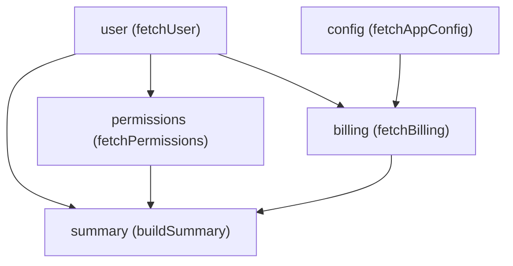

<!-- BUNDLE_SIZE:START -->

> 5.44 kB minified + gzipped

<!-- BUNDLE_SIZE:END -->

When asynchronous tasks have partial interdependencies — Task C depends on Task A, while Task D
depends on both Task A and Task B — flat parallel combinators like `Task.Result.all` or
`Promise.all` are insufficient. Developers frequently resort to brittle pyramids of nested
`Promise.all` calls, positional tuple indexing, or manual variable coordination:

```ts
// Fragile nested parallel pyramids:
const [user, config] = await Promise.all([fetchUser(userId), fetchConfig()]);

// Accidental serialization or redundant duplicate fetches:
const [permissions, billing] = await Promise.all([
  fetchPermissions(user.roleId),
  fetchBilling(user.orgId, config.region),
]);

const summary = await buildSummary(user, permissions, billing);
```

This manual coordination introduces three severe failure modes in production applications:

1. **Accidental Serialization**: Independent steps are often sequenced unnecessarily, artificially
   increasing end-to-end request latency.
2. **Redundant Execution in Diamond Dependencies**: If multiple downstream tasks depend on the same
   upstream task (e.g., both `permissions` and `billing` require `user`), naive branching often
   executes the shared task multiple times.
3. **Leaked Background Work**: If one branch fails midway, in-flight sibling tasks continue running
   in the background, wasting database connections, CPU cycles, and network bandwidth.

`Graph` eliminates this boilerplate by providing a declarative Directed Acyclic Graph (DAG)
orchestrator. You declare steps and their upstream dependencies as typed nodes; `Graph` schedules
them with maximum parallelism, guarantees that diamond dependencies run exactly once, and cancels
in-flight siblings immediately on any failure.



```ts
type Graph<E, Out> = {
  readonly kind: "Graph";
  // Opaque execution blueprint compiled and verified by Graph.make
};
```

---

## Defining Nodes

Individual workflow steps are defined using `Graph.node`. Each node declares its unique `id`, its
upstream `deps`, and an execution thunk `run`:

```ts
import { Graph, Task } from "@nlozgachev/pipelined/core";

// 1. Independent root nodes:
const user = Graph.node({
  id: "user",
  run: () => fetchUser("u_42"),
});

const config = Graph.node({
  id: "config",
  run: () => fetchAppConfig(),
});
```

When a node requires upstream data, list the required nodes in `deps`. The `run` callback
contextually receives the resolved values with full TypeScript type inference:

```ts
const permissions = Graph.node({
  id: "permissions",
  deps: { user },
  run: ({ user }) => fetchPermissions(user.roleId),
});

const billing = Graph.node({
  id: "billing",
  deps: { user, config },
  run: ({ user, config }) => fetchBilling(user.orgId, config.region),
});
```

Notice that `{ user, config }` are typed automatically from the output of their respective nodes.
Zero type annotations or manual casts are required.

---

## Compiling a Graph

A graph is compiled and validated by specifying the target sink node with `Graph.make`:

```ts
const summary = Graph.node({
  id: "summary",
  deps: { user, permissions, billing },
  run: ({ user, permissions, billing }) =>
    Task.Result.make.ok({
      user,
      permissions,
      billing,
    }),
});

// Compiles and validates the dependency graph targeting 'summary':
const dashboardGraph = Graph.make(summary);
```

During compilation, `Graph.make`:

1. Traverses all reachable upstream ancestors.
2. Asserts that all node identifiers within the graph are unique.
3. Executes Kahn's algorithm to prove the graph is acyclic. If an indirect cycle exists across files
   or modules, `Graph.make` throws immediately at startup, preventing runtime deadlocks.
4. Pre-computes topological execution tiers and reverse-dependency adjacency lists for fast runtime
   scheduling.

---

## Executing the Graph

`Graph.run` evaluates a compiled graph, returning a standard lazy, infallible `Task.Result<E, Out>`:

```ts
const outcome = await Graph.run(dashboardGraph)();

if (outcome.kind === "Ok") {
  console.log("Dashboard assembled:", outcome.value);
} else {
  console.error("Workflow failed with error:", outcome.error);
}
```

Because `Graph.run` returns a `Task.Result`, it composes directly into standard pipelines:

```ts
import { pipe } from "@nlozgachev/pipelined/composition";
import { Graph, Task } from "@nlozgachev/pipelined/core";

const summaryTask = pipe(
  Graph.run(dashboardGraph),
  Task.Result.map((dashboard) => dashboard.summary),
);

const result = await summaryTask();
```

---

## Concurrency Control

By default, `Graph.run` schedules all nodes with satisfied dependencies concurrently with unbounded
parallelism (`Infinity`). When interacting with rate-limited APIs or bounded database connection
pools, restrict the maximum active worker count using the `concurrency` option:

```ts
// At most 4 asynchronous tasks will execute simultaneously:
const outcome = await Graph.run(dashboardGraph, { concurrency: 4 })();
```

The scheduler maintains an internal in-degree ready queue, dispatching newly unblocked nodes as
concurrency slots become available.

---

## Fault Isolation & Sibling Cancellation

If any node fails with `Result.make.err` or throws an uncaught exception:

1. An internal `AbortController` fires immediately.
2. Active sibling tasks (which receive the `AbortSignal` via their `Task.Result` thunk) cancel
   promptly, preventing wasted compute and leaked connections.
3. Unstarted downstream nodes are immediately discarded.
4. The caller task settles immediately with the failure.

```ts
const failingStep = Graph.node({
  id: "failingStep",
  run: () => Task.Result.make.err({ kind: "NetworkTimeout" as const }),
});

const slowStep = Graph.node({
  id: "slowStep",
  // Receives the AbortSignal and aborts as soon as failingStep rejects:
  run: () => (signal) => Task.delay(Duration.seconds(30))(Task.Result.make.ok("never_runs"))(signal),
});
```

---

## Resilience Policies: Timeout & Retry

Individual nodes can attach resilience policies directly in their configuration:

```ts
import { Duration, RetryPolicy } from "@nlozgachev/pipelined/types";

const paymentStep = Graph.node({
  id: "payment",
  deps: { order },
  timeout: {
    duration: Duration.seconds(5),
    onTimeout: () => ({ kind: "PaymentTimeout" as const }),
  },
  retry: RetryPolicy.exponential({
    attempts: 3,
    initial: Duration.milliseconds(100),
    when: (err) => err.kind === "TransientNetworkError",
    onRetry: ({ attempt, error, delay }) => {
      console.warn(`Payment attempt ${attempt} failed with ${error.kind}. Retrying in ${delay.millis}ms`);
    },
  }),
  run: ({ order }) => processPayment(order.id, order.amount),
});
```

- **`timeout`**: Aborts the node if execution exceeds the specified `Duration`, returning the error
  produced by `onTimeout()`. The timeout error type is unified automatically into the node's error
  channel.
- **`retry`**: Automatically retries transient failures according to the supplied `RetryPolicy`
  before reporting an error to the graph scheduler. The optional `when` predicate filters which
  errors trigger retries, while `onRetry` intercepts individual retry events for logging or
  instrumentation.

### Graph-Level Retry Telemetry

For centralized telemetry and tracing across all nodes in a graph, configure `onRetry` in
`Graph.RunOptions`:

```ts
const outcome = await Graph.run(dashboardGraph, {
  concurrency: 4,
  onRetry: ({ nodeId, attempt, error, delay }) => {
    metrics.increment("graph.node.retry", { nodeId, attempt });
  },
})();
```

---

## Problems it solves

- **Eliminating nested `Promise.all` pyramids and positional tuple indexing**: Asynchronous
  workflows with partial dependencies often degrade into brittle pyramids of nested `Promise.all`
  calls with positional destructuring (`[res1, [res2, res3]]`). `Graph` models workflows
  declaratively as named nodes and dependencies (`deps: { user, config }`), providing strongly typed
  dependency injection without positional coordinate tracking.
- **Preventing accidental step serialization**: Developers frequently sequence independent steps
  with sequential `await` calls to simplify data passing, unnecessarily inflating total request
  latency. `Graph` schedules all nodes with satisfied dependencies with maximum concurrency.
- **Guaranteeing single execution across diamond dependencies**: When multiple downstream steps
  share an upstream dependency, naive composition often executes the ancestor step redundantly for
  each branch. `Graph` caches intermediate outputs and guarantees that shared nodes execute exactly
  once.
- **Immediate sibling cancellation on failure**: When a node fails or throws, active in-flight
  sibling tasks receive an `AbortSignal` immediately, terminating wasted compute, unreleased
  database connections, and outbound network calls promptly.
- **Pre-flight cyclic dependency detection**: Accidental circular dependencies across modules or
  services can cause silent runtime deadlocks. `Graph.make` runs Kahn's algorithm at startup,
  failing fast with an explicit cycle error before execution begins.
- **Declarative resilience without timer boilerplate**: Attaching timeouts or exponential backoff to
  individual workflow tasks typically requires nested wrappers. `Graph.node` accepts `timeout` and
  `retry` policies directly in the node configuration, automatically unifying timeout error types
  into the node's error channel.
