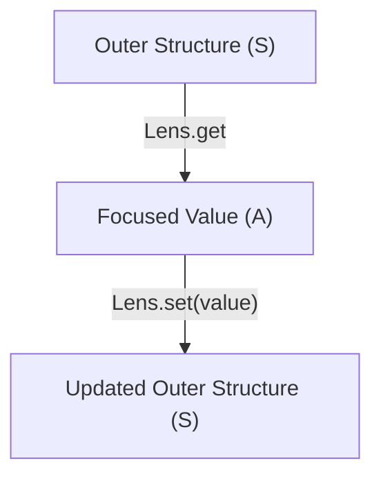

<!-- BUNDLE_SIZE:START -->

> 233 B minified + gzipped

<!-- BUNDLE_SIZE:END -->

Updating deeply nested properties immutably in standard TypeScript requires nested object spread
syntax (`{ ...a, b: { ...a.b, c: ... } }`). As data structures grow, spread chains become verbose,
difficult to scan, and prone to silent reference errors.

`Lens<S, A>` models a bidirectional path to a guaranteed property `A` inside an outer structure `S`.
It provides a reusable, composable path descriptor to read, overwrite, and immutably modify values
at any level of nesting.

---

## The problem with nested object spreads

Consider an application configuration that manages database connections and pool limits:

```ts
type AppConfig = {
  readonly env: string;
  readonly database: {
    readonly host: string;
    readonly port: number;
    readonly pool: {
      readonly min: number;
      readonly max: number;
    };
  };
};

const config: AppConfig = {
  env: "production",
  database: {
    host: "db.internal",
    port: 5432,
    pool: {
      min: 2,
      max: 10,
    },
  },
};
```

Mutating deep values directly breaks immutability and bypasses change detection:

```ts
// Mutation modifies shared memory directly and breaks reference equality checks:
config.database.pool.max = 20;
```

To update the configuration immutably with native JavaScript, every intermediate level must be
copied manually:

```ts
const updatedConfig: AppConfig = {
  ...config,
  database: {
    ...config.database,
    pool: {
      ...config.database.pool,
      max: 20,
    },
  },
};
```

This pattern has three concrete failure modes:

1. **Spread fatigue**: Each additional level of nesting adds another nested object literal. A path
   four levels deep requires four spread operations.
2. **Key loss and structural bugs**: Omitting a single spread operator silently discards sibling
   keys at that layer. TypeScript cannot always catch a missing spread if the inner shape happens to
   satisfy an optional or widened type.
3. **Tight coupling**: The update logic hardcodes the exact schema path at the call site. If
   `database` is moved under an `infrastructure` block, every manual spread chain across the
   codebase must be rewritten.

---

## Type Structure & Mental Model

A `Lens<S, A>` separates the definition of where a value lives from the operations performed on it:

```ts
type Lens<S, A> = {
  readonly get: (structure: S) => A;
  readonly set: (value: A) => (structure: S) => S;
};
```

A lens consists of two pure functions:

- `get`: Extracts the focused value `A` from the outer structure `S`.
- `set`: Accepts a new value `A` and an outer structure `S`, returning an updated outer structure
  `S` with the focused value replaced.



Because a lens holds both functions, it acts as a bidirectional channel. Defining a lens once turns
an access path into a first-class value that can be stored, passed to child components, and composed
with other lenses.

---

## Creating Lenses

The primary constructor is `Lens.from.property`, which focuses on an object key. The
double-parenthesis invocation (`Lens.from.property<Structure>()("key")`) allows TypeScript to
autocomplete valid property keys and infer the target value type:

```ts
import { Lens } from "@nlozgachev/pipelined/core";

type DatabaseConfig = AppConfig["database"];
type PoolConfig = DatabaseConfig["pool"];

const databaseLens = Lens.from.property<AppConfig>()("database");
const poolLens = Lens.from.property<DatabaseConfig>()("pool");
const maxPoolLens = Lens.from.property<PoolConfig>()("max");
```

### Custom accessors

For data structures that are not plain keyed objects — such as tuples, positional coordinates, or
custom records — `Lens.from.accessors` constructs a lens from custom getter and setter functions:

```ts
type Coordinate = readonly [latitude: number, longitude: number];

const latitudeLens = Lens.from.accessors(
  (coord: Coordinate) => coord[0],
  (latitude) => (coord) => [latitude, coord[1]] as const,
);

const position: Coordinate = [52.52, 13.405];
const updatedPosition = Lens.set(latitudeLens)(48.8566)(position);
// [48.8566, 13.405]
```

---

## Reading and Writing Deep Values

`Lens.get`, `Lens.set`, and `Lens.modify` are curried and accept the target structure as their final
argument, allowing clean integration with `pipe`:

```ts
import { pipe } from "@nlozgachev/pipelined/composition";
import { Lens } from "@nlozgachev/pipelined/core";

// 1. Read a value
const currentMax = pipe(config.database.pool, Lens.get(maxPoolLens));
// 10

// 2. Overwrite a value immutably
const expandedPool = pipe(
  config.database.pool,
  Lens.set(maxPoolLens)(25),
);
// { min: 2, max: 25 }

// 3. Transform a value with a mapping function
const doubledPool = pipe(
  config.database.pool,
  Lens.modify(maxPoolLens)((limit) => limit * 2),
);
// { min: 2, max: 20 }
```

### Reference preservation with `modify`

`Lens.modify` inspects the output of the transformation function using `Object.is`. If the mapper
returns the exact same value that was already present, `Lens.modify` returns the original structure
reference unchanged. This avoids unnecessary object allocations and prevents redundant re-renders in
UI frameworks that rely on referential equality:

```ts
const samePool = pipe(
  config.database.pool,
  Lens.modify(maxPoolLens)((limit) => limit),
);

// Returns true — same reference preserved because no field actually changed:
console.log(samePool === config.database.pool);
```

---

## Composing Paths with andThen

Individual lenses compose into deep paths using `Lens.andThen`. The resulting composite lens behaves
like any standard lens, reading and updating through the entire chain in a single step:

```ts
import { pipe } from "@nlozgachev/pipelined/composition";
import { Lens } from "@nlozgachev/pipelined/core";

// Compose shallow lenses into a deep path:
const maxConnectionsLens = pipe(
  Lens.from.property<AppConfig>()("database"),
  Lens.andThen(Lens.from.property<DatabaseConfig>()("pool")),
  Lens.andThen(Lens.from.property<PoolConfig>()("max")),
);

// Read from the root:
const limit = pipe(config, Lens.get(maxConnectionsLens));
// 10

// Update deep inside the root immutably:
const updatedConfig = pipe(
  config,
  Lens.set(maxConnectionsLens)(50),
);
```

`updatedConfig` contains the new limit. Intermediate objects along the path (`database` and `pool`)
are copied immutably, while untouched siblings remain referentially equal to their counterparts in
`config`.

---

## Conversions and Optional Paths

A `Lens` requires that the target field is guaranteed to exist. When a path crosses an optional or
nullable property (e.g. `billingAddress?: Address`), the path transitions from a guaranteed lens to
an `Optional`.

`Lens.andThenOptional` composes a `Lens` with an `Optional` segment, producing an `Optional`.
Alternatively, `Lens.to.Optional` widens a `Lens` directly into an `Optional` whose getter always
returns `Some`:

```ts
import { pipe } from "@nlozgachev/pipelined/composition";
import { Lens, Optional } from "@nlozgachev/pipelined/core";

type UserPreferences = {
  readonly theme?: string;
};

type UserAccount = {
  readonly id: string;
  readonly preferences: UserPreferences;
};

const preferencesLens = Lens.from.property<UserAccount>()("preferences");
const themeOptional = Optional.from.property<UserPreferences>()("theme");

// Compose a guaranteed lens directly with an optional leaf:
const userThemeOptional = pipe(
  preferencesLens,
  Lens.andThenOptional(themeOptional),
);

// Widen a lens into an Optional explicitly:
const preferencesOptional = Lens.to.Optional(preferencesLens);
```

See the [Optional guide](/guides/optional) for details on navigating and modifying nullable paths.

---

## Pipeline Composition

Here is an end-to-end e-commerce order fulfillment pipeline. It receives an order payload,
normalizes customer shipping details, recalculates package dimensions, and increments a processing
revision counter. Using lenses, each step operates directly on its focused sub-model without
coupling helper functions to the overall order schema:

```ts
import { pipe } from "@nlozgachev/pipelined/composition";
import { Lens } from "@nlozgachev/pipelined/core";

type ShippingAddress = {
  readonly recipient: string;
  readonly postalCode: string;
  readonly city: string;
};

type PackageDimensions = {
  readonly weightGrams: number;
  readonly insured: boolean;
};

type FulfillmentOrder = {
  readonly orderId: string;
  readonly revision: number;
  readonly shipping: {
    readonly address: ShippingAddress;
    readonly dimensions: PackageDimensions;
  };
};

const shippingLens = Lens.from.property<FulfillmentOrder>()("shipping");
const addressLens = Lens.from.property<FulfillmentOrder["shipping"]>()("address");
const dimensionsLens = Lens.from.property<FulfillmentOrder["shipping"]>()("dimensions");
const postalCodeLens = Lens.from.property<ShippingAddress>()("postalCode");
const weightLens = Lens.from.property<PackageDimensions>()("weightGrams");
const revisionLens = Lens.from.property<FulfillmentOrder>()("revision");

// Compose deep path lenses:
const orderPostalLens = pipe(shippingLens, Lens.andThen(addressLens), Lens.andThen(postalCodeLens));
const orderWeightLens = pipe(shippingLens, Lens.andThen(dimensionsLens), Lens.andThen(weightLens));

const incomingOrder: FulfillmentOrder = {
  orderId: "ord_8821",
  revision: 1,
  shipping: {
    address: {
      recipient: "Ada Lovelace",
      postalCode: " 10115 ",
      city: "Berlin",
    },
    dimensions: {
      weightGrams: 450,
      insured: false,
    },
  },
};

// Process updates linearly across disparate sub-models:
const processedOrder = pipe(
  incomingOrder,
  Lens.modify(orderPostalLens)((code) => code.trim()),
  Lens.modify(orderWeightLens)((weight) => weight + 50),
  Lens.modify(revisionLens)((rev) => rev + 1),
);
```

---

## Problems it solves

- Deep updates in nested trees require cascades of spread operators that drift rightward and obscure
  business intent. `Lens` encapsulates path navigation, enabling single-line reads, writes, and
  updates at any level of nesting.
- Passing entire root state objects to child components or domain helpers tightly couples those
  sub-routines to the global schema. Passing a focused `Lens<State, SubModel>` allows sub-routines
  to read and mutate their specific slice in complete isolation.
- Unintentional object allocations in state managers trigger cascading UI re-renders. `Lens.modify`
  checks `Object.is` before applying writes, returning the original object reference if the target
  value did not change.
- Refactoring schema layouts usually requires searching and rewriting manual spread patterns across
  dozens of files. Lenses centralize access paths into standalone values that can be updated in a
  single location.
- Form inputs and bidirectional controls require both an extractor to display current state and an
  updater to persist changes. `Lens` provides a unified pair of pure functions that can be passed
  directly into form controllers and settings widgets.
