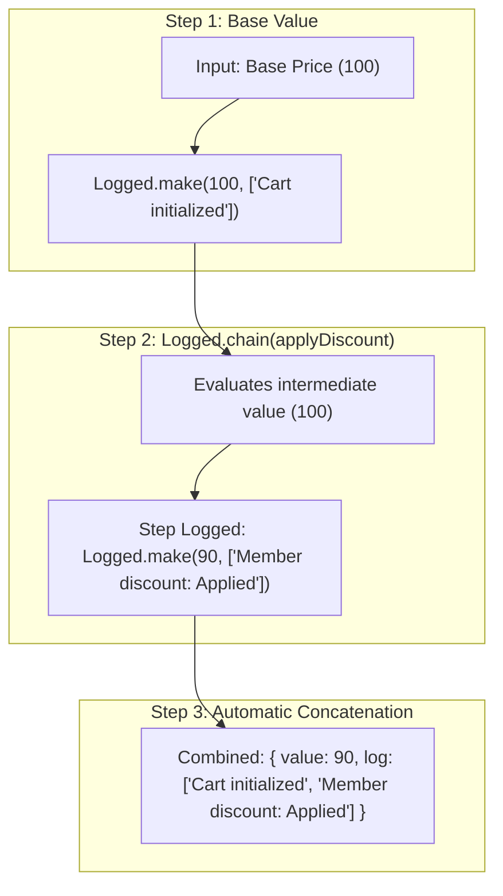

<!-- BUNDLE_SIZE:START -->

> 266 B minified + gzipped

<!-- BUNDLE_SIZE:END -->

In application development, collecting audit trails or diagnostic traces across multi-step
computations is a familiar requirement: pricing pipelines, tax calculations, compliance checks, and
data migrations often need to explain how intermediate decisions were reached.

To keep functions pure without mutable globals, log messages are typically threaded manually
alongside results using tuples:

```ts
// Threading logs manually alongside return values
function applyDiscount(price: number): [number, string[]] {
  if (price > 100) {
    return [price * 0.9, ["Member discount (-10%): Applied"]];
  }
  return [price, ["Member discount: Skipped (subtotal <= 100)"]];
}

function applyTax(price: number): [number, string[]] {
  const tax = price * 0.08;
  return [price + tax, [`Standard tax (8%): Added $${tax.toFixed(2)}`]];
}

function calculateTotal(basePrice: number): [number, string[]] {
  const auditLogs: string[] = ["Cart initialized"];

  const [discountedPrice, discountLogs] = applyDiscount(basePrice);
  auditLogs.push(...discountLogs);

  const [finalPrice, taxLogs] = applyTax(discountedPrice);
  auditLogs.push(...taxLogs);

  return [finalPrice, auditLogs];
}
```

This pattern is straightforward and familiar, but as workflows grow, manual log threading requires
repetitive plumbing: callers must unpack intermediate tuples, allocate arrays, and explicitly push
logs at each stage. If a push call is omitted, intermediate logs are lost without compiler feedback.
Alternatively, calling global loggers directly inside business logic couples pure calculations to
external I/O, complicates isolated unit testing, and interleaves traces during concurrent runs.

`Logged<L, A>` simplifies this workflow. It pairs a value `A` with an immutable sequence of log
entries `L`, automatically concatenating logs in chronological order as transformations are chained.

---

## Type Structure & Mental Model

`Logged<L, A>` represents a value `A` paired with an immutable read-only sequence of log entries
`L`:

```ts
type Logged<L, A> = {
  readonly value: A;
  readonly log: readonly L[];
};
```



Logs are treated strictly as immutable data. As operations sequence through a pipeline, log entries
accumulate automatically in chronological FIFO order without mutable arrays or parameter threading.

---

## Creating Logged Values

Lift raw values into `Logged` using `Logged.make`, or record a standalone log event using
`Logged.from.entry`:

```ts
import { Logged } from "@nlozgachev/pipelined/core";

// Lifting a raw value with an empty initial log
const start = Logged.make(0);
// { value: 0, log: [] }

// Lifting a value with an initial log entry sequence
const seeded = Logged.make("order_101", ["Order received", "Validated schema"]);
// { value: "order_101", log: ["Order received", "Validated schema"] }

// Recording a single log entry with an undefined value payload
const note = Logged.from.entry("Initializing calculations");
// { value: undefined, log: ["Initializing calculations"] }
```

`Logged.make(value, log?)` wraps an existing payload and defaults the log array to `[]`.
`Logged.from.entry(entry)` writes a single log entry and sets `value` to `undefined`, ready to be
sequenced into a pipeline with `chain`.

---

## Transforming Values and Logs

`Logged` provides distinct combinators to transform the payload channel, modify the log channel, or
sequence dependent operations.

### Transforming values with `map`

`map` transforms the contained value while leaving the accumulated log completely untouched:

```ts
import { pipe } from "@nlozgachev/pipelined/composition";

const doubled = pipe(
  Logged.make(5, ["initial"]),
  Logged.map((n) => n * 2),
);
// { value: 10, log: ["initial"] }
```

### Transforming logs with `mapLog`

`mapLog` applies a mapping function to every accumulated log entry without altering the contained
value. Use this to attach timestamps, prepend subsystem tags, or redact sensitive credentials before
external export:

```ts
const formatted = pipe(
  Logged.make(42, ["step 1", "step 2"]),
  Logged.mapLog((entry) => `[AUDIT] ${entry.toUpperCase()}`),
);
// { value: 42, log: ["[AUDIT] STEP 1", "[AUDIT] STEP 2"] }
```

### Sequencing operations with `chain`

`chain` sequences two computations where the second operation depends on the output value of the
first. The log entries from both steps are automatically concatenated in execution order:

```ts
const program = pipe(
  Logged.make(1),
  Logged.chain((n) => pipe(Logged.from.entry("Incremented value"), Logged.map(() => n + 1))),
  Logged.chain((n) => pipe(Logged.from.entry("Doubled value"), Logged.map(() => n * 2))),
);
// { value: 4, log: ["Incremented value", "Doubled value"] }
```

### Combining independent logged values with `apply`

When combining multiple independent `Logged` computations, `Logged.apply` applies a wrapped curried
function to a wrapped argument, concatenating logs from both sides in order:

```ts
const buildLineItem = (sku: string) => (quantity: number) => ({ sku, quantity });

const validatedSku = Logged.make("SKU-900", ["Verified SKU in catalog"]);
const allocatedQty = Logged.make(3, ["Reserved 3 warehouse units"]);

const lineItem = pipe(
  Logged.make(buildLineItem),
  Logged.apply(validatedSku),
  Logged.apply(allocatedQty),
);
// {
//   value: { sku: "SKU-900", quantity: 3 },
//   log: ["Verified SKU in catalog", "Reserved 3 warehouse units"]
// }
```

---

## Side-Effects and Telemetry

Use `tap` and `tapLog` to execute side effects during pipeline execution without altering container
contents or log traces.

### Inspecting values with `tap`

`Logged.tap` executes a callback receiving the contained payload:

```ts
const audited = pipe(
  Logged.make(42, ["init"]),
  Logged.tap((val) => console.log(`Current value: ${val}`)),
);
```

### Inspecting logs with `tapLog`

`Logged.tapLog` executes a callback receiving the complete read-only array of accumulated logs:

```ts
const monitored = pipe(
  Logged.make(42, ["cache hit", "authorized"]),
  Logged.tapLog((logs) => console.log(`Step produced ${logs.length} log events`)),
);
```

---

## Object Accumulation: `assignTo` and `assign`

When accumulating multiple sequential computations into a single object, nesting `chain` calls
produces deep indentation. Use `assignTo` and `assign` to construct an accumulator record
step-by-step:

```ts
interface User {
  id: string;
}
interface Preferences {
  theme: string;
}

const loadUser = (id: string) => Logged.make({ id }, [`Loaded user ${id}`]);
const loadPrefs = (id: string) => Logged.make({ theme: "dark" }, [`Loaded preferences for ${id}`]);

const profile = pipe(
  loadUser("usr_42"),
  Logged.assignTo("user"),
  Logged.assign("preferences", ({ user }) => loadPrefs(user.id)),
);
// {
//   value: { user: { id: "usr_42" }, preferences: { theme: "dark" } },
//   log: ["Loaded user usr_42", "Loaded preferences for usr_42"]
// }
```

---

## Optics & Subfields: `focus`

`Logged.focus` pairs with a `Lens` to run a logged computation on a nested property within a larger
record, updating the focused field while accumulating any log entries produced during that
sub-computation:

```ts
import { Lens } from "@nlozgachev/pipelined/core";

interface ShippingDetails {
  address: string;
  postalCode: string;
}

interface Order {
  id: string;
  shipping: ShippingDetails;
}

const shippingLens = Lens.from.property<Order>()("shipping");

const normalizeShipping = (shipping: ShippingDetails): Logged<string, ShippingDetails> =>
  Logged.make(
    { ...shipping, postalCode: shipping.postalCode.trim() },
    ["Normalized postal code formatting"],
  );

const order = Logged.make<string, Order>(
  { id: "ord_1", shipping: { address: "100 Market St", postalCode: " 94103 " } },
  ["Order created"],
);

const updatedOrder = pipe(
  order,
  Logged.focus(shippingLens)(normalizeShipping),
);
// {
//   value: { id: "ord_1", shipping: { address: "100 Market St", postalCode: "94103" } },
//   log: ["Order created", "Normalized postal code formatting"]
// }
```

---

## Extracting Results with `to.Pair`

Extract the payload and accumulated log entries at the boundary of your program using
`Logged.to.Pair`:

```ts
const [result, auditTrail] = Logged.to.Pair(program);

// Dispatch logs programmatically to external infrastructure:
auditTrail.forEach((entry) => logger.info(entry));
```

`Logged.to.Pair` returns a standard `Pair<A, ReadonlyArray<L>>` (a `readonly [A, ReadonlyArray<L>]`
tuple). Because `Logged` is an eager data container, conversion to a tuple avoids misleading
execution terminology.

---

## Practical Example: A Business Rules Engine

Consider an e-commerce checkout engine where multiple promotional discount rules evaluate a cart.
Each rule must record whether it was applied or why it was skipped, creating a complete audit trail
for customer support:

```ts
type PromoRule = (subtotal: number) => Logged<string, number>;

const applyMemberDiscount: PromoRule = (subtotal) =>
  subtotal > 100
    ? pipe(Logged.from.entry("Member discount (-10%): Applied"), Logged.map(() => subtotal * 0.9))
    : pipe(Logged.from.entry("Member discount: Skipped (subtotal <= 100)"), Logged.map(() => subtotal));

const applyFreeShippingCredit: PromoRule = (subtotal) =>
  subtotal >= 75
    ? pipe(Logged.from.entry("Shipping credit ($5): Applied"), Logged.map(() => subtotal - 5))
    : pipe(Logged.from.entry("Shipping credit: Skipped (subtotal < 75)"), Logged.map(() => subtotal));

const calculateTotal = (basePrice: number): Logged<string, number> =>
  pipe(
    Logged.make(basePrice, ["Cart initialized"]),
    Logged.chain(applyMemberDiscount),
    Logged.chain(applyFreeShippingCredit),
    Logged.mapLog((log) => `[CHECKOUT] ${log}`),
  );

const [finalTotal, auditLogs] = Logged.to.Pair(calculateTotal(120));
// finalTotal = 103
// auditLogs = [
//   "[CHECKOUT] Cart initialized",
//   "[CHECKOUT] Member discount (-10%): Applied",
//   "[CHECKOUT] Shipping credit ($5): Applied"
// ]
```

Each promotional rule remains completely modular. Rules declare their own log messages in isolation,
and `chain` stitches the audit trail together as computations run.

---

## Problems it solves

- **Auditable business calculations**: In financial settlement, pricing pipelines, and tax
  estimation, each computation must output both the final number and an immutable audit trail
  explaining each deduction or adjustment. `Logged` collects these audit records without mutable
  global state.
- **Diagnostic warning accumulation**: When parsing external data or migrating legacy schemas,
  non-fatal warnings (such as deprecated field usage or default fallbacks applied) must travel
  alongside the transformed payload without interrupting pipeline execution.
- **Mock-free log verification**: Testing logging behavior traditionally requires intercepting
  `stdout` or mocking logger instances. `Logged` treats logs as standard return data, allowing unit
  test suites to assert directly against log arrays using plain `toStrictEqual()`.
