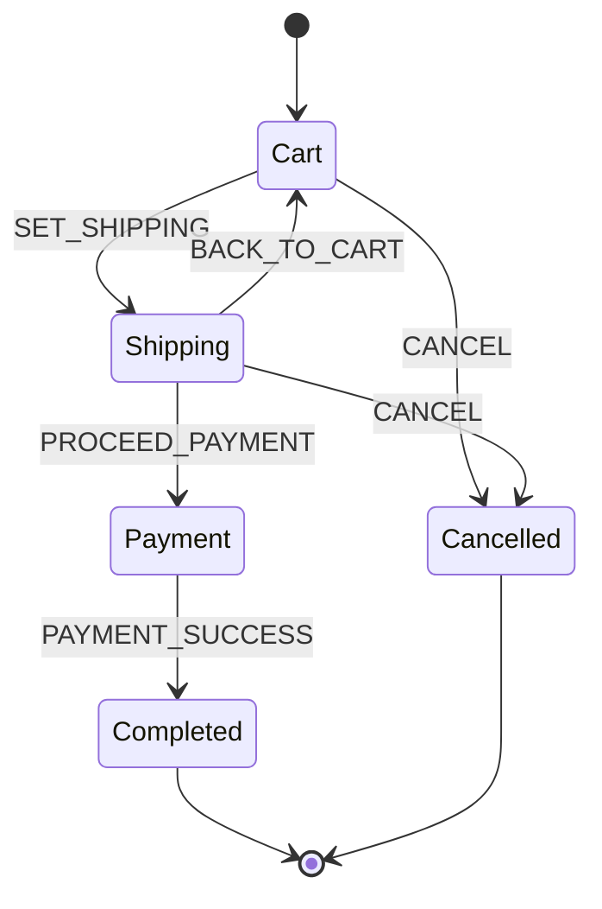

<!-- BUNDLE_SIZE:START -->

> 1.69 kB minified + gzipped (1,689 B)

<!-- BUNDLE_SIZE:END -->

Managing multi-step workflows (like checkouts, document approvals, or authentication flows) with
independent boolean flags (`isLoading`, `isError`, `isSubmitted`) creates $2^N$ implicit states—most
of which represent impossible or invalid combinations (such as `isLoading: true` while
`orderReceipt` is present). Furthermore, untyped `switch/case` reducers permit arbitrary state jumps
and provide no protection against race conditions when background async tasks resolve after a user
has already navigated away.

`Machine` models workflows as explicit discriminated variant-states where each state carries *only*
the payload valid for that step, enforces outbound transition targets at compile time, and
automatically aborts in-flight tasks upon exiting a state.



---

## Defining States and Events

Every state variant is constructed using `Machine.State<Kind, Payload, AllowedTargets>`. The third
generic argument `AllowedTargets` constrains which state kinds can be returned by transition
handlers for that state:

```ts
import { Machine } from "@nlozgachev/pipelined/core";

export type CheckoutState =
  | Machine.State<
    "cart",
    { readonly items: readonly string[]; readonly subtotalCents: number },
    "shipping" | "cancelled"
  >
  | Machine.State<
    "shipping",
    {
      readonly items: readonly string[];
      readonly subtotalCents: number;
      readonly address: string;
      readonly shippingCents: number;
    },
    "payment" | "cart" | "cancelled"
  >
  | Machine.State<
    "payment",
    { readonly orderId: string; readonly totalCents: number },
    "completed" | "shipping"
  >
  | Machine.State<
    "completed",
    { readonly orderId: string; readonly receiptUrl: string },
    never
  >
  | Machine.State<"cancelled", { readonly reason: string }, never>;

export type CheckoutEvents = {
  ADD_ITEM: { readonly item: string; readonly priceCents: number };
  SET_SHIPPING: { readonly address: string; readonly shippingCents: number };
  PROCEED_PAYMENT: { readonly orderId: string };
  PAYMENT_SUCCESS: { readonly receiptUrl: string };
  BACK_TO_CART: void;
  CANCEL: { readonly reason: string };
};
```

---

## Creating a Machine: `Machine.make`

Define the initial state and transition table with `Machine.make`. Handlers receive the
strongly-typed active state and event payload. The compiler enforces that transition handlers only
return states permitted by `AllowedTargets`:

```ts
export const checkoutMachine = Machine.make<CheckoutState, CheckoutEvents>({
  initial: Machine.state("cart", { items: [], subtotalCents: 0 }),
  states: {
    cart: {
      on: {
        ADD_ITEM: (state, { item, priceCents }) =>
          Machine.state("cart", {
            items: [...state.value.items, item],
            subtotalCents: state.value.subtotalCents + priceCents,
          }),
        SET_SHIPPING: (state, { address, shippingCents }) =>
          Machine.state("shipping", {
            items: state.value.items,
            subtotalCents: state.value.subtotalCents,
            address,
            shippingCents,
          }),
        CANCEL: (_state, { reason }) =>
          Machine.state("cancelled", { reason }),
      },
    },
    shipping: {
      on: {
        PROCEED_PAYMENT: (state, { orderId }) =>
          Machine.state("payment", {
            orderId,
            totalCents: state.value.subtotalCents + state.value.shippingCents,
          }),
        BACK_TO_CART: (state) =>
          Machine.state("cart", {
            items: state.value.items,
            subtotalCents: state.value.subtotalCents,
          }),
        CANCEL: (_state, { reason }) =>
          Machine.state("cancelled", { reason }),
      },
    },
    payment: {
      on: {
        PAYMENT_SUCCESS: (state, { receiptUrl }) =>
          Machine.state("completed", {
            orderId: state.value.orderId,
            receiptUrl,
          }),
      },
    },
    completed: {},
    cancelled: {},
  },
});
```

---

## Pure Pipelines: `Machine.transition`

In pipelines and functional compositions, use `Machine.transition`. It is a pure, curried data-last
transition function `(machine, event) => (state) => nextState` with zero side effects:

```ts
import { pipe } from "@nlozgachev/pipelined/composition";
import { Machine } from "@nlozgachev/pipelined/core";

const cartState = Machine.state("cart", {
  items: ["Mechanical Keyboard"],
  subtotalCents: 15000,
});

const shippingState = pipe(
  cartState,
  Machine.transition(checkoutMachine, {
    kind: "SET_SHIPPING",
    value: { address: "123 Tech Blvd, Silicon Valley", shippingCents: 1500 },
  }),
);

console.log(shippingState.kind); // "shipping"
```

If an event is not handled by the current state, `Machine.transition` returns the state reference
unchanged.

---

## Pattern Matching: `Machine.match` and `Machine.is`

Eliminate states cleanly using `Machine.match`. Every variant declared in `States` must be handled,
and each callback receives its specific narrowed payload:

```ts
const view = pipe(
  shippingState,
  Machine.match({
    cart: ({ value }) => `${value.items.length} items ($${value.subtotalCents / 100})`,
    shipping: ({ value }) => `Ship to ${value.address} ($${value.shippingCents / 100})`,
    payment: ({ value }) => `Charge $${value.totalCents / 100}`,
    completed: ({ value }) => `Order ${value.orderId} placed: ${value.receiptUrl}`,
    cancelled: ({ value }) => `Checkout cancelled: ${value.reason}`,
  }),
);
```

For imperative conditional logic, use the curried type guard `Machine.is`:

```ts
if (Machine.is("shipping")(shippingState)) {
  console.log("Address:", shippingState.value.address);
}
```

---

## Integration with React: `useReducer`

Standard React reducers use the uncurried signature `(state, action) => nextState`. Use
`Machine.to.reducer` to obtain a reducer directly compatible with React's `useReducer`:

```tsx
import { pipe } from "@nlozgachev/pipelined/composition";
import { Machine } from "@nlozgachev/pipelined/core";
import React, { useReducer } from "react";
import { checkoutMachine, type CheckoutState } from "./checkoutMachine";

export function CheckoutApp() {
  const [state, dispatch] = useReducer(
    Machine.to.reducer(checkoutMachine),
    checkoutMachine.initial,
  );

  return (
    <div className="checkout-container">
      {pipe(
        state,
        Machine.match({
          cart: ({ value }) => (
            <div>
              <h2>Cart ({value.items.length} items)</h2>
              <button
                onClick={() =>
                  dispatch({
                    kind: "SET_SHIPPING",
                    value: { address: "123 Tech Blvd", shippingCents: 1500 },
                  })}
              >
                Proceed to Shipping
              </button>
            </div>
          ),
          shipping: ({ value }) => (
            <div>
              <h2>Shipping Address</h2>
              <p>{value.address}</p>
              <button
                onClick={() =>
                  dispatch({
                    kind: "PROCEED_PAYMENT",
                    value: { orderId: "ord_1001" },
                  })}
              >
                Proceed to Payment
              </button>
              <button onClick={() => dispatch({ kind: "BACK_TO_CART" })}>
                Back
              </button>
            </div>
          ),
          payment: ({ value }) => (
            <div>
              <h2>Payment: ${(value.totalCents / 100).toFixed(2)}</h2>
              <button
                onClick={() =>
                  dispatch({
                    kind: "PAYMENT_SUCCESS",
                    value: { receiptUrl: "https://pay.example.com/ord_1001" },
                  })}
              >
                Confirm Payment
              </button>
            </div>
          ),
          completed: ({ value }) => (
            <div>
              <h2>Order Completed!</h2>
              <p>Receipt: {value.receiptUrl}</p>
            </div>
          ),
          cancelled: ({ value }) => (
            <div>
              <h2>Cancelled</h2>
              <p>Reason: {value.reason}</p>
            </div>
          ),
        }),
      )}
    </div>
  );
}
```

---

## Integration with Redux

Redux stores initialize by dispatching an internal action with an `undefined` initial state.
`Machine.to.reducer` automatically detects `undefined` and initializes the store with
`machine.initial`:

```ts
import { Machine } from "@nlozgachev/pipelined/core";
import { createStore } from "redux";
import { checkoutMachine } from "./checkoutMachine";

// 1. Create Redux store directly with Machine reducer
const store = createStore(Machine.to.reducer(checkoutMachine));

// 2. Initial state is immediately ready:
console.log(store.getState().kind); // "cart"

// 3. Dispatching typed actions updates state:
store.dispatch({
  kind: "ADD_ITEM",
  value: { item: "Ergonomic Chair", priceCents: 35000 },
});

console.log(store.getState().value); // { items: ["Ergonomic Chair"], subtotalCents: 35000 }
```

---

## Stateful Execution & Async Lifecycles: `Machine.interpret`

When states need to trigger async requests, background tasks, or timers, use `Machine.interpret`. It
spawns an execution actor managing active state lifecycles:

- **State-Scoped `AbortSignal`**: Passed to `entry`, automatically aborted when transitioning out of
  that state or when `actor.abort()` is called.
- **Stale Callback Suppression**: Async completions originating from previous states are safely
  dropped.
- **Re-entrant Dispatch Queue**: Synchronous `send` calls inside handlers or callbacks resolve in
  FIFO order.

```ts
type AuthState =
  | Machine.State<"idle", void, "authenticating">
  | Machine.State<"authenticating", { readonly email: string }, "authenticated" | "failed">
  | Machine.State<"authenticated", { readonly token: string }, "idle">
  | Machine.State<"failed", { readonly error: string }, "authenticating" | "idle">;

type AuthEvents = {
  SUBMIT: { readonly email: string };
  RESOLVE: { readonly token: string };
  REJECT: { readonly error: string };
  CANCEL: void;
};

const authMachine = Machine.make<AuthState, AuthEvents>({
  initial: Machine.state("idle"),
  states: {
    idle: {
      on: {
        SUBMIT: (_state, { email }) => Machine.state("authenticating", { email }),
      },
    },
    authenticating: {
      // 1. Scoped entry effect with automatic AbortSignal
      entry: (state, { send, signal }) => {
        fetch(`/api/login?email=${encodeURIComponent(state.value.email)}`, { signal })
          .then((res) => res.json())
          .then((data) => send({ kind: "RESOLVE", value: { token: data.token } }))
          .catch((err) => {
            if (!signal.aborted) {
              send({ kind: "REJECT", value: { error: err.message } });
            }
          });

        // 2. Optional cleanup disposer run on state exit
        return () => console.log("Cleaned up authenticating state");
      },
      on: {
        RESOLVE: (_state, { token }) => Machine.state("authenticated", { token }),
        REJECT: (_state, { error }) => Machine.state("failed", { error }),
        CANCEL: () => Machine.state("idle"),
      },
    },
    authenticated: {
      on: {
        CANCEL: () => Machine.state("idle"),
      },
    },
    failed: {
      on: {
        SUBMIT: (_state, { email }) => Machine.state("authenticating", { email }),
        CANCEL: () => Machine.state("idle"),
      },
    },
  },
});

const actor = Machine.interpret(authMachine);

const unsubscribe = actor.subscribe((state) => {
  console.log("Active state:", state.kind);
});

// Trigger login
actor.send({ kind: "SUBMIT", value: { email: "dev@example.com" } });

// If the user navigates away before fetch resolves, the active request is aborted
// and late callbacks are ignored:
actor.send({ kind: "CANCEL" });
```

---

## Synchronization with `EventBus`

Actors synchronize directly with [`EventBus`](/guides/event-bus/). Passing `bus` in options forwards
all schema events into the actor without glue code:

```ts
import { EventBus, Machine } from "@nlozgachev/pipelined/core";

const authBus = EventBus.make<AuthEvents>();
const actor = Machine.interpret(authMachine, { bus: authBus });

// Emitting on the bus drives transitions in the actor
EventBus.emit(authBus, { kind: "SUBMIT", value: { email: "user@example.com" } });
```

---

## Problems it Solves

1. **Boolean Flag Proliferation**: Replaces independent boolean combinations (`isLoading`,
   `isError`, `isSubmitted`) with mutually exclusive discriminated union states carrying only
   relevant payloads.
2. **Illegal State Transitions**: Enforces compile-time outbound target constraints
   (`AllowedTargets`) so invalid state jumps are caught by TypeScript rather than triggering runtime
   bugs.
3. **Async Race Conditions & Stale Callbacks**: Automatically cancels state-scoped `AbortController`
   instances upon exiting a state and ignores callbacks from superseded state generations.
4. **Impedance Mismatch with React & Redux**: Provides `Machine.to.reducer` to natively bridge
   data-last pipelines with standard uncurried `(state, action) => nextState` UI stores.
5. **Re-entrant Dispatch Corruption**: Implements an internal FIFO queue ensuring nested or
   re-entrant `send` dispatches resolve deterministically in sequence without stack overflows.
