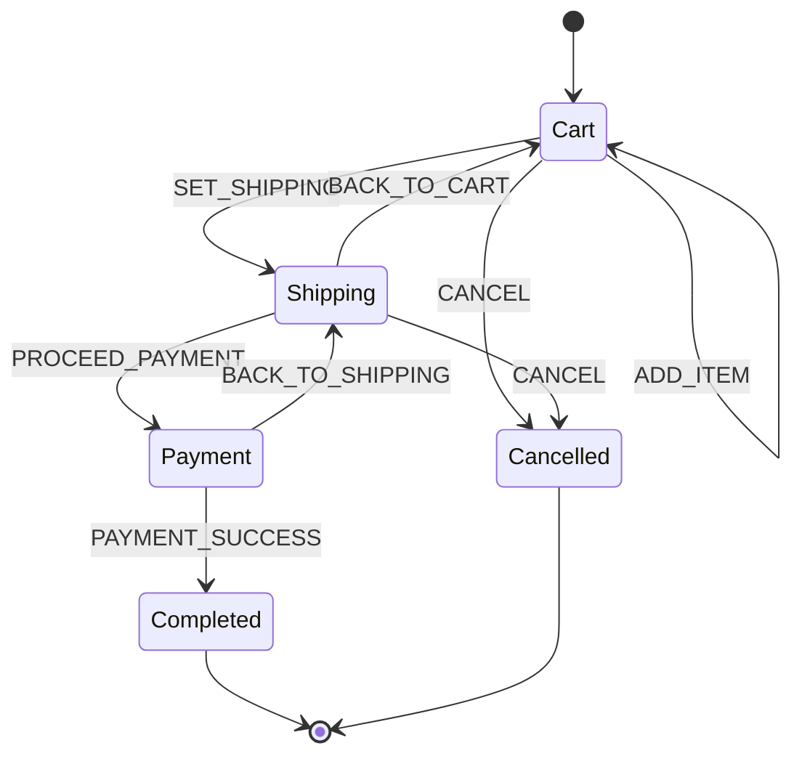

<!-- BUNDLE_SIZE:START -->

> 1.89 kB minified + gzipped

<!-- BUNDLE_SIZE:END -->

Managing multi-step workflows like order checkouts, document approvals, or user authentication with
independent boolean flags quickly leads to fragile code:

```ts
// Independent boolean flags in vanilla code
interface CheckoutState {
  isLoading: boolean;
  isError: boolean;
  isShipping: boolean;
  isPayment: boolean;
  receiptUrl?: string;
  errorMessage?: string;
}
```

Every boolean flag added to an interface doubles the number of implicit states. Six boolean flags
create 2^N (64) possible combinations — most of which represent impossible or invalid states. The
compiler cannot prevent bugs like `isLoading: true` while `receiptUrl` is already populated, or
jumping straight from cart into payment without valid shipping details. Untyped `switch/case`
reducers permit arbitrary state jumps and provide no protection against race conditions when
background async tasks resolve after a user has already navigated away.

`Machine` models workflows as explicit discriminated variant-states where each state carries only
the payload valid for that step, enforces outbound transition targets at compile time, and
automatically aborts in-flight tasks upon exiting a state.



---

## Defining States and Events

Every state variant is constructed using `Machine.State<Kind, Payload, AllowedTargets>`. The third
generic argument `AllowedTargets` constrains which state kinds can be returned by transition
handlers for that state:

```ts
import { Machine } from "@nlozgachev/pipelined";

export type CheckoutState =
  | Machine.State<
    "cart",
    { readonly items: readonly string[]; readonly subtotalCents: number },
    "shipping" | "cancelled"
  >
  | Machine.State<
    "shipping",
    {
      readonly items: readonly string[];
      readonly subtotalCents: number;
      readonly address: string;
      readonly shippingCents: number;
    },
    "payment" | "cart" | "cancelled"
  >
  | Machine.State<
    "payment",
    { readonly orderId: string; readonly totalCents: number },
    "completed" | "shipping"
  >
  | Machine.State<
    "completed",
    { readonly orderId: string; readonly receiptUrl: string },
    never
  >
  | Machine.State<"cancelled", { readonly reason: string }, never>;

export type CheckoutEvents = {
  ADD_ITEM: { readonly item: string; readonly priceCents: number };
  SET_SHIPPING: { readonly address: string; readonly shippingCents: number };
  PROCEED_PAYMENT: { readonly orderId: string };
  PAYMENT_SUCCESS: { readonly receiptUrl: string };
  BACK_TO_CART: void;
  CANCEL: { readonly reason: string };
};
```

---

## Creating a Machine: `Machine.make`

Define the initial state and transition table with `Machine.make`. Handlers receive the
strongly-typed active state and event payload. The compiler enforces that transition handlers only
return states permitted by `AllowedTargets`:

```ts
export const checkoutMachine = Machine.make<CheckoutState, CheckoutEvents>({
  initial: Machine.state("cart", { items: [], subtotalCents: 0 }),
  states: {
    cart: {
      on: {
        ADD_ITEM: (state, { item, priceCents }) =>
          Machine.state("cart", {
            items: [...state.value.items, item],
            subtotalCents: state.value.subtotalCents + priceCents,
          }),
        SET_SHIPPING: (state, { address, shippingCents }) =>
          Machine.state("shipping", {
            items: state.value.items,
            subtotalCents: state.value.subtotalCents,
            address,
            shippingCents,
          }),
        CANCEL: (_state, { reason }) =>
          Machine.state("cancelled", { reason }),
      },
    },
    shipping: {
      on: {
        PROCEED_PAYMENT: (state, { orderId }) =>
          Machine.state("payment", {
            orderId,
            totalCents: state.value.subtotalCents + state.value.shippingCents,
          }),
        BACK_TO_CART: (state) =>
          Machine.state("cart", {
            items: state.value.items,
            subtotalCents: state.value.subtotalCents,
          }),
        CANCEL: (_state, { reason }) =>
          Machine.state("cancelled", { reason }),
      },
    },
    payment: {
      on: {
        PAYMENT_SUCCESS: (state, { receiptUrl }) =>
          Machine.state("completed", {
            orderId: state.value.orderId,
            receiptUrl,
          }),
      },
    },
    completed: {},
    cancelled: {},
  },
});
```

---

## Pure Pipelines: `Machine.transition`

In pipelines and functional compositions, use `Machine.transition`. It is a pure, curried data-last
transition function `(machine, event) => (state) => nextState` with zero side effects:

```ts
import { Machine, pipe } from "@nlozgachev/pipelined";

const cartState = Machine.state("cart", {
  items: ["Mechanical Keyboard"],
  subtotalCents: 15000,
});

const shippingState = pipe(
  cartState,
  Machine.transition(checkoutMachine, {
    kind: "SET_SHIPPING",
    value: { address: "123 Tech Blvd, Silicon Valley", shippingCents: 1500 },
  }),
);

console.log(shippingState.kind); // "shipping"
```

If an event is not handled by the current state, `Machine.transition` returns the state reference
unchanged.

---

## Pattern Matching: `Machine.match` and `Machine.is`

Eliminate states cleanly using `Machine.match`. Every variant declared in `States` must be handled,
and each callback receives its specific narrowed payload:

```ts
const view = pipe(
  shippingState,
  Machine.match({
    cart: ({ value }) => `${value.items.length} items ($${value.subtotalCents / 100})`,
    shipping: ({ value }) => `Ship to ${value.address} ($${value.shippingCents / 100})`,
    payment: ({ value }) => `Charge $${value.totalCents / 100}`,
    completed: ({ value }) => `Order ${value.orderId} placed: ${value.receiptUrl}`,
    cancelled: ({ value }) => `Checkout cancelled: ${value.reason}`,
  }),
);
```

For imperative conditional logic, use the curried type guard `Machine.is`:

```ts
if (Machine.is("shipping")(shippingState)) {
  console.log("Address:", shippingState.value.address);
}
```

---

## Integration with React: `useReducer`

Standard React reducers use the uncurried signature `(state, action) => nextState`. Use
`Machine.to.reducer` to obtain a reducer directly compatible with React's `useReducer`:

```tsx
import { Machine, pipe } from "@nlozgachev/pipelined";
import React, { useReducer } from "react";
import { checkoutMachine, type CheckoutState } from "./checkoutMachine";

export function CheckoutApp() {
  const [state, dispatch] = useReducer(
    Machine.to.reducer(checkoutMachine),
    checkoutMachine.initial,
  );

  return (
    <div className="checkout-container">
      {pipe(
        state,
        Machine.match({
          cart: ({ value }) => (
            <div>
              <h2>Cart ({value.items.length} items)</h2>
              <button
                onClick={() =>
                  dispatch({
                    kind: "SET_SHIPPING",
                    value: { address: "123 Tech Blvd", shippingCents: 1500 },
                  })}
              >
                Proceed to Shipping
              </button>
            </div>
          ),
          shipping: ({ value }) => (
            <div>
              <h2>Shipping Address</h2>
              <p>{value.address}</p>
              <button
                onClick={() =>
                  dispatch({
                    kind: "PROCEED_PAYMENT",
                    value: { orderId: "ord_1001" },
                  })}
              >
                Proceed to Payment
              </button>
              <button onClick={() => dispatch({ kind: "BACK_TO_CART" })}>
                Back
              </button>
            </div>
          ),
          payment: ({ value }) => (
            <div>
              <h2>Payment: ${(value.totalCents / 100).toFixed(2)}</h2>
              <button
                onClick={() =>
                  dispatch({
                    kind: "PAYMENT_SUCCESS",
                    value: { receiptUrl: "https://pay.example.com/ord_1001" },
                  })}
              >
                Confirm Payment
              </button>
            </div>
          ),
          completed: ({ value }) => (
            <div>
              <h2>Order Completed!</h2>
              <p>Receipt: {value.receiptUrl}</p>
            </div>
          ),
          cancelled: ({ value }) => (
            <div>
              <h2>Cancelled</h2>
              <p>Reason: {value.reason}</p>
            </div>
          ),
        }),
      )}
    </div>
  );
}
```

---

## Integration with Redux

Redux stores initialize by dispatching an internal action with an `undefined` initial state.
`Machine.to.reducer` automatically detects `undefined` and initializes the store with
`machine.initial`:

```ts
import { Machine } from "@nlozgachev/pipelined";
import { createStore } from "redux";
import { checkoutMachine } from "./checkoutMachine";

// 1. Create Redux store directly with Machine reducer
const store = createStore(Machine.to.reducer(checkoutMachine));

// 2. Initial state is immediately ready:
console.log(store.getState().kind); // "cart"

// 3. Dispatching typed actions updates state:
store.dispatch({
  kind: "ADD_ITEM",
  value: { item: "Ergonomic Chair", priceCents: 35000 },
});

console.log(store.getState().value); // { items: ["Ergonomic Chair"], subtotalCents: 35000 }
```

---

## Stateful Execution & Async Lifecycles: `Machine.interpret`

Pure reducers and `Machine.transition` compute next states synchronously. While this suffices for
local UI data transformations, real-world workflows depend on asynchronous operations:
authenticating with an API, charging payment cards, polling background jobs, or awaiting user
inputs.

Managing asynchronous side effects outside the state machine (such as inside ad-hoc component effect
hooks or detached async functions) introduces three classic race conditions:

1. **Stale callbacks overwriting active state**: If a user submits an authentication form, cancels
   the dialog, and submits a different email, a delayed response from the first request can resolve
   after cancellation and log the user into the wrong account.
2. **Dangling network requests and timers**: When a user transitions away from a screen or aborts a
   flow, in-flight HTTP requests and active intervals continue running in the background unless
   manually cancelled, consuming network bandwidth and leaking memory.
3. **Re-entrant dispatch corruption**: If an event handler synchronously triggers another event
   dispatch, naive recursive handlers update state out of order, leading to corrupted state
   snapshots or call stack exhaustion.

`Machine.interpret` turns a pure machine specification into an active execution actor that manages
the lifecycle of asynchronous effects with three guarantees:

- **State-scoped cancellation via `AbortSignal`**: Each state's `entry` hook receives an
  `AbortSignal`. The actor aborts this signal the moment the machine exits that state or when
  `actor.abort()` is called, cancelling in-flight requests and timers automatically.
- **Generation token suppression**: Each state transition increments an internal generation counter.
  If an asynchronous promise callback from a superseded state eventually settles, the actor detects
  the stale generation token and ignores the dispatch as an idempotent no-op.
- **Sequential FIFO dispatch queue**: When `send` is invoked synchronously within a transition
  handler or entry hook, the event is queued and evaluated only after the active transition
  finishes, guaranteeing strict causal event order.

```ts
type AuthState =
  | Machine.State<"idle", void, "authenticating">
  | Machine.State<"authenticating", { readonly email: string }, "authenticated" | "failed">
  | Machine.State<"authenticated", { readonly token: string }, "idle">
  | Machine.State<"failed", { readonly error: string }, "authenticating" | "idle">;

type AuthEvents = {
  SUBMIT: { readonly email: string };
  RESOLVE: { readonly token: string };
  REJECT: { readonly error: string };
  CANCEL: void;
};

const authMachine = Machine.make<AuthState, AuthEvents>({
  id: "auth-flow",
  initial: Machine.state("idle"),
  states: {
    idle: {
      on: {
        SUBMIT: (_state, { email }) => Machine.state("authenticating", { email }),
      },
    },
    authenticating: {
      // 1. Scoped entry effect with automatic AbortSignal
      entry: (state, { send, signal }) => {
        fetch(`/api/login?email=${encodeURIComponent(state.value.email)}`, { signal })
          .then((res) => res.json())
          .then((data) => send({ kind: "RESOLVE", value: { token: data.token } }))
          .catch((err) => {
            if (!signal.aborted) {
              send({ kind: "REJECT", value: { error: err.message } });
            }
          });

        // 2. Optional cleanup disposer run on state exit
        return () => console.log("Cleaned up authenticating state");
      },
      on: {
        RESOLVE: (_state, { token }) => Machine.state("authenticated", { token }),
        REJECT: (_state, { error }) => Machine.state("failed", { error }),
        CANCEL: () => Machine.state("idle"),
      },
    },
    authenticated: {
      on: {
        CANCEL: () => Machine.state("idle"),
      },
    },
    failed: {
      on: {
        SUBMIT: (_state, { email }) => Machine.state("authenticating", { email }),
        CANCEL: () => Machine.state("idle"),
      },
    },
  },
});

const actor = Machine.interpret(authMachine, {
  id: "auth-instance-1",
  onError: (error, context) => {
    console.error(`Actor ${context?.actorId} failed in ${context?.phase}:`, error);
  },
});

const unsubscribe = actor.subscribe((state) => {
  console.log("Active state:", state.kind);
});

// Trigger login
actor.send({ kind: "SUBMIT", value: { email: "dev@example.com" } });

// If the user navigates away before fetch resolves, the active request is aborted
// and late callbacks are ignored:
actor.send({ kind: "CANCEL" });
```

Providing an optional `id` labels both blueprint definitions (`[object Machine(auth-flow)]`) and
runtime actor instances (`[object Machine.Actor(auth-instance-1)[auth-flow]]`) for inspection and
telemetry. Any synchronous exception thrown inside lifecycle hooks or transition handlers is caught
and routed to `onError` with contextual metadata (`actorId`, `state`, and `phase`).

---

## Synchronization with `EventBus`

In distributed architectures, event producers and state consumers are separated across module
boundaries. Background WebSocket connections, worker threads, keyboard listeners, and analytics
trackers emit events continuously.

- **`EventBus` acts as a broadcast highway**: It decouples event producers from consumers,
  distributing typed messages across subsystems without hardcoded references. However, an event bus
  maintains no workflow state — it delivers every emitted message to every registered subscriber
  regardless of whether the application is ready to process it.
- **`Machine` acts as a stateful gatekeeper**: It enforces workflow rules, ignores events that are
  invalid for the active state variant, and binds asynchronous side-effect lifecycles to state
  transitions.

Passing `bus` to `Machine.interpret` connects the broadcast highway directly to the stateful
gatekeeper:

```ts
import { EventBus, Machine } from "@nlozgachev/pipelined";

// 1. Define shared message schema for network & collaboration events
export type CollaborationEvents = {
  CONNECT: { readonly serverUrl: string };
  CONNECTED: { readonly sessionId: string };
  DISCONNECT: void;
  REMOTE_PATCH: { readonly patchId: string; readonly content: string };
};

// 2. Define explicit state variants with outbound target bounds
export type CollaborationState =
  | Machine.State<"disconnected", void, "connecting">
  | Machine.State<
    "connecting",
    { readonly serverUrl: string },
    "connected" | "disconnected"
  >
  | Machine.State<
    "connected",
    { readonly sessionId: string; readonly documentText: string },
    "connected" | "disconnected"
  >;

// 3. Define statechart with entry effects and transition handlers
export const collaborationMachine = Machine.make<
  CollaborationState,
  CollaborationEvents
>({
  initial: Machine.state("disconnected"),
  states: {
    disconnected: {
      on: {
        CONNECT: (_state, { serverUrl }) =>
          Machine.state("connecting", { serverUrl }),
      },
    },
    connecting: {
      entry: (state, { send, signal }) => {
        // Scoped connection: abort signal cancels setup if state exits early
        const socket = new WebSocket(state.value.serverUrl);

        socket.onopen = () => {
          send({ kind: "CONNECTED", value: { sessionId: "sess_xyz123" } });
        };

        signal.addEventListener("abort", () => {
          socket.close();
        });

        return () => socket.close();
      },
      on: {
        CONNECTED: (_state, { sessionId }) =>
          Machine.state("connected", { sessionId, documentText: "" }),
        DISCONNECT: () => Machine.state("disconnected"),
      },
    },
    connected: {
      on: {
        REMOTE_PATCH: (state, { content }) =>
          Machine.state("connected", {
            sessionId: state.value.sessionId,
            documentText: state.value.documentText + content,
          }),
        DISCONNECT: () => Machine.state("disconnected"),
      },
    },
  },
});

// 4. Create an event bus and attach the actor directly
const syncBus = EventBus.make<CollaborationEvents>({
  onError: (error) => console.error("Sync bus error:", error),
});

const actor = Machine.interpret(collaborationMachine, { bus: syncBus });

// 5. External WebSocket clients or UI modules publish events to the bus:
EventBus.emit(syncBus, {
  kind: "CONNECT",
  value: { serverUrl: "wss://collab.example.com" },
});

// Out-of-order patches arriving before connection completes are dropped safely:
EventBus.emit(syncBus, {
  kind: "REMOTE_PATCH",
  value: { patchId: "p1", content: "Initial draft text" },
});

// Teardown unsubscribes the actor from syncBus and closes the active connection:
actor.abort();
```

### Architectural Mechanics of the Bridge

1. **Shared Discriminated Union Protocol**: Both `EventBus.Message<Events>` and
   `Machine.Event<Events>` adhere to the identical `{ kind: K, value: Events[K] }` discriminated
   union structure. When initialized with `{ bus }`, the actor registers an internal listener with
   the bus. Any message emitted to the bus enters the actor's FIFO dispatch queue without glue code
   or data mapping.

2. **Contextual Event Filtering**: When an event arrives from the bus, the actor delivers it to the
   machine's transition table for the active state. If the active state variant has no handler
   defined for that event kind, `Machine.transition` ignores the event and returns the current state
   reference unchanged. The event bus does not need to know the machine's internal state, and
   unhandled messages are discarded as safe, idempotent no-ops.

3. **Bound Lifecycle Teardown**: Calling `actor.abort()` cleans up all active state resources in a
   single operation: it fires the state-scoped `AbortSignal`, invokes the active state's exit
   disposer, and unsubscribes the actor's listener from the `EventBus`. This eliminates dangling
   listener leaks when a component or service shuts down.

### Technical Failure Modes Prevented

1. **Out-of-Order Packet and Event Corruption**: In distributed or real-time systems, network
   packets frequently arrive out of order (such as a `REMOTE_PATCH` arriving before connection
   negotiation finishes, or a late update arriving after disconnection). Without a state machine,
   premature or delayed events corrupt application state. `Machine` acts as a firewall: any event
   not explicitly permitted by the active state variant is dropped immediately.

2. **Dangling Subscription and Memory Leaks**: Manually wiring event bus listeners to UI component
   state requires tracking unsubscribe tokens and calling them across unmount boundaries. Passing
   `{ bus }` to `Machine.interpret` binds subscription lifecycles directly to the actor. Invoking
   `actor.abort()` unbinds the actor from the bus, preventing retain cycles and memory leaks.

3. **Cascading Exception Containment**: `EventBus` utilizes a breadth-first trampoline dispatch loop
   with error boundaries (`onError`). If a machine's transition handler or entry hook throws an
   unhandled exception, `EventBus` catches the error, isolates it, and routes it to `onError`. The
   failure is contained, preventing a broken state transition from crashing sibling subscribers or
   halting the broader event bus pipeline.

---

## Problems it solves

- **Impossible state combinations from boolean flag proliferation**: In complex workflows like
  checkout or user onboarding, managing status with multiple independent boolean flags (`isLoading`,
  `isError`, `isSubmitted`) creates 2^N implicit states. The compiler cannot prevent invalid
  combinations like `isLoading: true` while an order receipt is already present. `Machine` replaces
  disconnected flags with mutually exclusive discriminated union variants, ensuring only the payload
  valid for the active step exists in memory.
- **Illegal state jumps and broken workflow transitions**: Untyped `switch/case` reducers allow any
  action to transition into any state, making it possible for buggy UI code to jump directly from
  cart to payment confirmation without capturing an address. `Machine.State` lets you declare
  explicit outbound target bounds (`AllowedTargets`) so TypeScript flags illegal transitions at
  compile time before code ever runs.
- **Async race conditions, stale callbacks, and memory leaks**: When asynchronous requests are
  initiated from UI components or loose effects, late network responses can resolve after a user has
  cancelled or navigated away, overwriting fresh data with stale results. `Machine.interpret` passes
  a state-scoped `AbortSignal` directly to entry hooks, aborting in-flight requests immediately on
  state exit and dropping stale callbacks via internal generation counters.
- **Bridging pure functional pipelines with standard UI stores**: Functional pipelines favor curried
  data-last signatures `(event) => (state) => nextState`, whereas React's `useReducer` and Redux
  require uncurried `(state, action) => nextState` functions that handle `undefined` initial states.
  `Machine.to.reducer` bridges this gap, allowing pure statecharts to power standard React
  components and Redux stores with zero wrapper glue.
- **Re-entrant dispatch corruption and call stack overflow**: When an event handler or lifecycle
  hook synchronously triggers another event dispatch, recursive event loops can scramble event
  ordering or trigger stack overflows. `Machine.interpret` manages an internal FIFO dispatch queue,
  ensuring synchronous events are processed sequentially in exact causal order.
