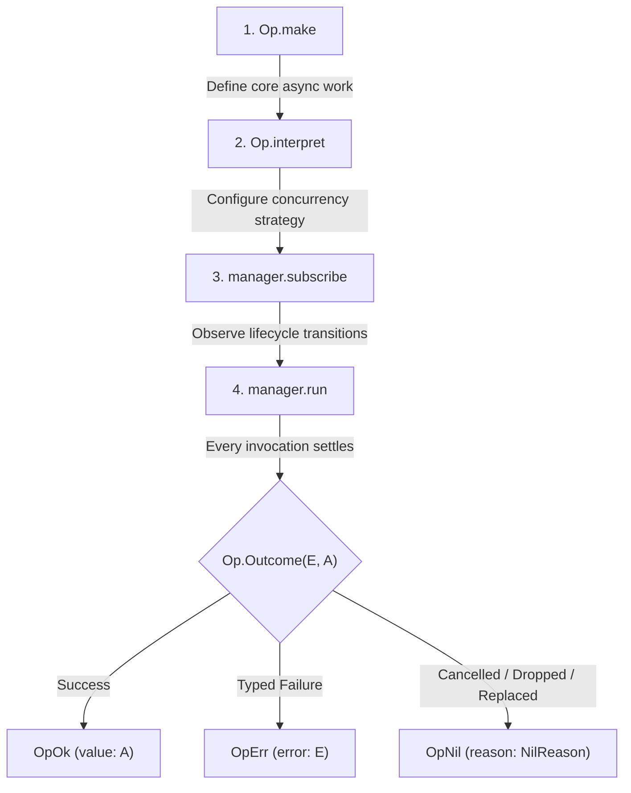
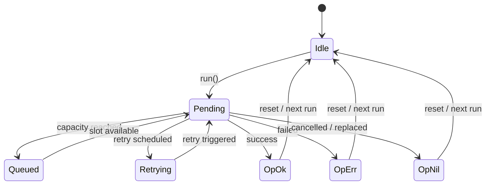

{/* BUNDLE_SIZE:START */}

> 5.96 kB minified + gzipped

{/* BUNDLE_SIZE:END */}

import { Aside } from '@astrojs/starlight/components'

Managing asynchronous workflows in frontend components or backend services usually couples task logic directly to execution controls. Consider a standard search-as-you-type input written in vanilla TypeScript:

```ts
// Manual AbortController and boolean flags in vanilla code
let currentController: AbortController | null = null;
let isLoading = false;
let searchResults: readonly string[] = [];
let searchError: string | null = null;

async function handleSearch(query: string) {
  // Cancel previous request if user typed again
  if (currentController) {
    currentController.abort();
  }
  currentController = new AbortController();
  isLoading = true;
  searchError = null;

  try {
    const response = await fetch(`/api/search?q=${encodeURIComponent(query)}`, {
      signal: currentController.signal,
    });
    if (!response.ok) throw new Error(`HTTP ${response.status}`);
    searchResults = (await response.json()) as readonly string[];
  } catch (error: unknown) {
    if (error instanceof DOMException && error.name === "AbortError") {
      // Ignored, but what about isLoading?
      return;
    }
    searchError = error instanceof Error ? error.message : String(error);
  } finally {
    // BUG: When an earlier request is aborted, its finally block runs immediately,
    // flipping isLoading to false while the newer request is still in flight!
    isLoading = false;
  }
}
```

This pattern exposes four critical failure modes in production:

1. **The `finally` state race**: When a user types a new character, the previous request is aborted. Its `finally` block runs immediately and resets `isLoading = false`, hiding the loading indicator while the second request is still waiting for network bytes.
2. **Out-of-order response overwrites**: If a developer forgets the `AbortController` entirely, a slower response from an earlier short query (`"ca"`) can resolve after a faster response from a longer query (`"cat"`), overwriting fresh results with stale data.
3. **Contradictory state flags**: Juggling separate `isLoading`, `searchError`, and `searchResults` variables allows impossible states to render (such as an error banner appearing alongside stale data while a spinner is active).
4. **Coupled execution logic**: Switching from "cancel previous" (`restartable`) to "ignore clicks while submitting" (`exclusive` for checkout buttons) requires rewriting the entire control flow from scratch with guard flags and manual timers.

`Op<Args, E, A>` decouples the **what** (the core asynchronous task) from the **how** (the execution strategy). You describe the asynchronous work once with `Op.make`, then configure concurrency, retries, and timeouts declaratively with `Op.interpret`.

---

## Type Structure & Mental Model

`Op` separates asynchronous coordination into two distinct layers: the task definition and the stateful manager.



### The Task Definition (`Op<Args, E, A>`)

An `Op<Args, E, A>` is an immutable blueprint for fallible asynchronous work. It accepts an `AbortSignal` and your domain arguments, returning a promise. It never runs on its own:

```ts
import { Op } from "@pplnd/core";

// Op<[query: string], ApiError, readonly User[]>
```

### The Execution Manager (`Op.Manager<Args, E, A>`)

Created by passing an `Op` blueprint to `Op.interpret(op, options)`. The manager owns the active state machine, enforces your chosen concurrency model (`restartable`, `exclusive`, `queue`, `buffered`, `debounced`, `throttled`, `concurrent`, `keyed`, `once`), and coordinates subscriptions.

### The Lifecycle State (`Op.State<E, A>`)

The manager transitions through observable lifecycle states:

```ts
type State<E, A> =
  | { readonly kind: "Idle" }
  | { readonly kind: "Pending" }
  | { readonly kind: "Queued"; readonly position: number }
  | {
    readonly kind: "Retrying";
    readonly attempt: number;
    readonly lastError: E;
    readonly nextRetryIn: Duration;
  }
  | Outcome<E, A>;
```



### The Tri-State Outcome (`Op.Outcome<E, A>`)

Every invocation triggered via `manager.run(...args)` returns a promise (`Deferred<Op.Outcome<E, A>>`) that is **guaranteed to settle**. Invocations never hang or reject unexpectedly. Every run settles into one of three variants:

```ts
type Outcome<E, A> =
  | { readonly kind: "OpOk"; readonly value: A }
  | { readonly kind: "OpErr"; readonly error: E }
  | { readonly kind: "OpNil"; readonly reason: NilReason };

type NilReason = "aborted" | "dropped" | "replaced" | "evicted";
```

- `OpOk`: The operation completed successfully with value `A`.
- `OpErr`: The operation failed with a typed domain error `E`.
- `OpNil`: The operation did not finish because the concurrency strategy cancelled, dropped, replaced, or evicted it.

---

## Creating Operations

`Op.make` defines an operation by accepting an asynchronous runner function and an error options object:

```ts
import { Op } from "@pplnd/core";

interface User {
  readonly id: string;
  readonly name: string;
}

type ApiError = {
  readonly kind: "ApiError";
  readonly message: string;
};

const toApiError = (error: unknown): ApiError => ({
  kind: "ApiError",
  message: error instanceof Error ? error.message : String(error),
});

const fetchUserOp = Op.make(
  (signal) => (id: string) =>
    fetch(`/users/${id}`, { signal }).then((r) => {
      if (!r.ok) throw new Error(`HTTP ${r.status}`);
      return r.json() as Promise<User>;
    }),
  { id: "fetchUser", onError: toApiError },
);
```

The outer factory receives an `AbortSignal`. The inner returned function defines the actual action and its arguments. Pass the signal to cancellable operations (such as `fetch`). TypeScript automatically infers the parameters of the inner function, guaranteeing that `manager.run(...args)` is fully typed without repeating type annotations.

If the async function is defined elsewhere with signal curried first, you can pass its reference directly:

```ts
const getUserData = (signal: AbortSignal) => (id: string): Promise<User> =>
  fetch(`/users/${id}`, { signal }).then((r) => r.json());

const fetchUserFromService = Op.make(getUserData, {
  onError: toApiError,
});
```

<Aside type="caution">
The `AbortSignal` is required for concurrency strategies to cancel obsolete in-flight requests. Ignoring the signal allows underlying operations to continue running, wasting bandwidth and server resources.
</Aside>

### Lifting Plain Async Functions with `Op.lift`

For rapid prototyping or utilities where typed domain error mapping is unnecessary, `Op.lift` wraps a plain async function. Any uncaught rejection is captured automatically as `Err<unknown>`:

```ts
const quickSearchOp = Op.lift(
  (signal) => (query: string) =>
    fetch(`/search?q=${encodeURIComponent(query)}`, { signal }).then((r) => r.json()),
);
```

---

## The Execution Lifecycle & Type Guards

To execute an operation, interpret it with a concurrency strategy and trigger `run()`:

```ts
// 1. Choose strategy and create manager
const userManager = Op.interpret(fetchUserOp, {
  strategy: "exclusive",
  id: "profile-loader",
});

// 2. Subscribe to state transitions
userManager.subscribe((state) => {
  if (Op.is.pending(state)) showSpinner();
  if (Op.Outcome.is.ok(state)) renderProfile(state.value);
  if (Op.Outcome.is.err(state)) showError(state.error.message);
});

// 3. Trigger execution
userManager.run("user_123");
```

Both `Op.make` and `Op.interpret` accept an optional `id` for diagnostics. In DevTools and loggers,
the manager displays as `[object Op.Manager(profile-loader)[fetchUser]]`, combining the instance
identifier with the blueprint definition without conflating runtime identity.

### Inspecting Lifecycle States with `Op.is`

The manager state transitions through active states before settling into an `Op.Outcome`. Use the `Op.is` type guards to inspect the manager's lifecycle stage:

- `Op.is.idle(state)` — true before the first run or after `manager.reset()`.
- `Op.is.pending(state)` — true while an operation is actively executing.
- `Op.is.queued(state)` — true when waiting in a queue (`state.position` indicates the 1-based queue slot).
- `Op.is.retrying(state)` — true when waiting between retry attempts (`state.attempt`, `state.lastError`, `state.nextRetryIn`).
- `Op.is.settled(state)` — true when the state has settled into an `Op.Outcome` (`Ok`, `Err`, or `Nil`).

```ts
userManager.subscribe((state) => {
  if (Op.is.idle(state)) renderIdlePrompt();
  if (Op.is.pending(state)) showSpinner();
  if (Op.is.queued(state)) showQueueBadge(state.position);
  if (Op.is.retrying(state)) showRetryBanner(state.attempt, state.lastError.message);
  if (Op.is.settled(state)) hideSpinner();
});
```

---

## Choosing a Concurrency Strategy

The execution strategy dictates what happens when `run()` is triggered while an existing operation is already in flight.

### Single-Execution & Exclusive Strategies

- **`restartable`**: New calls immediately abort any active in-flight request (`reason: "replaced"`) and start a fresh run. Only the latest invocation ever completes. Use `restartable` for autocomplete inputs, search boxes, and tab switching.
- **`exclusive`**: New calls are ignored (`reason: "dropped"`) while an operation is actively in flight. The active request always runs to completion. Use `exclusive` for form submissions and payment checkouts to prevent double-submits.
- **`once`**: Fires at most once. Only the first `run()` executes, and all subsequent calls resolve immediately to `Nil` (`reason: "dropped"`). Once the first invocation finishes, its settled state is cached permanently (until `manager.reset()` is called). Use `once` for app bootstrap and initial configuration loads.

### Queuing & Draft Buffering Strategies

- **`queue`**: Calls are placed in a FIFO queue (`Queued` state) and executed sequentially in the order they were submitted. Supports optional `maxSize`, `overflow` (`"drop"` or `"replace-last"`), `concurrency`, and `dedupe`. Ideal for transactional batch steps and offline sync queues.
- **`buffered`**: Maintains 1 active execution slot and a waiting buffer (default size 1). When a new call arrives while one is already waiting, the older waiting call is evicted (`reason: "evicted"`) and replaced by the latest call. Use `buffered` for auto-saving editor drafts.

### Rate-Limiting & Parallel Strategies

- **`debounced`**: Waits for a quiet period of `duration` before starting execution. Every new call resets the timer and evicts the previous pending call (`reason: "evicted"`). Supports optional `leading: true` and `maxWait`:

```ts
import { Duration } from "@pplnd/core";

const debouncedSearch = Op.interpret(quickSearchOp, {
  strategy: "debounced",
  duration: Duration.milliseconds(250),
});
```

- **`throttled`**: Fires immediately on the first call, then locks out subsequent calls for `duration`. By adding `trailing: true`, the most recent call made during the cooldown window fires once when the cooldown expires:

```ts
import { Duration } from "@pplnd/core";

const handleResize = Op.interpret(computeLayoutOp, {
  strategy: "throttled",
  duration: Duration.milliseconds(100),
  trailing: true,
});
```

- **`concurrent`**: Runs up to `concurrency` operations simultaneously. When capacity is full, `overflow: "queue"` places callers into a waiting queue (`Queued` state), whereas `overflow: "drop"` immediately resolves excess calls to `Nil` (`reason: "dropped"`):

```ts
const uploadManager = Op.interpret(uploadFileOp, {
  strategy: "concurrent",
  concurrency: 3,
  overflow: "queue",
});
```

- **`keyed`**: Multiplexes independent state machines per input key, running different keys in parallel while applying a `perKey` sub-strategy (`"exclusive"` or `"restartable"`) to calls sharing the same key. `manager.state` is a `ReadonlyMap<K, State>`:

```ts
const userProfileManager = Op.interpret(fetchUserOp, {
  strategy: "keyed",
  key: (id) => id,
  perKey: "exclusive",
});

userProfileManager.subscribe((map) => {
  for (const [userId, state] of map) {
    if (Op.is.pending(state)) showRowSpinner(userId);
    if (Op.Outcome.is.ok(state)) renderRow(userId, state.value);
  }
});

userProfileManager.run("user_a"); // Starts slot 'user_a'
userProfileManager.run("user_b"); // Starts slot 'user_b' in parallel
```

---

## State Subscriptions, Cancellation, and UI Integration

The manager returned by `Op.interpret` owns the active state machine. You can subscribe to state changes, read `manager.state` synchronously, or cancel in-flight work:

```ts
const manager = Op.interpret(fetchUserOp, { strategy: "restartable" });

manager.subscribe((state) => {
  if (Op.is.pending(state)) showSpinner();
  if (Op.Outcome.is.ok(state)) renderProfile(state.value);
  if (Op.Outcome.is.nil(state)) clearUI();
});
```

The `manager.state` property is always available for synchronous reads, making it straightforward to bind to reactive UI frameworks:

```ts
import { useSyncExternalStore } from "react";

function useUserProfile(manager: typeof userManager) {
  return useSyncExternalStore(
    (onStoreChange) => manager.subscribe(onStoreChange),
    () => manager.state,
  );
}
```

- **`manager.abort()`**: Cancels any active or queued executions immediately, resolving their callers with `Nil` (`reason: "aborted"`). On a `keyed` manager, `manager.abort(key)` aborts a specific key, or `manager.abort()` aborts all keys.
- **`manager.reset()`**: Returns the manager state to `Idle` (or clears the map on a `keyed` manager).
- **`manager.poll({ interval })(...args)`**: Repeatedly triggers `run(...args)` on a fixed interval, returning a cleanup function to stop polling.

---

## Per-Invocation Awaiting & Settlement Invariant

Every time you invoke `manager.run(...args)`, it returns a `Deferred` value that resolves to the specific settled outcome (`Op.Outcome`) of that invocation. Even if an invocation is replaced or aborted by a subsequent call, its promise is guaranteed to settle with `Nil` rather than hanging:

```ts
const outcome = await checkoutManager.run(cartData);

if (Op.Outcome.is.ok(outcome)) {
  navigateTo("/receipt");
} else if (Op.Outcome.is.err(outcome)) {
  renderAlert(outcome.error.message);
}
```

Because `manager.run()` returns a `Deferred`, combining multiple in-flight invocations uses `Deferred.all` or `Deferred.race`:

```ts
import { Deferred } from "@pplnd/core";

const [profile, settings] = await Deferred.all([
  fetchProfileManager.run(userId),
  fetchSettingsManager.run(userId),
]);
```

---

## Declarative Resilience: Retries & Timeouts

Retries and timeouts are configured declaratively at interpretation time, keeping operational concerns out of your core async definitions:

```ts
import { Duration, RetryPolicy } from "@pplnd/core";

const paymentManager = Op.interpret(submitPaymentOp, {
  strategy: "exclusive",
  retry: RetryPolicy.exponential({
    attempts: 3,
    initial: Duration.milliseconds(500),
    when: (error) => error.message.includes("timeout"),
    onRetry: ({ attempt, error, delay }) => {
      console.warn(`Payment attempt ${attempt} failed: ${error.message}. Retrying in ${delay.millis}ms`);
    },
  }),
  timeout: {
    duration: Duration.seconds(10),
    onTimeout: (): ApiError => ({
      kind: "ApiError",
      message: "Transaction timed out after 10s",
    }),
  },
});
```

If a retry policy is active, the manager's state union automatically includes `Op.Retrying<E>` between attempts, allowing the UI to inspect `state.attempt`, `state.lastError`, and `state.nextRetryIn`.

---

## Working with `Op.Outcome`

`Op.Outcome` is a complete container namespace with constructors (`make.ok`, `make.err`, `make.nil`), type guards (`is.ok`, `is.err`, `is.nil`), transformations (`map`, `mapError`, `chain`, `recover`), side-effect taps (`tap`, `tapError`), and eliminators (`match`, `getOrElse`).

The `Nil` variant carries a precise `reason` explaining why the invocation did not finish:

- `"aborted"` — `manager.abort()` was called explicitly.
- `"dropped"` — the invocation was ignored because the strategy had no remaining capacity.
- `"replaced"` — a newer `run()` call executed, cancelling this in-flight invocation.
- `"evicted"` — the invocation was removed from a waiting queue or buffer before starting.

```ts
import { Op, pipe } from "@pplnd/core";

const outcome = await userManager.run("user_123");

const displayName = pipe(
  outcome,
  Op.Outcome.map((user) => user.name.trim()),
  Op.Outcome.mapError((err) => ({ ...err, message: `[UserLookup] ${err.message}` })),
  Op.Outcome.tap((name) => console.info("Loaded user:", name)),
  Op.Outcome.tapError((err) => console.error("Failed:", err.message)),
  Op.Outcome.recover((err) =>
    err.message.includes("HTTP 404")
      ? Op.Outcome.make.ok({ id: "anon", name: "Guest User" })
      : Op.Outcome.make.err(err)
  ),
  Op.Outcome.getOrElse(() => ({ id: "fallback", name: "Default User" })),
);
```

When sequencing another fallible step that returns an `Op.Outcome` or handling all three branches explicitly, use `Op.Outcome.chain` and `Op.Outcome.match`:

```ts
const validateUser = (user: User): Op.Outcome<ApiError, User> =>
  user.name.length > 0
    ? Op.Outcome.make.ok(user)
    : Op.Outcome.make.err({ kind: "ApiError", message: "Empty user name" });

const statusMessage = pipe(
  outcome,
  Op.Outcome.chain(validateUser),
  Op.Outcome.match({
    ok: (user) => `Welcome back, ${user.name}`,
    err: (err) => `Alert: ${err.message}`,
    nil: (reason) => `Request skipped (${reason})`,
  }),
);
```

---

## Outcome Conversions and Wiring

At system boundaries, convert between `Op.Outcome` and `Result` or `Maybe`:

- **`Op.Outcome.to.Result(onNil)`**: Maps `Ok` to `Ok`, `Err` to `Err`, and `Nil` to `Err(onNil(reason))`.
- **`Op.Outcome.to.Maybe(outcome)`**: Maps `Ok` to `Some`, and maps both `Err` and `Nil` to `None`.
- **`Op.Outcome.from.Result(result)`**: Maps `Result.Ok` to `Op.Outcome.Ok` and `Result.Err` to `Op.Outcome.Err`.
- **`Op.Outcome.from.Maybe(maybe, onNone?)`**: Maps `Maybe.Some` to `Op.Outcome.Ok` and `Maybe.None` to `Op.Outcome.Nil` (defaulting reason to `"dropped"`).

```ts
import { Maybe, Result } from "@pplnd/core";

const resultOutcome = pipe(
  outcome,
  Op.Outcome.to.Result((reason): ApiError => ({
    kind: "ApiError",
    message: `Request skipped: ${reason}`,
  })),
); // Result<ApiError, User>

const maybeOutcome = Op.Outcome.to.Maybe(outcome); // Maybe<User>

const fromRes = Op.Outcome.from.Result(Result.make.ok(42)); // OpOk(42)
const fromMay = Op.Outcome.from.Maybe(Maybe.make.none(), () => "aborted"); // OpNil("aborted")
```

To trigger a downstream manager or side effect automatically whenever a source manager settles with `Ok`, use `Op.wire`:

```ts
const stopWire = Op.wire(userManager, (user) => auditLogManager.run(user.id));
```

---

## Composing Outcome Pipelines

Here is an end-to-end example processing an order checkout. It awaits an exclusive payment submission, verifies discount codes, recovers from non-fatal inventory alerts, logs auditing records, and extracts a customer confirmation banner:

```ts
import { Op, pipe } from "@pplnd/core";

interface OrderReceipt {
  readonly orderId: string;
  readonly amount: number;
  readonly appliedCoupon?: string;
}

type CheckoutError = {
  readonly kind: "PaymentDeclined" | "InventoryLocked";
  readonly message: string;
};

const verifyCoupon = (receipt: OrderReceipt): Op.Outcome<CheckoutError, OrderReceipt> =>
  receipt.amount >= 0
    ? Op.Outcome.make.ok(receipt)
    : Op.Outcome.make.err({ kind: "PaymentDeclined", message: "Invalid order amount" });

async function processCheckout(cartId: string): Promise<string> {
  const outcome = await checkoutManager.run(cartId);

  return pipe(
    outcome,
    Op.Outcome.chain(verifyCoupon),
    Op.Outcome.tap((receipt) => {
      telemetryManager.run({ event: "order_completed", orderId: receipt.orderId });
    }),
    Op.Outcome.recover((error) =>
      error.kind === "InventoryLocked"
        ? Op.Outcome.make.ok({ orderId: "BACKORDER", amount: 0 })
        : Op.Outcome.make.err(error)
    ),
    Op.Outcome.match({
      ok: (receipt) => `Order confirmed: ${receipt.orderId}`,
      err: (err) => `Checkout error: ${err.message}`,
      nil: (reason) => `Checkout halted (${reason})`,
    }),
  );
}
```

---

## Problems It Solves

- **Search-as-you-type and tab navigation without network race conditions (`restartable`)**: In autocomplete inputs or rapid tab navigation, fast user actions fire multiple overlapping HTTP requests. Slower earlier responses often arrive after newer ones, overwriting fresh data with stale results. Setting `strategy: "restartable"` automatically aborts previous in-flight HTTP requests via `AbortSignal`, freeing up browser socket connections and guaranteeing only the latest network response updates state.
- **Preventing duplicate mutation requests and double charges (`exclusive`)**: Rapidly clicking payment, checkout, or delete buttons can send duplicate HTTP POST/PUT requests to backend servers. Setting `strategy: "exclusive"` ignores subsequent triggers while a network mutation is actively in flight, structurally eliminating duplicate API submissions without manual component boolean flags.
- **Auto-saving editor drafts without API congestion (`buffered` and `debounced`)**: In rich text editors and settings forms, sending an HTTP PUT/PATCH request on every single keystroke floods the backend server, while saving only on unmount risks data loss. `buffered` keeps at most one active network request in flight and one waiting draft (automatically replacing superseded payloads), while `debounced` waits for typing pauses before dispatching the HTTP save.
- **Per-entity independent network requests in tables and feeds (`keyed`)**: In data tables or dashboard lists where users trigger actions on individual items (such as archiving a row, fetching order details, or retrying a failed webhook), tracking loading and error states per row manually requires complex ID-mapped state dictionaries. `keyed` multiplexes independent request managers per entity ID, isolating in-flight `AbortSignal`s and state transitions so one item's slow network request never blocks or cancels another.
- **Rate-limited batch uploads and connection pool management (`concurrent`)**: Firing dozens of simultaneous HTTP requests (such as uploading file batches or fetching paginated collections) can saturate browser connection limits (such as HTTP/1.1 six-connection host limits) or trigger HTTP 429 Too Many Requests errors. `concurrent` with `overflow: "queue"` caps simultaneous active requests (e.g. `concurrency: 3`) and queues the remainder, while `overflow: "drop"` discards excess requests when rate limits are saturated.
- **Sequential transactional API queues (`queue`)**: In multi-step backend operations (such as creating an account, provisioning tenant databases, and sending invitations) or offline sync queues, HTTP requests must execute in strict chronological order where each request depends on the completion of the previous one. `queue` serializes all network invocations in strict FIFO order without manual promise queue plumbing.
- **Rate-limited telemetry and high-frequency API sync (`throttled`)**: High-frequency actions (such as sending real-time cursor presence beacons, analytics pings, or rapid refresh requests) risk overwhelming API endpoints. `throttled` guarantees network requests fire at most once per time window, executing immediately on the leading edge and optionally dispatching the latest payload on the trailing edge.
- **One-time session bootstrap and configuration fetching (`once`)**: In web applications, fetching auth session tokens, remote feature flags, or global tenant settings during app startup must hit the network exactly once. `once` guarantees that only the first request reaches the network, permanently caching the result and resolving subsequent calls immediately without repeated API fetches.
- **Network resilience with declarative retries, timeouts, and polling (`retry`, `timeout`, `poll`)**: Flaky mobile connections, temporary 503 Service Unavailable spikes, and hanging socket connections require backoff retry strategies and hard timeout limits. `Op` encapsulates backoff schedules, error filter predicates (`when`), timeout aborts, and automated interval polling (`manager.poll`) into a declarative configuration blueprint, cleanly decoupled from business code.
- **Tying request lifecycle states to reactive UI stores without inconsistent flags**: Managing network lifecycles with separate `isLoading`, `isError`, `error`, and `data` flags leads to contradictory UI states (such as spinners showing alongside error alerts). `Op` managers provide a single reactive state machine with synchronous `manager.state` reads, making integration with React (`useSyncExternalStore`), Vue, or Svelte predictable and exhaustive.
