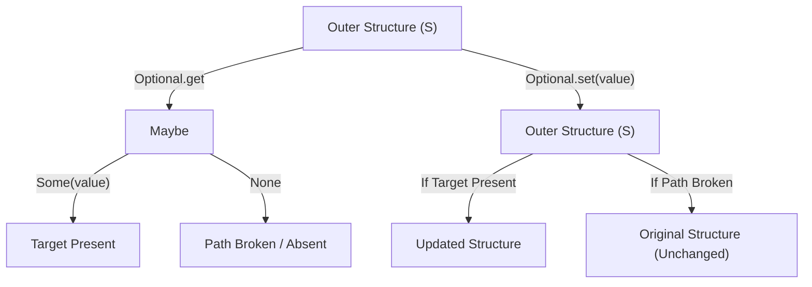

<!-- BUNDLE_SIZE:START -->

> 1.87 kB minified + gzipped (1,874 B)

<!-- BUNDLE_SIZE:END -->

JavaScript provides optional chaining (`?.`) to safely read through nullable object hierarchies, but
offers no equivalent syntax for immutable writes. Updating an optional nested property immutably
requires nested ternary expressions, null checks, and layered object spreads.

`Optional<S, A>` models a bidirectional path to a property or index `A` inside `S` that may or may
not exist. Reading yields `Maybe<A>`, while writing or modifying updates the value if the path
exists and acts as an immediate no-op if any segment is absent.

---

## The problem with updating optional paths

Consider a user settings structure where both the notification preferences and specific channel
configurations are optional:

```ts
type UserSettings = {
  readonly username: string;
  readonly notifications?: {
    readonly email?: boolean;
    readonly slack?: {
      readonly webhookUrl?: string;
      readonly enabled?: boolean;
    };
  };
};

const settings: UserSettings = {
  username: "alice",
  notifications: {
    email: true,
  },
};
```

Optional chaining cannot be placed on the left-hand side of an assignment:

```ts
// SyntaxError: Invalid left-hand side in assignment:
settings.notifications?.slack?.enabled = true;
```

To update this immutably using standard JavaScript, every optional layer must be inspected with a
ternary guard:

```ts
const updatedSettings: UserSettings = {
  ...settings,
  notifications: settings.notifications
    ? {
        ...settings.notifications,
        slack: settings.notifications.slack
          ? {
              ...settings.notifications.slack,
              enabled: true,
            }
          : undefined,
      }
    : undefined,
};
```

This approach presents three distinct challenges:

1. **Defensive ternary pyramids**: Each optional level doubles the indentation. The core mutation
   becomes lost inside defensive boilerplate.
2. **Accidental property injection**: If an intermediate level is missing and we provide a fallback
   object (`settings.notifications ?? { ... }`), we risk unintentionally creating sub-trees that the
   user never opted into.
3. **Array bounds vulnerabilities**: Modifying an element by index in an array
   (`users[2]?.permissions`) requires cloning the array, verifying that `index >= 0` and
   `index < length`, and rejecting non-integer indices (`NaN`, floats).

---

## Type Structure & Mental Model

An `Optional<S, A>` pairs a getter that returns `Maybe<A>` with a setter that returns the original
structure unchanged when the target is absent:

```ts
import type { Maybe } from "@nlozgachev/pipelined/core";

type Optional<S, A> = {
  readonly get: (structure: S) => Maybe<A>;
  readonly set: (value: A) => (structure: S) => S;
};
```

The mental model centers on safe traversal:



If the path exists, updates produce a new object reference with the leaf modified. If any segment in
the path is missing (`null` or `undefined`), `Optional.set` and `Optional.modify` short-circuit and
return the input structure reference unchanged.

---

## Creating Optional Paths

`Optional.from.property` focuses on an optional or nullable property in an object.
`Optional.from.index` focuses on an element at an array index:

```ts
import { Optional } from "@nlozgachev/pipelined/core";

// Focus on an optional object field:
const notificationsOptional = Optional.from.property<UserSettings>()("notifications");

// Focus on an array element by index:
const primaryQueueOptional = Optional.from.index<string>(0);
```

### Strict index boundaries

`Optional.from.index` enforces strict numerical validation. It guards against non-integers, negative
numbers, `NaN`, and `Infinity`:

```ts
const items = ["primary", "secondary"];

const invalidIndexOptional = Optional.from.index<string>(1.5);
Optional.get(invalidIndexOptional)(items);
// None — float indices are rejected

const outOfBoundsOptional = Optional.from.index<string>(5);
Optional.get(outOfBoundsOptional)(items);
// None — index exceeds array length
```

### Custom accessors

`Optional.from.accessors` constructs an optional path from custom getter and setter functions. The
getter must return a `Maybe`:

```ts
import { Maybe, Optional } from "@nlozgachev/pipelined/core";

const firstCharOptional = Optional.from.accessors(
  (text: string) => text.length > 0 ? Maybe.make.some(text[0]) : Maybe.make.none(),
  (char) => (text) => text.length > 0 ? char + text.slice(1) : text,
);
```

---

## Reading Values Safely

`Optional.get` extracts the target value wrapped in `Maybe<A>`. For terminal values,
`Optional.getOrElse` supplies a default fallback, and `Optional.match` handles presence and absence
with named cases:

```ts
import { pipe } from "@nlozgachev/pipelined/composition";
import { Optional } from "@nlozgachev/pipelined/core";

type NotificationSettings = NonNullable<UserSettings["notifications"]>;
const slackOptional = Optional.from.property<NotificationSettings>()("slack");

const activeNotifications: NotificationSettings = { email: true };

// 1. Read as Maybe<SlackConfig>
const slackMaybe = pipe(activeNotifications, Optional.get(slackOptional));
// None

// 2. Read with a fallback default thunk
const slackConfig = pipe(
  activeNotifications,
  Optional.getOrElse(slackOptional)(() => ({ enabled: false })),
);
// { enabled: false }

// 3. Pattern match with named handlers
const isSlackConfigured = pipe(
  activeNotifications,
  Optional.match(slackOptional)({
    none: () => false,
    some: (slack) => Boolean(slack.webhookUrl),
  }),
);
// false
```

---

## Modifying and Writing Through Optionals

`Optional.set` replaces the target value if the path exists. `Optional.modify` applies a
transformation function to the focused value:

```ts
import { pipe } from "@nlozgachev/pipelined/composition";
import { Optional } from "@nlozgachev/pipelined/core";

type SlackConfig = { readonly webhookUrl?: string; readonly enabled?: boolean };
const enabledOptional = Optional.from.property<SlackConfig>()("enabled");

const config: SlackConfig = { enabled: false };

// Update the field when present:
const enabledConfig = pipe(config, Optional.set(enabledOptional)(true));
// { enabled: true }

// Transform the field when present:
const toggledConfig = pipe(
  config,
  Optional.modify(enabledOptional)((state) => !state),
);
// { enabled: true }
```

### No-op when path is broken

When modifying an object where the target segment is absent, `Optional.modify` leaves the original
structure intact:

```ts
const emptyConfig: SlackConfig = {};

const result = pipe(
  emptyConfig,
  Optional.modify(enabledOptional)((state) => !state),
);

// Returns true — exact same object reference returned without injecting keys:
console.log(result === emptyConfig);
```

---

## Composing Deep Optional Paths

`Optional.andThen` chains multiple optional paths together. If any segment along the path is
missing, the entire traversal resolves to `None` on read, or returns the original root object on
write:

```ts
import { pipe } from "@nlozgachev/pipelined/composition";
import { Optional } from "@nlozgachev/pipelined/core";

type FullSettings = Required<UserSettings>;
type SlackParent = Required<FullSettings["notifications"]>;

const notificationsOpt = Optional.from.property<UserSettings>()("notifications");
const slackOpt = Optional.from.property<SlackParent>()("slack");
const webhookOpt = Optional.from.property<Required<SlackParent["slack"]>>()("webhookUrl");

// Compose a 3-tier optional path:
const deepWebhookOptional = pipe(
  notificationsOpt,
  Optional.andThen(slackOpt),
  Optional.andThen(webhookOpt),
);

// Read deep value safely:
const urlMaybe = pipe(settings, Optional.get(deepWebhookOptional));
// None

// Set deep value safely — acts as a no-op because slack is undefined in settings:
const unchanged = pipe(
  settings,
  Optional.set(deepWebhookOptional)("https://hooks.slack.com/services/..."),
);
// Returns settings reference unchanged
```

---

## Bridging Lenses and Optionals

Domain structures frequently mix guaranteed structural containers with optional leaf properties.
`Lens` and `Optional` bridge seamlessly:

- `Lens.andThenOptional`: Connects an initial guaranteed `Lens` to an inner `Optional`.
- `Optional.andThenLens`: Connects an initial `Optional` to an inner guaranteed `Lens`.
- `Lens.to.Optional`: Widens any `Lens` into an `Optional`.

```ts
import { pipe } from "@nlozgachev/pipelined/composition";
import { Lens, Optional } from "@nlozgachev/pipelined/core";

type SslConfig = {
  readonly certPath: string;
};

type ServerConfig = {
  readonly host: string;
  readonly port: number;
  readonly ssl?: SslConfig;
};

type AppDeployment = {
  readonly server: ServerConfig;
};

const serverLens = Lens.from.property<AppDeployment>()("server");
const sslOptional = Optional.from.property<ServerConfig>()("ssl");
const certPathLens = Lens.from.property<SslConfig>()("certPath");

// Compose: Guaranteed Lens -> Optional -> Inner Guaranteed Lens
const deploymentCertOptional = pipe(
  serverLens,
  Lens.andThenOptional(sslOptional),
  Optional.andThenLens(certPathLens),
);

// Convert a Lens into an Optional:
const serverAsOptional = Lens.to.Optional(serverLens);
```

---

## Pipeline Composition

Here is an end-to-end cloud cluster configuration pipeline. It updates an application deployment
manifest, adjusting the replica count of an optional background worker pool, modifying an indexed
container volume mount, and formatting an optional telemetry collector endpoint:

```ts
import { pipe } from "@nlozgachev/pipelined/composition";
import { Lens, Optional } from "@nlozgachev/pipelined/core";

type VolumeMount = {
  readonly mountPath: string;
  readonly readOnly: boolean;
};

type WorkerPool = {
  readonly replicas: number;
  readonly autoScale: boolean;
};

type TelemetryConfig = {
  readonly endpoint?: string;
  readonly sampleRate: number;
};

type ClusterManifest = {
  readonly clusterId: string;
  readonly volumes: readonly VolumeMount[];
  readonly telemetry?: TelemetryConfig;
  readonly workerPool?: WorkerPool;
};

const telemetryOpt = Optional.from.property<ClusterManifest>()("telemetry");
const endpointOpt = Optional.from.property<TelemetryConfig>()("endpoint");
const workerPoolOpt = Optional.from.property<ClusterManifest>()("workerPool");
const replicasLens = Lens.from.property<WorkerPool>()("replicas");
const volumesLens = Lens.from.property<ClusterManifest>()("volumes");
const firstVolumeOpt = Optional.from.index<VolumeMount>(0);
const readOnlyLens = Lens.from.property<VolumeMount>()("readOnly");

// Compose composite optics:
const workerReplicasOpt = pipe(workerPoolOpt, Optional.andThenLens(replicasLens));
const telemetryEndpointOpt = pipe(telemetryOpt, Optional.andThen(endpointOpt));
const firstVolumeReadOnlyOpt = pipe(
  volumesLens,
  Lens.andThenOptional(firstVolumeOpt),
  Optional.andThenLens(readOnlyLens),
);

const manifest: ClusterManifest = {
  clusterId: "prod-cluster-eu",
  volumes: [{ mountPath: "/data/cache", readOnly: false }],
  workerPool: {
    replicas: 3,
    autoScale: true,
  },
};

// Process updates across guaranteed and optional boundaries in a single pipeline:
const updatedManifest = pipe(
  manifest,
  // 1. Scale worker replicas if the worker pool exists:
  Optional.modify(workerReplicasOpt)((count) => count + 2),
  // 2. Set telemetry endpoint if telemetry config exists (no-op since telemetry is absent):
  Optional.set(telemetryEndpointOpt)("https://metrics.internal/v1"),
  // 3. Mark the primary cache volume mount as read-only:
  Optional.set(firstVolumeReadOnlyOpt)(true),
);
```

---

## Problems it solves

- Modifying properties along optional chains requires nested ternary operators and defensive guards
  that obscure business logic. `Optional` performs reads as `Maybe` and safely applies writes only
  when all segments exist.
- Manual spread operations on optional fields risk creating default objects where none were
  intended. `Optional.modify` and `Optional.set` act as safe no-ops when paths are broken,
  preventing unintentional property pollution.
- Mutating indexed array values requires defensive bounds checking and array cloning.
  `Optional.from.index` validates indices against boundary and integer rules, rejecting `NaN`,
  floating-point values, and negative indices automatically.
- Real-world domains combine guaranteed container objects with optional attributes. Composing `Lens`
  and `Optional` through `andThenOptional` and `andThenLens` provides a unified optic pipeline
  across heterogeneous data shapes.
- Extracting absent properties requires manual fallback management. `Optional.getOrElse` and
  `Optional.match` provide structured ways to unwrap present values or execute fallback logic
  without scattered null checks.
