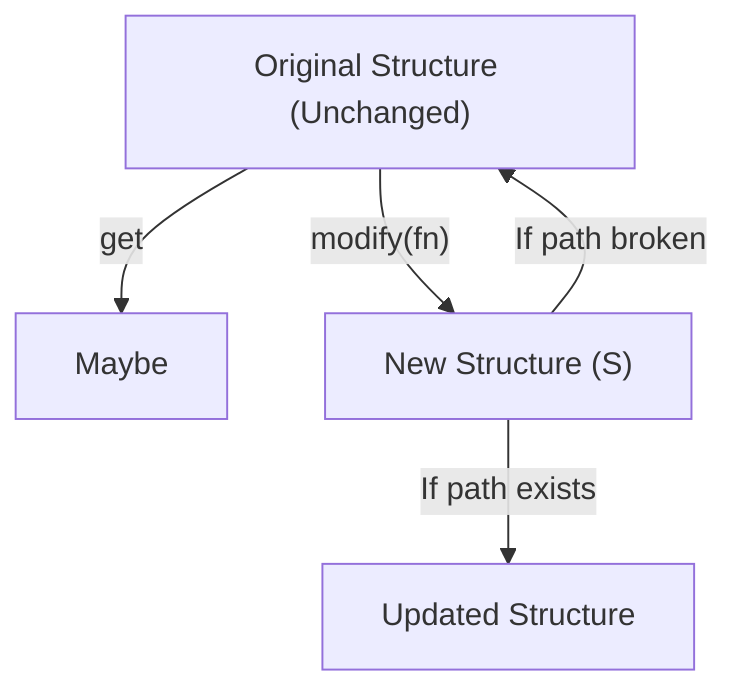

<!-- BUNDLE_SIZE:START -->

> 1.87 kB minified + gzipped (1,874 B)

<!-- BUNDLE_SIZE:END -->

While optional chaining (`?.`) allows safe reads through nullable object hierarchies, JavaScript has
no syntax for immutable updates along nullable paths. Updating nested optional properties immutably
requires multi-layer conditional checks and object spreads.

`Optional<S, A>` models a bidirectional path to an optional property `A` inside `S`. Reads return
`Maybe<A>`, while writes and modifications apply immutably if the target exists, acting as a no-op
if any segment is missing.

## The problem with updating optional paths

Consider a system that tracks a user's notification preferences, where both the preferences
sub-object and individual notification channels are completely optional:

```ts
type UserSettings = {
  username: string;
  notifications?: {
    email?: boolean;
    slack?: {
      webhookUrl?: string;
      enabled?: boolean;
    };
  };
};

const settings: UserSettings = {
  username: "alice",
  notifications: {
    email: true,
  },
};
```

If we want to enable the Slack channel, we cannot simply write:

```ts
// Syntax Error: Optional chaining cannot be used on the left-hand side of an assignment
settings.notifications?.slack?.enabled = true;
```

To update this safely and immutably using standard JavaScript, we must manually guard each nullable
level to determine whether we need to create it or skip the update:

```ts
const updatedSettings = {
  ...settings,
  notifications: settings.notifications
    ? {
        ...settings.notifications,
        slack: settings.notifications.slack
          ? {
              ...settings.notifications.slack,
              enabled: true,
            }
          : undefined, // Or create a default Slack object
      }
    : undefined,
};
```

This code is incredibly difficult to read, write, and maintain. It forces the developer to manually
manage the control flow of absence, mixing business logic with defensive null-checking.

## The shift to nullable paths

An `Optional<S, A>` models a traversal that might fail to reach its destination.

- Reading through an optional yields `Maybe<A>` (returning `Some` if the path is valid and holds a
  value, or `None` if any segment is absent).
- Overwriting or modifying through an optional returns a new structure with the update applied if
  the path exists, or the original structure unchanged if the path is broken.



## Creating optional paths

We can target optional object properties using `Optional.from.property`, and array elements by index
using `Optional.from.index`:

```ts
import { Optional } from "@nlozgachev/pipelined/core";

// Focus on an optional field within an object
const notificationsOptional = Optional.from.property<UserSettings>()("notifications");

// Focus on a specific element of an array by index
const firstItemOptional = Optional.from.index<string>(0); // Optional<readonly string[], string>
```

If we need a custom optional path — such as parsing a string value that might be empty or invalid —
we can define it manually with `Optional.from.accessors`:

```ts
import { Maybe } from "@nlozgachev/pipelined/core";

const firstCharOptional = Optional.from.accessors(
  (str: string) => str.length > 0 ? Maybe.make.some(str[0]) : Maybe.make.none(),
  (char) => (str) => str.length > 0 ? char + str.slice(1) : str
);
```

## Reading values safely

When reading a value through an `Optional`, we receive a `Maybe` context. We then use standard
functional helpers to extract or match on the value:

```ts
import { pipe } from "@nlozgachev/pipelined/composition";

type NotificationSettings = NonNullable<UserSettings["notifications"]>;
const slackOptional = Optional.from.property<NotificationSettings>()("slack");

// 1. Extract the Slack settings as a Maybe context
const slackSettings = pipe(settings.notifications ?? {}, Optional.get(slackOptional));
// Returns: None (since 'slack' is undefined in our settings)

// 2. Extract the focused value with a fallback default using getOrElse
const activeSlackConfig = pipe(
  settings.notifications ?? {},
  Optional.getOrElse(slackOptional)(() => ({ enabled: false })),
);
// Returns: { enabled: false }

// 3. Match on the result with named handlers
const hasWebhook = pipe(
  settings.notifications ?? {},
  Optional.match(slackOptional)({
    none: () => false,
    some: (slack) => Boolean(slack.webhookUrl),
  }),
);
```

## Modifying and writing through optionals

Writing or modifying a value through an `Optional` always returns a new object reference if the path
is resolved and a change occurs, preserving reference equality and returning the original object if
the path is broken:

```ts
const slackEnabledOptional = Optional.from.property<{ webhookUrl?: string; enabled?: boolean }>()("enabled");

// Safely modify a value if it exists, otherwise do nothing
const updatedNotifications = pipe(
  settings.notifications ?? {},
  Optional.modify(slackOptional)(
    (slack) => ({ ...slack, enabled: true }),
  ),
);
// Returns the original object reference unchanged because 'slack' was undefined.
```

## Composing deep optional paths

Just like lenses, optionals compose. We can combine multiple optional paths using
`Optional.andThen`. If any step in the composition fails, the entire chain resolves to a safe no-op
or a `None` value:

```ts
const notifications = Optional.from.property<UserSettings>()("notifications");
const slack = Optional.from.property<Required<UserSettings>["notifications"]>()("slack");
const webhook = Optional.from.property<Required<Required<UserSettings>["notifications"]>["slack"]>()("webhookUrl");

// Compose a deep optional path
const slackWebhookOptional = pipe(
  notifications,
  Optional.andThen(slack),
  Optional.andThen(webhook)
);

// Read the deep webhook URL if it exists
const urlMaybe = pipe(settings, Optional.get(slackWebhookOptional)); // None

// Attempt to set a value deep inside the structure safely
const nextSettings = pipe(
  settings,
  Optional.set(slackWebhookOptional)("https://hooks.slack.com/services/...")
);
```

## Bridging Lenses and Optionals

It is very common for a path to start with fields that are guaranteed to exist, and then reach a
field that is optional. We can transition from a `Lens` to an `Optional` using `Lens.to.Optional`,
or compose a lens directly using `Optional.andThenLens` or `Lens.andThenOptional`:

```ts
import { Lens } from "@nlozgachev/pipelined/core";

type SslConfig = {
  certPath: string;
};

type ServerConfig = {
  host: string;
  port: number;
  ssl?: SslConfig;
};

type Config = {
  server: ServerConfig;
};

const serverLens = Lens.from.property<Config>()("server");
const sslOptional = Optional.from.property<ServerConfig>()("ssl");
const certPathLens = Lens.from.property<SslConfig>()("certPath");

// Compose a guaranteed Lens with an Optional, then with an inner Lens:
const sslCertOptional = pipe(
  serverLens,
  Lens.andThenOptional(sslOptional),
  Optional.andThenLens(certPathLens),
);

// You can also convert any Lens into an Optional directly with Lens.to.Optional:
const serverOptional = Lens.to.Optional(serverLens);
```

## Problems it solves

- **Updating optional nested properties safely**: In user preference trees and optional
  configuration blocks (such as `user?.preferences?.notifications?.emailDigest`), modifying an
  optional leaf requires multiple existence checks to avoid modifying non-existent objects.
  `Optional` safely retrieves values as `Maybe` and immutably modifies target fields only when the
  path is present.
- **Conditional modifications without creating phantom fields (`Optional.modify`)**: Applying
  updates (such as trimming an optional nickname or incrementing an optional retry count) should
  only take place if the field already exists. `Optional.modify` applies functions to existing
  targets without creating unwanted default properties.
- **Modifying specific items in nested array state**: Updating an element at an index inside an
  array nested inside state (such as `cart.items[index].quantity`) requires cloning the array,
  checking bounds, and spreading parent objects. `Optional.from.index` allows direct, boundary-safe
  updates to indexed collection elements.
- **Composing guaranteed and optional paths**: Real-world domain models mix required structural
  wrappers with optional fields. `Optional` connects guaranteed paths (`Lens`) with optional leaves
  (`Optional`), providing a unified, type-safe pipeline for deep reads and writes.
