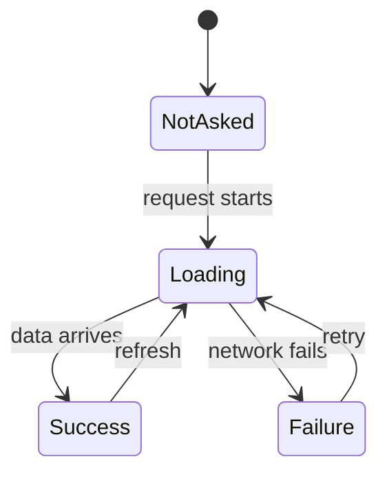

Representing asynchronous UI state with independent boolean flags (`data`, `isLoading`, `error`)
allows impossible state combinations (such as `isLoading: true` while an `error` is displayed) and
makes initial un-fetched states ambiguous.

`RemoteData<E, A>` models the complete request lifecycle as a discriminated union of four mutually
exclusive states: `NotAsked`, `Loading`, `Failure<E>`, and `Success<A>`:



By packaging our loading state into a single, cohesive type, we ensure that our application can only
ever represent valid states.

```ts
import { pipe } from "@nlozgachev/pipelined/composition";
import { RemoteData } from "@nlozgachev/pipelined/core";

export type RemoteData<E, A> =
  | RemoteData.NotAsked
  | RemoteData.Loading
  | RemoteData.Failure<E>
  | RemoteData.Success<A>;
```

---

## Creating RemoteData

To track a lifecycle, we transition our state through the explicit constructors of `RemoteData`:

```ts
import { RemoteData } from "@nlozgachev/pipelined/core";

type UserState = RemoteData<string, User>;

// 1. Initial idle state before any action
let state: UserState = RemoteData.make.notAsked();

// 2. An API request is initiated
state = RemoteData.make.loading();

// 3. The network times out
state = RemoteData.make.failure("Request timed out");

// 4. A successful reload brings data
state = RemoteData.make.success(activeUser);
```

### Inspecting states with type guards: `is.*`

When checking a specific lifecycle state in imperative code or UI conditionals, use the `RemoteData.is`
type guards (`notAsked`, `loading`, `failure`, `success`):

```ts
if (RemoteData.is.notAsked(state)) {
  triggerInitialFetch();
}

if (RemoteData.is.loading(state)) {
  showLoadingSpinner();
}

if (RemoteData.is.failure(state)) {
  // Narrowed to RemoteData.Failure<string>
  reportErrorBanner(state.error);
}

if (RemoteData.is.success(state)) {
  // Narrowed to RemoteData.Success<User>
  renderUserHeader(state.value);
}
```

---

## Exhaustive Rendering with match

The primary benefit of `RemoteData` is that it makes your rendering and consumption logic safe. When
you unpack the data, `match` requires you to handle all four branches explicitly. If you forget one,
the compiler will refuse to build your application:

```ts
import { pipe } from "@nlozgachev/pipelined/composition";

const uiMessage = pipe(
  userDataState,
  RemoteData.match({
    notAsked: () => "Click the button to load your profile",
    loading: () => "Retrieving data...",
    failure: (error) => `Could not load profile: ${error}`,
    success: (user) => `Welcome back, ${user.name}`,
  }),
);
```

Because the compiler enforces that every branch is defined, you can never accidentally skip the
loading spinner or forget to handle a network failure.

---

## Transforming States in Flight

We do not have to immediately unpack `RemoteData` to work with it. We can describe transformations
on our successful values while they are still managed within their lifecycle context.

### Pure transformations with `map`

`map` applies a transformation to the value inside a `Success` container, leaving `NotAsked`,
`Loading`, and `Failure` entirely untouched:

```ts
const userDisplayName = pipe(
  userDataState,
  RemoteData.map((user) => user.name.toUpperCase()),
);
```

If the state is `Loading`, it remains `Loading` after the `map`. The transformation is only executed
if the data has successfully arrived, allowing us to describe what should happen to the value
without worrying about whether it is loading or failed.

### Standardizing errors with `mapError`

`mapError` applies a transformation to the error inside a `Failure` container, leaving all other
states untouched. This is useful for translating low-level API error objects into user-friendly
message strings:

```ts
const cleanState = pipe(
  userDataState,
  RemoteData.mapError((apiErr) => apiErr.message),
);
```

### Combining multiple states with `apply`

When a UI view depends on multiple independent `RemoteData` resources (such as a user profile and
their billing plan), `RemoteData.apply` merges their lifecycles:

- If all inputs are `Success`, the curried function is applied.
- If any input is `Failure`, the first `Failure` is propagated.
- Otherwise, if any input is `Loading`, the combined state is `Loading`.
- Otherwise, the combined state is `NotAsked`.

```ts
const buildAccountView = (user: User) => (plan: BillingPlan) => ({
  userName: user.name,
  tier: plan.tierName,
});

const accountViewState = pipe(
  RemoteData.make.success(buildAccountView),
  RemoteData.apply(userDataState),
  RemoteData.apply(billingPlanState),
); // RemoteData<string, { userName: string; tier: string }>
```

---

## Chaining Dependent Requests

Often, one asynchronous state depends on the result of another — for instance, looking up a selected
organization's details from a loaded user record.

For this, we use `chain`. If the current state is `Success`, `chain` passes the value to your next
function and returns its `RemoteData` state. If the state is `Loading`, `Failure`, or `NotAsked`,
the step is skipped and that state propagates automatically:

```ts
const activeOrgState = pipe(
  userDataState,
  RemoteData.chain((user) => getOrgStateForUser(user.orgId)), // returns RemoteData
);
```

---

## Validating outcomes: filter

Sometimes a fetch succeeds, but the data does not satisfy our business constraints (e.g., a
retrieved price list is empty). We can use `filter` to convert a `Success` into a `Failure` based on
a condition:

```ts
const verifiedPrice = pipe(
  priceFetchState,
  RemoteData.filter(
    (price) => price > 0,
    (price) => `Price of ${price} is invalid. Price must be positive.`,
  ),
);
```

If the fetch succeeded with `-1`, the state is converted to `Failure("Price of -1 is invalid...")`.
If the state was `Loading`, the check is bypassed.

---

## Extracting and Recovering

### Safe fallbacks with `getOrElse`

When you simply need to extract the success value or supply a fallback if the data is loading,
absent, or failed, you can use `getOrElse`:

```ts
const theme = pipe(
  themeFetchState,
  RemoteData.getOrElse(() => "light-theme"),
);
```

### Recovering from failures with `recover`

When a `RemoteData` state is `Failure` and you want to fall back to a cached `RemoteData` state (or
recover to a default `Success` value), use `RemoteData.recover`:

```ts
const resilientCatalogState = pipe(
  liveCatalogState,
  RemoteData.recover((error) =>
    error === "OFFLINE"
      ? RemoteData.make.success(cachedCatalogItems)
      : RemoteData.make.failure(error)
  ),
);
```

---

## Side effects with tap and tapError

To run a side effect when data has arrived (`Success`) or when an error has occurred (`Failure`)
without altering the `RemoteData` state, use `tap` and `tapError`:

```ts
pipe(
  userDataState,
  RemoteData.tap((user) => analytics.identify(user.id)),
  RemoteData.tapError((err) => {
    logger.error("User profile fetch failed", { error: err });
  }),
);
```

---

## Interoperability at boundaries

`RemoteData` works naturally in UI states, while lower-level utilities usually communicate using
`Maybe` or `Result` types. You can convert between them at system boundaries.

### Downgrading to Maybe or Result

To discard all error and loading information, you can convert to `Maybe` using `to.Maybe`. Only
`Success` becomes a `Some`:

```ts
const maybeUser = RemoteData.to.Maybe(userDataState); // Some(user) or None
```

To convert to a `Result`, you must provide a fallback error to represent what should happen if the
data is still `NotAsked` or `Loading`:

```ts
const resultUser = pipe(
  userDataState,
  RemoteData.to.Result(() => "Data has not loaded yet"),
); // Ok(user) or Err(error | "Data has not loaded yet")
```

### Converting from Result and Maybe

When you trigger an asynchronous operation (e.g. using a `Task.Result`), you obtain a standard
`Result<E, A>` when it resolves. Use `RemoteData.from.Result` to convert that `Result` directly into
`Success` or `Failure`:

```ts
// In your async execution block:
const result = await fetchUserProfileTask();

// Passed directly to state:
setDataState(RemoteData.from.Result(result)); // Success(user) or Failure(error)
```

Similarly, if you have an optional `Maybe<A>` from a local cache lookup, use `RemoteData.from.Maybe`
to convert `Some` into `Success` and `None` into `Failure`:

```ts
const cachedProfileState = pipe(
  findCachedUser(userId), // Maybe<User>
  RemoteData.from.Maybe(() => "User not found in cache"),
); // Success(user) or Failure("User not found in cache")
```

---

## Pipeline composition

Here is a complete UI state pipeline that takes a raw `RemoteData` response for an invoice, filters
out invalid totals, recovers from transient offline errors using a cached snapshot, and renders a
status string for the view:

```ts
interface Invoice {
  id: string;
  amountCents: number;
}

const renderInvoiceBanner = (
  invoiceState: RemoteData<string, Invoice>,
  cachedInvoice: Invoice,
): string =>
  pipe(
    invoiceState,
    RemoteData.filter(
      (inv) => inv.amountCents >= 0,
      () => "INVALID_INVOICE_AMOUNT",
    ),
    RemoteData.tapError((err) => console.warn(`Invoice fetch issue: ${err}`)),
    RemoteData.recover((err) =>
      err === "NETWORK_OFFLINE"
        ? RemoteData.make.success(cachedInvoice)
        : RemoteData.make.failure(err)
    ),
    RemoteData.map((inv) => `Invoice #${inv.id}: $${(inv.amountCents / 100).toFixed(2)}`),
    RemoteData.match({
      notAsked: () => "Select an invoice to view details",
      loading: () => "Loading invoice details...",
      failure: (err) => `Unable to display invoice (${err})`,
      success: (summary) => summary,
    }),
  );
```

---

## Problems it solves

- **Eliminating impossible UI states**: Managing asynchronous data in UI components with separate
  variables (`isLoading`, `isError`, `data`, `errorMessage`) creates impossible combinations, like
  displaying a loading spinner alongside an error banner and stale data. `RemoteData` unifies these
  into a single four-state discriminated union (`NotAsked`, `Loading`, `Failure`, `Success`),
  guaranteeing impossible states cannot be represented.
- **Exhaustive view branch rendering**: Interactive components in frontend frameworks require
  distinct presentations for idle states, loading skeletons, error recovery cards, and populated
  content. `RemoteData.match` enforces exhaustive handling of each lifecycle stage at compile time,
  eliminating blank screens caused by unhandled loading or error conditions.
- **Coordinating multi-resource dashboard widgets (`RemoteData.apply`)**: When a dashboard widget
  depends on multiple asynchronous queries (such as user permissions and account metrics),
  `RemoteData.apply` merges their lifecycles cleanly, ensuring data views render only when every
  dependency succeeds while propagating `Loading` or `Failure` states automatically.
- **Transforming loaded state without flickering (`RemoteData.map`)**: In client state stores,
  formatting or filtering already-loaded records (e.g. applying a local text filter to a fetched
  product catalog) should not reset the UI to a loading state. `RemoteData.map` applies
  transformations purely to the `Success` payload while leaving other lifecycle states intact.
- **Seamless integration with asynchronous results (`from.Result`, `from.Maybe`)**: Bridging async
  API endpoints and cache lookups into UI component state via `RemoteData.from.Result` and
  `RemoteData.from.Maybe` converts raw outcomes into rendering states in a single line.
