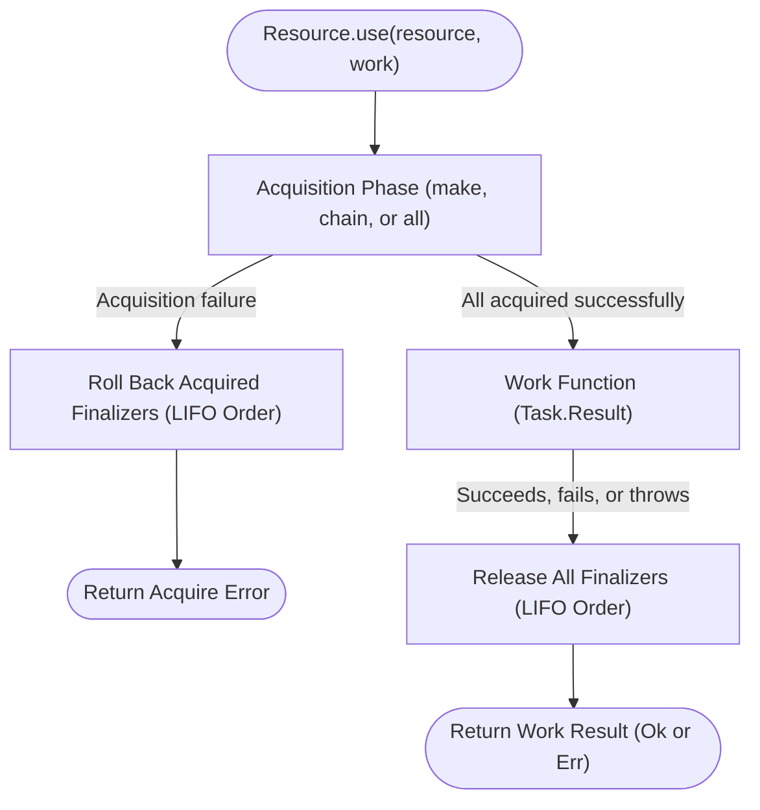

<!-- BUNDLE_SIZE:START -->

> 2.33 kB minified + gzipped (2,325 B)

<!-- BUNDLE_SIZE:END -->

Managing resources like database connections, file handles, or mutex locks requires guaranteeing
that cleanup logic runs even if operations fail or throw runtime errors:

```ts
const connection = await openConnection();
try {
  await runQueries(connection);
} finally {
  await connection.close();
}
```

This works for a single resource within a narrow scope. However, when workflows require multiple
resources — such as a database connection, a distributed lock, and a cache client — nested
`try/finally` blocks quickly become fragile. If the second resource fails to open or an operation
aborts midway, it is easy to leak an already-opened handle or release resources in the wrong order.

`Resource<E, A>` solves this structurally by packaging the potentially fallible `acquire` step (a
`Task.Result<E, A>`) and the infallible `release` step (a `(value: A) => Task<unknown>`) into a
composable lifecycle bracket — an abstraction pairing allocation with guaranteed cleanup:



```ts
type Resource<E, A> = {
  readonly kind: "Resource";
  // Opaque lifecycle bracket executed safely via Resource.use
};
```

By describing *how to open* and *how to close* a resource once, we delegate execution safety to
`Resource.use`, which guarantees that the cleanup step is always executed whenever acquisition
succeeds.

---

## Creating a Resource

We define a resource by supplying the actions to open and close it using `Resource.make`:

```ts
import { pipe } from "@nlozgachev/pipelined/composition";
import { Resource, Task } from "@nlozgachev/pipelined/core";

type DbError = { readonly kind: "DbError"; readonly message: string };

const dbResource = Resource.make(
  Task.Result.tryCatch(
    () => openConnection({ host: "db.local" }),
    { onError: (error): DbError => ({ kind: "DbError", message: `DB connection failed: ${error}` }) },
  ),
  (connection) => Task.tryCatch(() => connection.close(), { onError: () => {} }),
);
```

The release callback receives the exact value produced by the acquisition step. Even if a query
fails midway, `Resource.use` will execute `connection.close()` automatically.

### Resources that cannot fail

If acquiring the resource is guaranteed to succeed — such as acquiring an in-memory lock or starting
a local timer — we can use `Resource.from.Task` to skip error mapping:

```ts
const lockResource = Resource.from.Task(
  Task.from.sync(() => acquireInMemoryLock("process_orders")),
  (lock) => Task.from.sync(() => lock.release()),
);
```

The error parameter defaults to `never` to declare to the compiler that this resource cannot fail
during acquisition.

---

## Running Actions with use

To perform work with our resource, we pass our operational logic to `Resource.use`. The work
function receives the acquired value and returns a `Task.Result`:

```ts
const products = await pipe(
  dbResource,
  Resource.use((connection) =>
    Task.Result.tryCatch(
      () => connection.query("SELECT * FROM products"),
      { onError: (error): DbError => ({ kind: "DbError", message: `Query failed: ${error}` }) },
    )
  ),
)(); // Resolves to Result<DbError, Product[]>
```

Execution proceeds through four steps:

1. `dbResource` executes its `acquire` task. If acquisition fails, execution halts and yields the
   error without invoking `release`.
2. Upon successful acquisition, the active connection is passed to the query function.
3. Whether the query resolves to `Ok`, returns an `Err`, or throws an uncaught exception, the
   `release` finalizer (`connection.close()`) runs immediately.
4. The outcome of the query (`Ok` or `Err`) is returned to the caller.

---

## Transforming Values with map

When we need to transform or project the acquired asset (for example, deriving a repository from a
connection pool or selecting an authenticated sub-client) while preserving guaranteed cleanup of the
original asset, we use `Resource.map`:

```ts
const poolResource = Resource.make(
  Task.Result.tryCatch(
    () => createPool({ maxConnections: 10 }),
    { onError: (error): DbError => ({ kind: "DbError", message: String(error) }) },
  ),
  (pool) => Task.tryCatch(() => pool.drain(), { onError: () => {} }),
);

// Derive a resource that exposes only the repository to callers
const usersRepoResource = pipe(
  poolResource,
  Resource.map((pool) => new UserRepository(pool)),
);
```

The consumer receives `UserRepository` directly in `Resource.use`, while `Resource` retains the
original pool internally to guarantee `pool.drain()` runs when the scope exits.

---

## Dependent Acquisition with chain

When acquiring a second resource depends directly on the value of an earlier resource — such as
opening an SSH tunnel before connecting to a database, or connecting to a database before acquiring
an advisory lock — `Resource.chain` sequences them linearly:

```ts
declare function openSshTunnel(bastion: string): Resource<SshError, SshTunnel>;
declare function connectPostgres(config: { host: string; port: number }): Resource<DbError, PgClient>;
declare function acquireAdvisoryLock(client: PgClient, lockName: string): Resource<LockError, Lock>;

const migrationInfra = pipe(
  openSshTunnel("bastion.prod.internal"),
  Resource.chain((tunnel) =>
    pipe(
      connectPostgres({ host: "127.0.0.1", port: tunnel.localPort }),
      Resource.chain((db) =>
        pipe(
          acquireAdvisoryLock(db, "migrations"),
          Resource.map((lock) => ({ tunnel, db, lock })),
        ),
      ),
    ),
  ),
);
```

### Rollback on partial failure

If acquiring the advisory lock fails with an error:

1. `db` connection pool is immediately closed.
2. `tunnel` is immediately closed.
3. The lock acquisition error propagates to the caller.

When the work function inside `Resource.use` completes, cleanup executes in **strict reverse
(last-in, first-out / LIFO) order**: the advisory lock is released first, the database connection is
closed second, and the SSH tunnel is closed last.

---

## Grouping Multiple Resources with all

When an operation requires multiple distinct, independent resources — such as a database connection,
a Redis cache client, and an S3 storage bucket — `Resource.all` combines them into a single, unified
lifecycle bracket.

### Named record acquisition

```ts
const appInfra = Resource.all({
  db: dbResource,
  redis: redisResource,
  s3: s3BucketResource,
});

const result = await pipe(
  appInfra,
  Resource.use(({ db, redis, s3 }) =>
    runMigrationSuite(db, redis, s3),
  ),
)();
```

`Resource.all` acquires `db`, `redis`, and `s3` sequentially. If `s3` fails to acquire, `redis` and
`db` are immediately released in reverse order. When the migration completes, all three resources
are released in reverse order (`s3`, then `redis`, then `db`).

### Tuple acquisition

`Resource.all` also accepts a tuple of resources:

```ts
const combined = Resource.all([dbResource, cacheResource]);

const result = await pipe(
  combined,
  Resource.use(([connection, cache]) =>
    lookupWithFallback(connection, cache, userId),
  ),
)();
```

When pairing exactly two resources, `Resource.combine(dbResource, cacheResource)` pairs them into a
2-tuple.

---

## Pipeline Composition

Here is an end-to-end audit log export pipeline. It allocates a temporary scratch directory on disk
alongside a read-only database snapshot, dumps log records to a compressed archive, and uploads the
resulting file to cloud storage. Whether queries fail, disk space runs out, or upload times out, the
scratch directory is cleaned up and the database connection is closed in reverse order:

```ts
import { pipe } from "@nlozgachev/pipelined/composition";
import { Resource, Task } from "@nlozgachev/pipelined/core";

type BackupError =
  | { readonly kind: "DbError"; readonly message: string }
  | { readonly kind: "FsError"; readonly message: string }
  | { readonly kind: "UploadError"; readonly message: string };

type TempDir = { readonly path: string };
type DbSnapshot = { readonly query: (sql: string) => Promise<readonly Record<string, unknown>[]> };

declare function openDbSnapshot(databaseUrl: string): Resource<BackupError, DbSnapshot>;
declare function createTempDirectory(prefix: string): Resource<BackupError, TempDir>;
declare function writeArchive(dir: TempDir, data: readonly Record<string, unknown>[]): Promise<string>;
declare function uploadToS3(archivePath: string): Promise<string>;

const backupPipeline = pipe(
  Resource.all({
    db: openDbSnapshot("postgres://primary.internal/app"),
    scratch: createTempDirectory("backup-"),
  }),
  Resource.use(({ db, scratch }) =>
    Task.Result.tryCatch(
      async () => {
        const rows = await db.query("SELECT * FROM audit_logs");
        const archiveFile = await writeArchive(scratch, rows);
        const s3Key = await uploadToS3(archiveFile);
        return { s3Key, rowCount: rows.length };
      },
      { onError: (error): BackupError => ({ kind: "UploadError", message: String(error) }) },
    )
  ),
);
```

---

## Problems it solves

- Vanilla `try/finally` blocks and nested callback pyramids
  (`withConnection(c => withTx(t => ...))`) drift rightward, tangling return values with teardown
  logic. `Resource` turns acquisition and cleanup into first-class values that compose linearly with
  `pipe` and `chain`.
- Partial setup failures frequently leave orphan connections in the background. If service 3 of 4
  fails to open, manual code must track prior handles and unwind them without masking the setup
  error. `Resource.all` and `Resource.chain` guarantee automatic rollback in reverse order upon any
  acquisition failure.
- Dependent infrastructure requires strict reverse teardown. Terminating an SSH bastion tunnel
  before disconnecting an active PostgreSQL client triggers socket errors or hangs. `Resource`
  maintains an internal finalizer stack that guarantees teardown unwinds in exact reverse order of
  acquisition.
- Cleanup runs reliably across every exit path. Whether a computation resolves to `Ok`, returns an
  expected `Err`, throws an unhandled runtime error, or aborts via `AbortSignal`, finalizers execute
  without leaving lingering processes or open sockets.
- Batch tools and scripts often create scratch directories, spawn child processes, or stream file
  handles. `Resource.make` binds allocation directly to disposal, ensuring OS assets are released as
  soon as work leaves scope.
