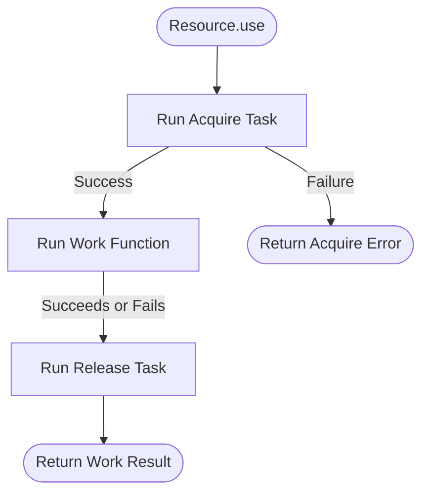

Managing resources like database connections, file handles, or mutex locks requires guaranteeing
that cleanup logic runs even if operations fail or throw runtime errors:

```ts
const connection = await openConnection();
try {
  await runQueries(connection);
} finally {
  await connection.close();
}
```

This works for a single resource within a narrow scope. However, when workflows require multiple
resources — such as a database connection, a distributed lock, and a cache client — nested
`try/finally` blocks quickly become fragile. If the second resource fails to open or an operation
aborts midway, it is easy to leak an already-opened handle or release resources in the wrong order.

`Resource<E, A>` solves this structurally by packaging the potentially fallible `acquire` step (a
`Task.Result<E, A>`) and the infallible `release` step (a `(value: A) => Task<unknown>`) into a
single, composable data structure:



```ts
import { pipe } from "@nlozgachev/pipelined/composition";
import { Resource, Task } from "@nlozgachev/pipelined/core";

export type Resource<E, A> = {
  readonly acquire: Task.Result<E, A>;
  readonly release: (value: A) => Task<unknown>;
};
```

By describing *how to open* and *how to close* a resource once, we delegate the execution safety to
`Resource.use`, which guarantees that the cleanup step is always executed whenever acquisition
succeeds.

---

## Creating a Resource

We define a resource by supplying the actions to open and close it using `Resource.make`:

```ts
import { pipe } from "@nlozgachev/pipelined/composition";
import { Resource, Task } from "@nlozgachev/pipelined/core";

type DbError = { readonly kind: "DbError"; readonly message: string };

const dbResource = Resource.make(
  Task.Result.tryCatch(
    () => openConnection({ host: "db.local" }),
    { onError: (error): DbError => ({ kind: "DbError", message: `DB connection failed: ${error}` }) },
  ),
  (connection) => Task.tryCatch(() => connection.close(), { onError: () => {} }),
);
```

The release callback receives the exact value produced by the acquisition step. Even if a query
fails midway, `Resource.use` will execute `connection.close()` automatically.

### Resources that cannot fail

If acquiring the resource is guaranteed to succeed — such as acquiring an in-memory lock or starting
a local timer — we can use `Resource.from.Task` to skip error mapping:

```ts
const lockResource = Resource.from.Task(
  Task.from.sync(() => acquireInMemoryLock("process_orders")),
  (lock) => Task.from.sync(() => lock.release()),
);
```

The error parameter defaults to `never` to declare to the compiler that this resource cannot fail
during acquisition.

---

## Running Actions with use

To perform work with our resource, we pass our operational logic to `Resource.use`. The work
function receives the acquired value and returns a `Task.Result`:

```ts
const products = await pipe(
  dbResource,
  Resource.use((connection) =>
    Task.Result.tryCatch(
      () => connection.query("SELECT * FROM products"),
      { onError: (error): DbError => ({ kind: "DbError", message: `Query failed: ${error}` }) },
    )
  ),
)(); // Resolves to Result<DbError, Product[]>
```

Let's trace the execution:

1. `dbResource` executes its `acquire` task. If this fails, execution stops and yields the
   acquisition error without calling `release`.
2. If successful, the active connection is passed to the query function.
3. Whether the query succeeds or fails, the `release` task (`connection.close()`) is immediately
   executed.
4. The final result of the query (`Ok` or `Err`) is returned.

---

## Composing Multiple Resources

When an operation requires multiple distinct resources to execute — for instance, a database
connection and a Redis cache client — we can combine them into a single, unified resource.

### Sequential acquisition with `combine`

`Resource.combine` acquires two resources in sequence (`resourceA` first, then `resourceB`) and
presents them as a single resource carrying a `readonly [A, B]` tuple of both values:

```ts
const combinedResource = Resource.combine(dbResource, cacheResource);

const result = await pipe(
  combinedResource,
  Resource.use(([connection, cache]) =>
    Task.Result.tryCatch(
      async () => {
        const cached = await cache.get("profile_123");
        if (cached) return cached;

        const user = await connection.query("SELECT * FROM users WHERE id = 123");
        await cache.set("profile_123", user);
        return user;
      },
      { onError: (error): DbError => ({ kind: "DbError", message: `Lookup failed: ${error}` }) },
    )
  ),
)();
```

When combining resources, the release tasks are executed in **reverse acquisition order**: the cache
is released first, and the database is released second.

If the database is successfully opened but the cache client fails to acquire, `Resource.combine`
immediately releases the database connection and returns the cache acquisition error. Your system is
guaranteed never to leak a connection mid-setup.

### Dependent resource nesting

For workflows where a second resource depends directly on the acquired value of the first (e.g.
initiating a transaction on an active connection), nest `Resource.use` calls:

```ts
const result = await pipe(
  dbResource,
  Resource.use((connection) =>
    pipe(
      transactionResource(connection),
      Resource.use((transaction) =>
        Task.Result.tryCatch(
          () => executeDatabaseWrite(transaction, orderData),
          { onError: (error): DbError => ({ kind: "DbError", message: `Write failed: ${error}` }) },
        )
      ),
    )
  ),
)();
```

The transaction resource will release (commit or roll back) before the database connection is
closed.

---

## Problems it solves

- **Database transaction and connection lifecycle safety**: Acquiring database connections and
  running transactional mutations requires strict cleanup: committing on success and rolling back on
  failure. `Resource` guarantees that release callbacks always execute, preventing orphaned
  connections or locked tables even when errors occur during execution.
- **Temporary files, socket descriptors, and child processes**: Batch workers and CLI tools often
  create scratch directories, open streaming file descriptors, or spawn background child processes.
  `Resource.make` binds allocation with automated cleanup, ensuring external OS assets are disposed
  of as soon as execution leaves scope.
- **Distributed mutex locks and lease coordination**: In concurrent worker clusters where jobs
  require exclusive access to shared resources, acquiring a distributed lock (e.g. via Redis) must
  be paired with guaranteed lock release upon completion or unexpected failure. `Resource`
  encapsulates lease acquisition and release into a clean, safe bracket.
- **Composing interdependent resources in reverse teardown order**: When a workflow requires
  acquiring resource A (a connection pool), resource B (a distributed lock), and resource C (a
  temporary staging file), teardown must occur in exact reverse order (C, then B, then A).
  `Resource` manages nested resource composition and enforces reverse-order cleanup automatically.
