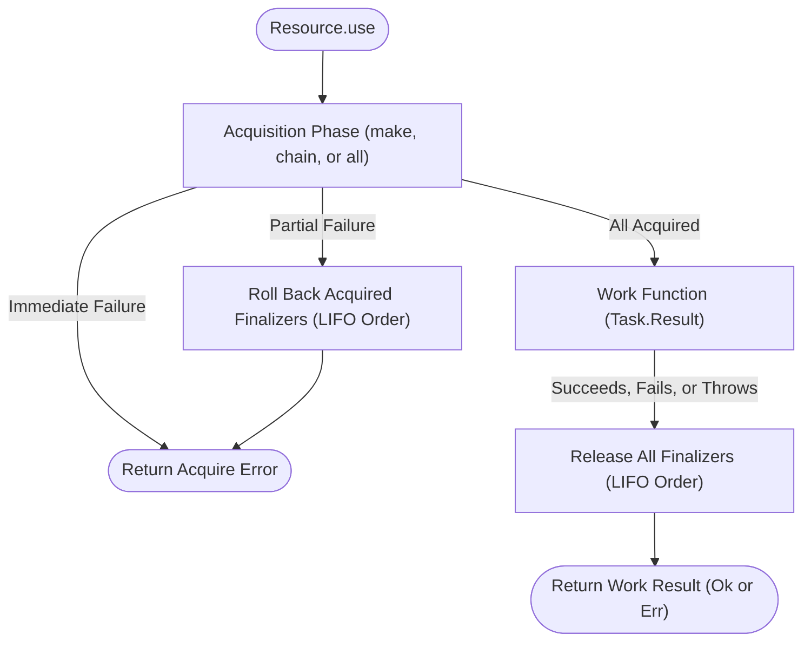

Managing resources like database connections, file handles, or mutex locks requires guaranteeing
that cleanup logic runs even if operations fail or throw runtime errors:

```ts
const connection = await openConnection();
try {
  await runQueries(connection);
} finally {
  await connection.close();
}
```

This works for a single resource within a narrow scope. However, when workflows require multiple
resources — such as a database connection, a distributed lock, and a cache client — nested
`try/finally` blocks quickly become fragile. If the second resource fails to open or an operation
aborts midway, it is easy to leak an already-opened handle or release resources in the wrong order.

`Resource<E, A>` solves this structurally by packaging the potentially fallible `acquire` step (a
`Task.Result<E, A>`) and the infallible `release` step (a `(value: A) => Task<unknown>`) into an
opaque, composable lifecycle bracket:



```ts
type Resource<E, A> = {
  readonly kind: "Resource";
  // Opaque lifecycle bracket executed safely via Resource.use
};
```

By describing *how to open* and *how to close* a resource once, we delegate execution safety to
`Resource.use`, which guarantees that the cleanup step is always executed whenever acquisition
succeeds.

---

## Creating a Resource

We define a resource by supplying the actions to open and close it using `Resource.make`:

```ts
import { pipe } from "@nlozgachev/pipelined/composition";
import { Resource, Task } from "@nlozgachev/pipelined/core";

type DbError = { readonly kind: "DbError"; readonly message: string };

const dbResource = Resource.make(
  Task.Result.tryCatch(
    () => openConnection({ host: "db.local" }),
    { onError: (error): DbError => ({ kind: "DbError", message: `DB connection failed: ${error}` }) },
  ),
  (connection) => Task.tryCatch(() => connection.close(), { onError: () => {} }),
);
```

The release callback receives the exact value produced by the acquisition step. Even if a query
fails midway, `Resource.use` will execute `connection.close()` automatically.

### Resources that cannot fail

If acquiring the resource is guaranteed to succeed — such as acquiring an in-memory lock or starting
a local timer — we can use `Resource.from.Task` to skip error mapping:

```ts
const lockResource = Resource.from.Task(
  Task.from.sync(() => acquireInMemoryLock("process_orders")),
  (lock) => Task.from.sync(() => lock.release()),
);
```

The error parameter defaults to `never` to declare to the compiler that this resource cannot fail
during acquisition.

---

## Running Actions with use

To perform work with our resource, we pass our operational logic to `Resource.use`. The work
function receives the acquired value and returns a `Task.Result`:

```ts
const products = await pipe(
  dbResource,
  Resource.use((connection) =>
    Task.Result.tryCatch(
      () => connection.query("SELECT * FROM products"),
      { onError: (error): DbError => ({ kind: "DbError", message: `Query failed: ${error}` }) },
    )
  ),
)(); // Resolves to Result<DbError, Product[]>
```

Let's trace the execution:

1. `dbResource` executes its `acquire` task. If this fails, execution stops and yields the
   acquisition error without calling `release`.
2. If successful, the active connection is passed to the query function.
3. Whether the query succeeds, returns `Err`, or throws, the `release` finalizer
   (`connection.close()`) is immediately executed.
4. The final result of the query (`Ok` or `Err`) is returned.

---

## Transforming Values with map

When we need to transform or project the acquired asset (for example, deriving a repository from a
connection pool or selecting an authenticated sub-client) while preserving guaranteed cleanup of the
original asset, we use `Resource.map`:

```ts
const poolResource = Resource.make(
  Task.Result.tryCatch(
    () => createPool({ maxConnections: 10 }),
    { onError: (error): DbError => ({ kind: "DbError", message: String(error) }) },
  ),
  (pool) => Task.tryCatch(() => pool.drain(), { onError: () => {} }),
);

// Derive a resource that exposes only the repository to callers
const usersRepoResource = pipe(
  poolResource,
  Resource.map((pool) => new UserRepository(pool)),
);
```

The consumer receives `UserRepository` directly in `Resource.use`, while `Resource` retains the
original pool internally to guarantee `pool.drain()` runs when the scope exits.

---

## Dependent Acquisition with chain

When acquiring a second resource depends directly on the value of an earlier resource — such as
opening an SSH tunnel before connecting to a database, or connecting to a database before acquiring
an advisory lock — `Resource.chain` sequences them linearly:

```ts
declare function openSshTunnel(bastion: string): Resource<SshError, SshTunnel>;
declare function connectPostgres(config: { host: string; port: number }): Resource<DbError, PgClient>;
declare function acquireAdvisoryLock(client: PgClient, lockName: string): Resource<LockError, Lock>;

const migrationInfra = pipe(
  openSshTunnel("bastion.prod.internal"),
  Resource.chain((tunnel) =>
    pipe(
      connectPostgres({ host: "127.0.0.1", port: tunnel.localPort }),
      Resource.chain((db) =>
        pipe(
          acquireAdvisoryLock(db, "migrations"),
          Resource.map((lock) => ({ tunnel, db, lock })),
        ),
      ),
    ),
  ),
);
```

### Rollback on partial failure

If acquiring the advisory lock fails with an error:

1. `db` connection pool is immediately closed.
2. `tunnel` is immediately closed.
3. The lock acquisition error propagates to the caller.

When the work function inside `Resource.use` completes, cleanup executes in **strict reverse (LIFO)
acquisition order**: the advisory lock is released first, the database connection is closed second,
and the SSH tunnel is closed last.

---

## Grouping Multiple Resources with all

When an operation requires multiple distinct, independent resources — such as a database connection,
a Redis cache client, and an S3 storage bucket — `Resource.all` combines them into a single, unified
lifecycle bracket.

### Named record acquisition

```ts
const appInfra = Resource.all({
  db: dbResource,
  redis: redisResource,
  s3: s3BucketResource,
});

const result = await pipe(
  appInfra,
  Resource.use(({ db, redis, s3 }) =>
    runMigrationSuite(db, redis, s3),
  ),
)();
```

`Resource.all` acquires `db`, `redis`, and `s3` sequentially. If `s3` fails to acquire, `redis` and
`db` are immediately released in reverse order. When the migration completes, all three resources
are released in reverse order (`s3`, then `redis`, then `db`).

### Tuple acquisition

`Resource.all` also accepts a tuple of resources:

```ts
const combined = Resource.all([dbResource, cacheResource]);

const result = await pipe(
  combined,
  Resource.use(([connection, cache]) =>
    lookupWithFallback(connection, cache, userId),
  ),
)();
```

For simple binary pairing, `Resource.combine(dbResource, cacheResource)` remains available as an
ergonomic alternative.

---

## Problems it solves

- **Eliminating callback pyramids (`withX` hell) and nested `try/finally` blocks**: Safely managing
  multiple resources in vanilla TypeScript forces developers into deeply nested `try/finally` blocks
  or nested callback wrappers (`withDb(db => withRedis(redis => ...))`). Code drifts rightward into
  a pyramid where error types and return values are tangled. `Resource` turns setup and teardown
  into first-class values that sequence cleanly with `pipe` and `chain`.
- **Automatic rollback on partial setup failure**: When opening multiple services, if service 3 of 4
  fails to acquire, already-acquired services (2 and 1) leak into the Node process unless complex
  manual rollback handlers are maintained. `Resource.all` and `Resource.chain` guarantee immediate,
  automatic rollback in reverse order on any acquisition failure.
- **Enforcing strict reverse (LIFO) teardown order**: Dependent services must be closed in the exact
  reverse order of acquisition (e.g. release advisory lock -> close database connection -> terminate
  SSH tunnel). Reversing the shutdown order manually is error-prone and can trigger connection
  resets or deadlocks. `Resource` manages an internal finalizer stack that guarantees reverse
  teardown order.
- **Reliable teardown across errors, exceptions, and abort signals**: In asynchronous workflows,
  execution can exit via successful completion, typed errors (`Result.Err`), runtime exceptions, or
  cancellation (`AbortSignal`). `Resource.use` binds cleanup to a structured bracket boundary that
  always executes release logic regardless of the exit path.
- **Safe disposal of ephemeral OS handles**: Batch jobs and CLI utilities frequently create
  temporary directories on disk, spawn child processes, or open streaming file descriptors.
  `Resource.make` pairs allocation with guaranteed disposal, ensuring external OS assets are cleaned
  up immediately when execution leaves scope.
