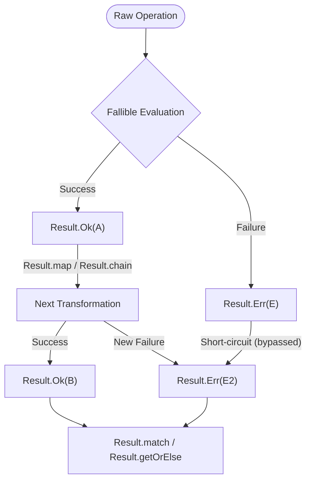

<!-- BUNDLE_SIZE:START -->

> 1.57 kB minified + gzipped (1,569 B)

<!-- BUNDLE_SIZE:END -->

Every function that can fail has two possible outcomes: it succeeds and returns a value, or it fails
and returns an error. Yet, in traditional JavaScript and TypeScript, only the success outcome is
visible in the return type. The failure is thrown out of band as a runtime exception.

## The problem with exceptions

In standard TypeScript, exceptions are invisible to the compiler. A function signature gives no
warning that an operation can fail:

```ts
interface UserConfig {
  port: number;
  host: string;
}

// Signature claims this always returns UserConfig:
function loadConfig(rawJson: string): UserConfig {
  const parsed = JSON.parse(rawJson); // Can throw SyntaxError
  if (typeof parsed.port !== "number" || parsed.port <= 0) {
    throw new Error("Invalid port"); // Throws Error
  }
  return { port: parsed.port, host: parsed.host ?? "localhost" };
}

// Callers have no compiler warning forcing them to catch:
try {
  const config = loadConfig(userInput);
  startServer(config);
} catch (error: unknown) {
  // error is unknown: did JSON parsing fail, or port validation?
  // TypeScript provides zero type narrowing for thrown exceptions.
}
```

This model creates three distinct failure modes:

1. **Invisible failure contracts**: Callers must inspect source code or read documentation to know
   what can throw.
2. **Untyped error handling**: In a `catch (error: unknown)` block, TypeScript loses all error type
   information.
3. **Unhandled crashes**: Any forgot-to-catch exception crashes the entire worker or HTTP request
   cycle.

With `Result`, the possibility of failure becomes part of the return type:

```ts
import { pipe } from "@nlozgachev/pipelined/composition";
import { Result } from "@nlozgachev/pipelined/core";

const loadConfig = (rawJson: string): Result<"INVALID_JSON" | "INVALID_PORT", UserConfig> =>
  pipe(
    Result.tryCatch(
      () => JSON.parse(rawJson) as { port?: unknown; host?: unknown },
      { onError: () => "INVALID_JSON" as const },
    ),
    Result.ensure(
      (data): data is { port: number; host?: string } =>
        typeof data.port === "number" && data.port > 0,
      () => "INVALID_PORT" as const,
    ),
    Result.map((data) => ({
      port: data.port,
      host: typeof data.host === "string" ? data.host : "localhost",
    })),
  );
```

The function signature `Result<"INVALID_JSON" | "INVALID_PORT", UserConfig>` communicates every
failure mode directly to callers. The TypeScript compiler refuses to let callers access `UserConfig`
without handling both error cases.

## The Result approach

`Result<E, A>` represents an operation's outcome as a discriminated union: `Ok<A>` (success holding
a value) or `Err<E>` (failure holding a typed error).



By turning exceptions into a data structure, we can chain operations safely. If any step fails, the
error flows through to the end of the pipeline automatically, while the happy path is skipped. We
decouple the logic of what we want to do from the logic of handling failures.

```ts
import { pipe } from "@nlozgachev/pipelined/composition";
import { Result } from "@nlozgachev/pipelined/core";

export type Result<E, A> = Result.Ok<A> | Result.Err<E>;
```

---

## Creating Results

To work within a typed error pipeline, we wrap our synchronous operations in a `Result` context at
the boundaries of our system.

```ts
import { Result } from "@nlozgachev/pipelined/core";

// Representing a successful outcome
const success = Result.make.ok(42); // Result<never, number>

// Representing a specific failure
const failure = Result.make.err("Connection timed out"); // Result<string, never>
```

### Wrapping throwing code with `tryCatch`

Most JavaScript libraries and built-in runtime APIs (like `JSON.parse` or filesystem operations)
rely on exceptions. `Result.tryCatch` wraps these unsafe, throwing operations and converts them into
a clean `Result`:

```ts
interface SessionPayload {
  userId: string;
}

const parseSession = (raw: string): Result<string, SessionPayload> =>
  Result.tryCatch(
    () => JSON.parse(raw) as SessionPayload,
    { onError: (error) => `Malformed JSON payload: ${error}` },
  );
```

The second argument is a configuration object with an `onError` mapper that intercepts the thrown
exception (which is of type `unknown`) and converts it into your designated error type `E`.

### Constructing from predicates and nullables

When you have a plain value and a condition that determines whether that value is valid,
`Result.from.Predicate` wraps the value into `Result` without requiring an explicit `if/else` block:

```ts
// Boolean condition:
const validateAge = Result.from.Predicate(
  (n: number) => n >= 18,
  (n) => `Age ${n} is below the required threshold of 18`,
);

// Type guard refinement: narrows unknown to string:
const parseString = Result.from.Predicate(
  (val: unknown): val is string => typeof val === "string",
  () => "Expected a string value",
);
```

The second argument receives the original input, allowing you to format descriptive error messages.
When given a custom TypeScript type guard (`(val: A) => val is B`), `Result.from.Predicate`
automatically narrows the inner value from `A` to `B`.

When reading a value that may be `null` or `undefined` (such as an environment variable or header),
`Result.from.nullable` converts non-nullish values to `Ok` and missing values to `Err`:

```ts
const getApiKey = (env: Record<string, string | undefined>): Result<string, string> =>
  pipe(
    env.API_KEY,
    Result.from.nullable(() => "Missing required API_KEY environment variable"),
  );
```

### Inspecting with type guards: `is.ok` and `is.err`

When interfacing with imperative code or test assertions, use `Result.is.ok` and `Result.is.err` to
narrow a `Result` and access `.value` or `.error` directly:

```ts
const parsed = parseSession('{"userId": "usr_42"}');

if (Result.is.ok(parsed)) {
  // Narrowed to Result.Ok<SessionPayload>
  console.log("Active user:", parsed.value.userId);
}

if (Result.is.err(parsed)) {
  // Narrowed to Result.Err<string>
  console.error("Failed to parse session:", parsed.error);
}
```

---

## Transforming values

Once our data is wrapped inside a `Result`, we can describe transformations on both the success and
failure branches independently.

### Transforming success values with `map`

`map` transforms the value inside an `Ok` container, leaving `Err` failures untouched:

```ts
import { pipe } from "@nlozgachev/pipelined/composition";

const double = (n: number) => n * 2;

pipe(Result.make.ok(5), Result.map(double)); // Ok(10)
pipe(Result.make.err("oops"), Result.map(double)); // Err("oops")
```

If you chain multiple `map` steps, they will continue to execute sequentially as long as the
pipeline remains successful. The moment an `Err` is encountered, all subsequent `map` calls are
bypassed:

```ts
const route = pipe(
  parseSession(input),
  Result.map((payload) => payload.userId),
  Result.map((id) => `/users/${id}`),
);
```

### Transforming errors with `mapError`

Sometimes you want to standardize or translate errors before passing them upstream. `mapError`
transforms the error inside an `Err` container, leaving `Ok` success values untouched:

```ts
const apiError = pipe(
  Result.make.err("connection_refused"),
  Result.mapError((code) => ({
    status: 503,
    message: `Database offline: ${code}`,
  })),
); // Err({ status: 503, message: "Database offline: connection_refused" })
```

This is especially valuable at the edge of your systems, allowing you to convert low-level database
or network errors into clean, user-facing error objects.

### Transforming both channels with `bimap`

When an operation requires mapping both the success value and the error value in a single step,
`bimap` accepts two callbacks: the first applies to `Err`, and the second applies to `Ok`:

```ts
type ApiPayload = { userId: string; email: string };
type ApiResponse = { data?: { user: string }; error?: string };

const formatResponse = (result: Result<string, ApiPayload>): ApiResponse =>
  pipe(
    result,
    Result.bimap(
      (err) => ({ error: `Request rejected: ${err}` }),
      (user) => ({ data: { user: user.email.toLowerCase() } }),
    ),
    Result.match({
      err: (errPayload) => errPayload,
      ok: (okPayload) => okPayload,
    }),
  );
```

### Validating success values with `ensure`

Sometimes a value is successfully parsed or retrieved, but fails a subsequent business rule.
`Result.ensure` tests the `Ok` value against a predicate. If the predicate returns `false`, it
converts the container to an `Err` using the provided error constructor:

```ts
interface CartItem {
  id: string;
  quantity: number;
}

// Boolean validation:
const validateStock = (item: CartItem, availableStock: number): Result<string, CartItem> =>
  pipe(
    Result.make.ok(item),
    Result.ensure(
      (i) => i.quantity <= availableStock,
      (i) => `Requested ${i.quantity} units of ${i.id}, but only ${availableStock} in stock`,
    ),
  );

validateStock({ id: "item_9", quantity: 2 }, 5); // Ok({ id: "item_9", quantity: 2 })
validateStock({ id: "item_9", quantity: 10 }, 5); // Err("Requested 10 units of item_9, but only 5 in stock")

// Type guard refinement:
type AdminUser = { id: string; role: "admin"; permissions: string[] };
type AppUser = { id: string; role: "member" } | AdminUser;

const requireAdmin = (user: Result<string, AppUser>): Result<string, AdminUser> =>
  pipe(
    user,
    Result.ensure(
      (u): u is AdminUser => u.role === "admin",
      () => "Admin privileges required",
    ),
  );
```

When given a custom TypeScript type guard (`(value: A) => value is B`), `Result.ensure`
automatically narrows the success type from `A` to `B`.

### Nested pipelines with `chain`

When a transformation step itself can fail and returns another `Result`, using `map` would result in
a nested type: `Result<E, Result<E, A>>`.

To prevent this nesting, we use `chain` to apply the transformation and flatten the context:

```ts
const validateUserExists = (id: string): Result<string, User> =>
  db.has(id) ? Result.make.ok(db.get(id)) : Result.make.err(`User ${id} not found`);

const userProfile = pipe(
  parseSession(input), // Result<string, SessionPayload>
  Result.map((payload) => payload.userId), // Result<string, string>
  Result.chain(validateUserExists), // Result<string, User>
);
```

If `parseSession` fails, the error short-circuits the pipeline immediately. If it succeeds, the
resulting `userId` is passed to `validateUserExists`. If that lookup fails, the new error is
returned. The pipeline reads as a single, linear progression of operations that can each
independently fail.

### Combining independent values with `apply`

When you have a curried function and multiple independent `Result` arguments, `Result.apply`
evaluates and applies them one by one, short-circuiting on the first `Err` encountered:

```ts
const calculateLineTotal = (unitPrice: number) => (quantity: number) => (discount: number) =>
  unitPrice * quantity * (1 - discount);

const lineTotal = pipe(
  Result.make.ok(calculateLineTotal),
  Result.apply(parsePrice(rawPrice)),
  Result.apply(parseQuantity(rawQuantity)),
  Result.apply(parseDiscount(rawDiscount)),
); // Result<string, number>
```

---

## Extracting the value

Eventually, we must unpack our `Result` to interface with the rest of our application.

### Safe defaults with `getOrElse`

`getOrElse` extracts the success value from an `Ok`, or returns a fallback value if we have an
`Err`:

```ts
pipe(
  Result.make.ok(5),
  Result.getOrElse(() => 0),
); // 5

pipe(
  Result.make.err("failed"),
  Result.getOrElse(() => 0),
); // 0
```

`getOrElse` takes a deferred function (a thunk) to construct the fallback. This ensures that
expensive operations, like reading a default value from a config file or instantiating a fallback
cache, are only executed if a failure actually occurred.

### Case analysis with `match`

To perform distinct business logic on both the success and failure branches, use `match`:

```ts
const message = pipe(
  userProfile,
  Result.match({
    ok: (user) => `Welcome back, ${user.name}`,
    err: (error) => `Login failed: ${error}`,
  }),
);
```

---

## Side effects with tap

When you want to perform a side effect — like logging a warning or emitting an analytics event —
without altering the data or breaking the flow, you can use `tap` and `tapError`.

`tap` runs its callback only on a successful `Ok` value:

```ts
pipe(
  userProfile,
  Result.tap((user) => console.log(`User ${user.id} accessed profile`)),
);
```

`tapError` runs its callback only on an `Err` failure:

```ts
pipe(
  userProfile,
  Result.tapError((err) => console.error(`Profile access failed: ${err}`)),
);
```

Both operators always return the original, unaltered `Result` to the next step of the pipeline.

---

## Recovering from errors

When an operation fails, you don't always want to settle for a static default. Often, you want to
attempt an alternative strategy that could also fail. For this, we use `recover`:

```ts
const loadConfig = (path: string): Result<string, Config> =>
  pipe(
    readLocalConfig(path),
    Result.recover((error) => {
      console.warn(`Local config failed: ${error}. Retrying remote...`);
      return fetchRemoteConfig(path);
    }),
  );
```

If the primary read succeeds, the recovery lookup is bypassed. If it fails, the recovery lookup is
tried.

If there are certain fatal errors that you should *never* attempt to recover from, you can use
`recoverUnless`. It takes a predicate to decide whether to let the error propagate without
attempting recovery:

```ts
pipe(
  authenticate(credentials),
  Result.recoverUnless(
    (err) => err === "ACCOUNT_SUSPENDED", // Do not recover if suspended
    () => refreshSession(),
  ),
);
```

---

## Converting to other containers

### Converting to and from Maybe

`Result` and `Maybe` are structurally compatible. The only difference is that `Result` carries a
typed reason for its failure, whereas `Maybe` models the absence of a value.

To discard the error context and convert to a `Maybe`, use `Result.to.Maybe`:

```ts
const maybeValue = Result.to.Maybe(Result.make.ok(42)); // Some(42)
const empty = Result.to.Maybe(Result.make.err("oops")); // None
```

Conversely, if you want to convert a `Maybe` into a `Result`, supply an error thunk via
`Result.from.Maybe` (or `Maybe.to.Result`) to replace `None`:

```ts
import { Maybe } from "@nlozgachev/pipelined/core";

const resultValue = pipe(
  Maybe.make.none(),
  Result.from.Maybe(() => "Value was absent"),
); // Err("Value was absent")
```

### Swapping container contexts: sequence.Maybe

When working with operations that return nested optional results (such as `Result<E, Maybe<A>>`),
`Result.sequence.Maybe` swaps the outer and inner contexts, producing `Maybe<Result<E, A>>`:

```ts
Result.sequence.Maybe(Result.make.ok(Maybe.make.some(42))); // Some(Ok(42))
Result.sequence.Maybe(Result.make.ok(Maybe.make.none())); // None
Result.sequence.Maybe(Result.make.err("DB error")); // Some(Err("DB error"))
```

### Converting to and from Validation

While `Result` is designed for fail-fast error propagation, `Validation` accumulates all errors
across independent fields. Convert between the two representations using `Result.from.Validation`
and `Result.to.Validation`:

```ts
import { Validation } from "@nlozgachev/pipelined/core";

// Convert error-accumulating Validation into a fail-fast Result with a combined error string:
const failFastResult = pipe(
  validationOutcome,
  Result.from.Validation((errors) => errors.join("; ")),
);

// Convert a fail-fast Result into a Validation container:
const validation = Result.to.Validation(Result.make.err("invalid_id")); // Failed(["invalid_id"])
```

---

## Accumulating values: assign / assignTo

When you need to perform multiple sequential operations and gather their results into a single
object, traditional pipelines can become deeply nested because each successive function needs access
to previous results:

```ts
const userProfile = pipe(
  getUser(userId),
  Result.chain((user) =>
    pipe(
      getPreferences(user.id),
      Result.map((prefs) => ({ user, prefs })),
    )
  ),
  Result.chain(({ user, prefs }) =>
    pipe(
      getTheme(prefs.themeId),
      Result.map((theme) => ({ user, prefs, theme })),
    )
  ),
);
```

To solve this, we can use `assignTo` and `assign` to cleanly accumulate values key-by-key in a flat,
readable pipeline.

`assignTo` wraps a value into the pipeline's accumulator object:

```ts
pipe(
  Result.make.ok(42),
  Result.assignTo("value"),
); // Ok({ value: 42 })
```

`assign` runs a new operation using the accumulated object and attaches the result to a new key:

```ts
const userProfile = pipe(
  getUser(userId),
  Result.assignTo("user"),
  Result.assign("prefs", ({ user }) => getPreferences(user.id)),
  Result.assign("theme", ({ prefs }) => getTheme(prefs.themeId)),
); // Ok({ user: User, prefs: Preferences, theme: Theme })
```

If any step fails, the entire pipeline short-circuits and propagates the failure immediately.

---

## Combining records: struct

While `assign` is ideal for sequential steps where a later step depends on the output of a prior
step, sometimes you have a set of independent `Result`s that you want to combine into a single
object. For this, you can use `Result.struct`.

It combines a record of `Result`s into a single `Result` holding a record of success values. If any
individual field is an `Err`, the entire struct short-circuits to that error immediately:

```ts
const user = Result.struct({
  name: Result.make.ok("Alice"),
  age: Result.make.ok(30),
  role: Result.from.Predicate(
    (r: string) => r === "admin" || r === "user",
    () => "Invalid role",
  )("user"),
}); // Ok({ name: "Alice", age: 30, role: "user" })
```

If multiple fields fail, `Result.struct` short-circuits and returns the first error encountered in
key order:

```ts
const serviceConfig = Result.struct({
  host: Result.make.ok("db.internal"),
  port: Result.make.err("Invalid port number"),
  apiKey: Result.make.err("Missing API key"),
}); // Err("Invalid port number")
```

---

## Pipeline composition

Here is an end-to-end checkout authorization pipeline that parses a raw request payload, validates
inventory and spending limits, logs errors for observability, and formats an HTTP response:

```ts
interface CheckoutPayload {
  sku: string;
  quantity: number;
  unitPrice: number;
}

const processOrder = (rawBody: string, availableStock: number): { status: number; body: string } =>
  pipe(
    Result.tryCatch(
      () => JSON.parse(rawBody) as CheckoutPayload,
      { onError: () => "INVALID_JSON" as const },
    ),
    Result.ensure(
      (order) => order.quantity > 0 && order.quantity <= availableStock,
      () => "INSUFFICIENT_STOCK" as const,
    ),
    Result.map((order) => ({
      ...order,
      total: order.quantity * order.unitPrice,
    })),
    Result.ensure(
      (order) => order.total <= 10_000,
      () => "LIMIT_EXCEEDED" as const,
    ),
    Result.tapError((code) => console.warn(`Order rejected: ${code}`)),
    Result.match({
      ok: (order) => ({ status: 200, body: `Confirmed ${order.quantity}x ${order.sku} (USD ${order.total})` }),
      err: (code) => ({ status: 400, body: `Order failed: ${code}` }),
    }),
  );
```

---

## Problems it solves

- **Domain service error modeling**: In workflows such as user authentication, checkout processing,
  or inventory allocation, business failures (like expired sessions, insufficient balance, or
  duplicate registrations) are expected application outcomes. `Result` models every failure as an
  explicit, typed data variant, requiring callers to handle specific failure modes without relying
  on untyped `catch` blocks.
- **Untyped exception containment at system boundaries**: Third-party packages, system calls, and
  external parsers often throw untyped runtime exceptions that bubble up unexpectedly. Wrapping
  these boundaries with `Result.tryCatch` captures runtime exceptions immediately, converting them
  into typed, inspectable values before they enter application logic.
- **Sequential fallible pipelines**: Coordinating a sequence of operations — such as reading
  configuration text, parsing JSON, validating schema constraints, and generating credentials —
  requires each step to succeed before running the next. `Result` composes these steps linearly via
  `pipe` and `Result.chain`, short-circuiting automatically on the first failure while preserving
  type safety across all intermediate values.
- **Error normalization across subsystem boundaries (`Result.mapError`)**: In complex features that
  touch the network, database drivers, and disk storage, each subsystem produces distinct error
  types. `Result.mapError` translates low-level transport errors into a cohesive domain error union
  at the boundary, ensuring internal business logic deals only with relevant application errors.
- **Combining multiple fallible steps (`Result.struct`)**: When bootstrapping a service that
  requires multiple independent config entries (such as database port, API key, and host URL),
  `Result.struct` combines individual `Result` values into a verified configuration record,
  succeeding only if all keys resolve and short-circuiting on the first bad value.
