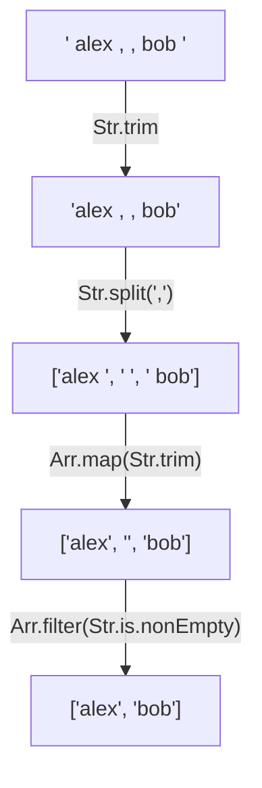

<!-- BUNDLE_SIZE:START -->

> 2.20 kB minified + gzipped

<!-- BUNDLE_SIZE:END -->

Strings are the primary medium for untrusted data entering an application. Whether you are parsing
HTTP headers, processing CSV uploads, or sanitizing user-submitted form fields, raw text requires
constant validation and formatting.

In standard JavaScript, the `String` prototype offers plenty of methods, but using them in data
pipelines introduces three recurring problems:

1. **Prototype methods are data-first**: Because `.trim()`, `.replace()`, and `.slice()` are called
   on the string instance, mixing them with standalone validators or array combinators inside `pipe`
   forces you to wrap every step in an inline arrow function (`s => s.trim()`).
2. **Unsafe numeric parsing**: Built-in functions like `Number.parseInt()` and `Number.parseFloat()`
   return `NaN` when given malformed text, which silently propagates through calculations as a valid
   `number` type.
3. **Stateful regular expressions and UTF-16 length traps**: Global `/g` regular expressions mutate
   their internal `lastIndex` cursor between calls, causing intermittent match failures, while
   `.length` counts UTF-16 code units rather than visible characters, miscounting emojis and
   international text.

```ts
function parseTags(rawInput: string): string[] {
  return rawInput
    .trim()
    .split(",")
    .map((tag) => tag.trim())
    .filter((tag) => tag.length > 0)
    .map((tag) => tag.toLowerCase());
}
```

The moment you need to insert a custom validation step or convert types mid-chain, prototype
chaining breaks down into temporary variables. `Str` solves this by providing pure, curried,
**data-last** string operations alongside safe `Maybe`-returning parsers and stateless regex
combinators.



---

## Checking Emptiness and Blank Strings

When validating form inputs or filtering parsed tokens, you often need to distinguish between a
string with zero characters and a string that contains only whitespace. `Str.is` provides three
predicates:

- `Str.is.empty`: Returns `true` when `text.length === 0`.
- `Str.is.nonEmpty`: Type guard that returns `true` when `text.length > 0`, narrowing the type to
  `Str.NonEmpty`.
- `Str.is.blank`: Returns `true` when the string is empty or consists exclusively of whitespace
  characters (`"   \t\n"`).

```ts
import { pipe } from "@nlozgachev/pipelined/composition";
import { Maybe } from "@nlozgachev/pipelined/core";
import { Arr, Str } from "@nlozgachev/pipelined/data";

Str.is.empty("");     // true
Str.is.empty("   ");  // false (contains whitespace characters)
Str.is.blank("   ");  // true (whitespace-only is considered blank)
Str.is.blank("sku1"); // false

const submittedNotes = ["Order confirmed", "", "   ", "Ship via express"];
const meaningfulNotes = pipe(
  submittedNotes,
  Arr.filter((note) => !Str.is.blank(note)),
); // ["Order confirmed", "Ship via express"]
```

When a function requires a compile-time guarantee that a string is not empty, use the branded
`Str.NonEmpty` type. You can refine any `string` into `Maybe<Str.NonEmpty>` using
`Str.NonEmpty.from.string`, or narrow it in place with `Str.is.nonEmpty`:

```ts
const apiKey = Str.NonEmpty.from.string("sk_live_98a7f6"); // Some(Str.NonEmpty)
const missingKey = Str.NonEmpty.from.string("");           // None
```

---

## Transforming Case and Cleaning Input

Basic formatting operations are curried and data-last, allowing you to pass them directly to `pipe`
or `Arr.map` without inline lambdas. Alongside `Str.toUpperCase` and `Str.toLowerCase`,
`Str.capitalize` uppercases only the first character while `Str.uncapitalize` lowercases only the
first character (useful when converting `PascalCase` identifiers to `camelCase`):

```ts
pipe("  support@example.com  ", Str.trim); // "support@example.com"

pipe("inv-2026", Str.toUpperCase);         // "INV-2026"
pipe(" TENTH_FLOOR ", Str.trim, Str.toLowerCase); // "tenth_floor"

pipe("pending approval", Str.capitalize);  // "Pending approval"
pipe("UserProfileId", Str.uncapitalize);   // "userProfileId"
```

---

## Slicing, Padding, and Truncating

To extract substrings, align fixed-width columns, or shorten long descriptions for UI previews,
`Str` provides data-last wrappers for `slice`, `padStart`, `padEnd`, and `truncate`:

```ts
// Extract a substring between start and optional end indices:
pipe("ORD-2026-9941", Str.slice(4, 8)); // "2026"
pipe("ORD-2026-9941", Str.slice(9));    // "9941"

// Pad strings to a target width for invoice numbers or console tables:
pipe("42", Str.padStart(6, "0"));      // "000042"
pipe("Subtotal", Str.padEnd(12, ".")); // "Subtotal...."
```

When displaying previews or summaries in notifications and tables, `Str.truncate` caps a string at a
maximum `length` (including the suffix) and appends `"..."` or a custom `suffix` only when the text
actually exceeds the limit:

```ts
const commitMessage = "Refactor payment settlement retry policy for webhook timeouts";

pipe(commitMessage, Str.truncate({ length: 28 }));
// "Refactor payment settleme..."

pipe(commitMessage, Str.truncate({ length: 28, suffix: "…" }));
// "Refactor payment settlement…"

pipe("Short note", Str.truncate({ length: 28 }));
// "Short note" (unchanged when within limit)
```

---

## Measuring Length: `size` and `graphemeSize`

JavaScript's native `String.prototype.length` counts UTF-16 code units rather than human-perceived
characters. Multi-byte characters such as emojis, accented letters composed of combining marks, or
zero-width joiner sequences report unexpected lengths (`"👋".length === 2` and
`"👨‍👩‍👧‍👦".length === 11`).

`Str.size` returns the fast UTF-16 code-unit length for byte-level checks, while `Str.graphemeSize`
uses `Intl.Segmenter` to count actual user-perceived characters (grapheme clusters):

```ts
// Fast UTF-16 code-unit length:
Str.size("hello"); // 5
Str.size("👋");    // 2

// User-perceived character (grapheme) count:
Str.graphemeSize("hello");  // 5
Str.graphemeSize("👋");     // 1
Str.graphemeSize("👨‍👩‍👧‍👦"); // 1
```

---

## Splitting and Segmenting Text

Standard JavaScript `.split()` handles mixed line endings and repeated spaces awkwardly. Alongside
curried `Str.split`, `Str.lines` normalizes `\n`, `\r\n`, and `\r` line breaks across operating
systems, and `Str.words` splits text on any whitespace boundary while automatically discarding empty
tokens:

```ts
pipe("read,write,admin", Str.split(","));
// ["read", "write", "admin"]

const rawLog = "INFO: Booting\r\nWARN: Cache miss\nERROR: Timeout";
Str.lines(rawLog);
// ["INFO: Booting", "WARN: Cache miss", "ERROR: Timeout"]

const searchQuery = "   wireless   mechanical   keyboard  ";
Str.words(searchQuery);
// ["wireless", "mechanical", "keyboard"]
```

---

## Replacing Text

`Str.replace` and `Str.replaceAll` accept the search pattern (`string` or `RegExp`) and replacement
string first, leaving the target text for last:

```ts
const hostTemplate = "db-primary.internal.local";

// Replace the first occurrence:
pipe(hostTemplate, Str.replace("primary", "replica"));
// "db-replica.internal.local"

// Replace every occurrence of a string or pattern:
pipe("4111-1111-2222-3333", Str.replaceAll(/\d(?=\d{4})/g, "*"));
// "****-****-****-3333"
```

---

## Substring Predicates: `startsWith`, `endsWith`, and `includes`

String matching functions in `Str` are curried predicates that slot directly into `Arr.filter` or
`Maybe.filter`:

```ts
const routes = [
  "/api/v1/users",
  "/api/v1/orders.json",
  "/healthz",
  "/api/v2/billing.json",
];

// Filter routes by prefix, suffix, or substring:
const apiRoutes = pipe(routes, Arr.filter(Str.startsWith("/api/")));
// ["/api/v1/users", "/api/v1/orders.json", "/api/v2/billing.json"]

const jsonEndpoints = pipe(routes, Arr.filter(Str.endsWith(".json")));
// ["/api/v1/orders.json", "/api/v2/billing.json"]

const v1Endpoints = pipe(routes, Arr.filter(Str.includes("/v1/")));
// ["/api/v1/users", "/api/v1/orders.json"]
```

---

## Pattern Matching with Regular Expressions

Native `RegExp` instances configured with global (`/g`) or sticky (`/y`) flags mutate their internal
`lastIndex` property on every `.test()` or `.exec()` call, causing the exact same regex check to
alternate between `true` and `false` across consecutive calls.

`Str.match` and `Str.test` reset `pattern.lastIndex = 0` before every execution, making regular
expression checks completely stateless and repeatable.

`Str.match` returns `Some<RegExpMatchArray>` when the pattern matches, or `None` when it does not:

```ts
const releaseTag = "release-v2.4.1";

const majorVersion = pipe(
  releaseTag,
  Str.match(/v(\d+)\.(\d+)\.(\d+)/),
  Maybe.map((groups) => groups[1]),
  Maybe.getOrElse(() => "0"),
); // "2"
```

`Str.test` returns a boolean and works directly as a reusable validation predicate:

```ts
const isValidSlug = Str.test(/^[a-z0-9]+(?:-[a-z0-9]+)*$/);

isValidSlug("functional-typescript"); // true
isValidSlug("Invalid Slug!");         // false
```

---

## Safe Numeric Parsing

To parse numeric text without letting `NaN` slip into calculations, `Str.parse.int` and
`Str.parse.float` return `Maybe<number>`, returning `None` whenever the string is empty or cannot be
parsed:

```ts
// Base-10 integer parsing:
Str.parse.int("42");  // Some(42)
Str.parse.int("3.7"); // Some(3)
Str.parse.int("abc"); // None

// Floating-point parsing:
Str.parse.float("19.95"); // Some(19.95)
Str.parse.float("N/A");   // None

const pageLimit = pipe(
  "invalid_limit",
  Str.parse.int,
  Maybe.getOrElse(() => 25),
); // 25
```

---

## Pipeline Composition

By combining `Str` and `Arr`, you can express multi-stage text normalization and extraction
workflows as a single linear pipeline:

```ts
import { pipe } from "@nlozgachev/pipelined/composition";
import { Arr, Str } from "@nlozgachev/pipelined/data";

const rawCsvColumn = `
  SKU-1042: Active
  # deprecated entry

  sku-2088: Pending Review — awaiting warehouse confirmation
  SKU-3091: Active
`;

const formattedLabels = pipe(
  rawCsvColumn,
  Str.lines,
  Arr.map(Str.trim),
  Arr.filter(Str.is.nonEmpty),
  Arr.filter((line) => !Str.startsWith("#")(line)),
  Arr.map(Str.toUpperCase),
  Arr.map(Str.truncate({ length: 24, suffix: "..." })),
);
// [
//   "SKU-1042: ACTIVE",
//   "SKU-2088: PENDING REV...",
//   "SKU-3091: ACTIVE"
// ]
```

---

## Problems it solves

- **Form input sanitization in data pipelines**: When cleaning user input (such as trimming
  whitespace, normalizing casing, padding identifiers, or truncating descriptions), native string
  methods require writing manual arrow wrappers inside `pipe`. `Str` provides curried, data-last
  combinators (`Str.trim`, `Str.toLowerCase`, `Str.capitalize`, `Str.uncapitalize`, `Str.slice`,
  `Str.padStart`, `Str.padEnd`, `Str.truncate`) that chain directly.
- **Accurate character and grapheme counting (`Str.size`, `Str.graphemeSize`)**: In
  internationalized applications or user interfaces with character counters, native `.length`
  miscounts surrogate pairs and compound emojis. `Str.graphemeSize` counts actual user-perceived
  glyphs via `Intl.Segmenter`, while `Str.size` provides a uniform data-last UTF-16 code-unit
  accessor.
- **Stateless regular expression matching without pointer bugs**: Native `RegExp` flags (`/g`, `/y`)
  maintain internal `lastIndex` pointer offsets that cause successive checks to fail intermittently.
  `Str.match` and `Str.test` reset state to index zero on every execution, guaranteeing idempotent,
  side-effect-free pattern matching.
- **Safe numeric string conversion**: Parsing numbers from HTTP parameters or form text with
  `Number()` or `parseInt()` yields `NaN` on invalid input without static compiler warnings.
  `Str.parse.int` and `Str.parse.float` return `Maybe<number>`, ensuring non-numeric inputs are
  handled safely before doing math.
- **Compile-time non-empty string branding (`Str.NonEmpty`, `Str.is.nonEmpty`)**: Validating at API
  boundaries that required text fields (like API keys or resource IDs) are not empty and preserving
  that guarantee in the type system via `Str.NonEmpty.from.string` and `Str.is.nonEmpty`.
- **Named string predicates in array pipelines**: Filtering arrays of strings with named predicates
  (`Str.is.empty`, `Str.is.nonEmpty`, `Str.is.blank`, `Str.startsWith`, `Str.endsWith`,
  `Str.includes`) without writing inline lambda wrappers.
- **Cross-platform multi-line and token text parsing**: Splitting text into lines or words often
  breaks on mixed CRLF/LF line endings or multiple consecutive whitespace characters. `Str.lines`
  and `Str.words` handle cross-platform line breaks and variable spacing automatically.
