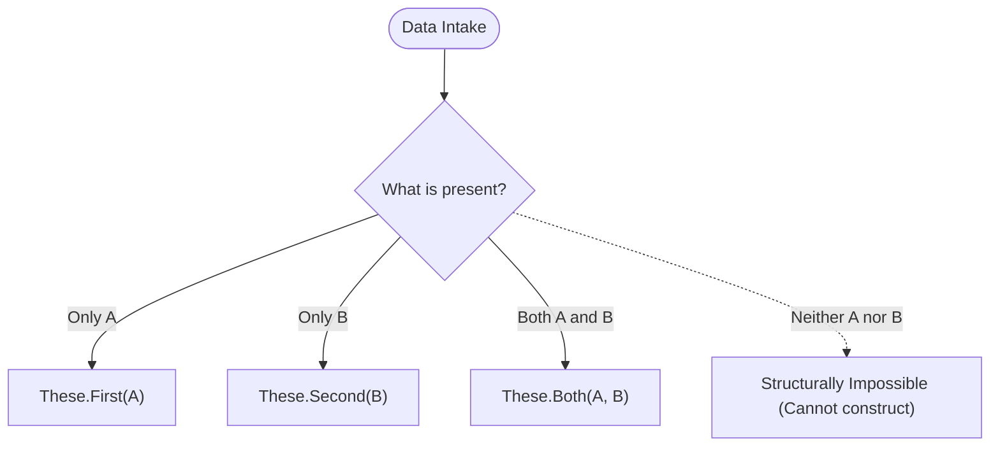

<!-- BUNDLE_SIZE:START -->

> 1.99 kB minified + gzipped

<!-- BUNDLE_SIZE:END -->

TypeScript models exclusive-OR states with discriminated unions (`A | B`) and paired states with
objects (`{ a: A; b: B }`). However, operations like data synchronization, diff engines, and
non-fatal warnings require modeling inclusive-OR states: having a first value, a second value, or
both simultaneously.

`These<A, B>` represents inclusive-OR as a discriminated union of three variants: `First<A>`,
`Second<B>`, and `Both<A, B>`:

- `First(a)` — only the first value is present.
- `Second(b)` — only the second value is present.
- `Both(a, b)` — both the first and second values are present.



`These` is a neutral, structural domain-modeling type. It does not carry any success, failure, or
implicit error connotations. Neither side is privileged.

```ts
import { pipe, These } from "@pplnd/core";

export type These<A, B> = These.First<A> | These.Second<B> | These.Both<A, B>;
```

---

## Structural Modeling: Domain Examples

### 1. Contact Information

Suppose you are designing a notification service that requires contact details. A user can register
their email address `A`, their phone number `B`, or both `Both(A, B)`. Representing this with
standard union types or optional fields is fragile because it permits the invalid state of having
neither.

With `These`, the type system enforces that at least one contact channel is present:

```ts
import { These } from "@pplnd/core";

type ContactDetails = These<EmailAddress, PhoneNumber>;

const emailOnly = These.make.first(email); // Email only
const phoneOnly = These.make.second(phone); // Phone only
const both = These.make.both(email, phone); // Both channels available
```

### 2. Local and Remote Synchronization

Suppose you are building a database synchronizer that reconciles local and remote changes. When
comparing records, three outcomes are structurally possible:

- Only local changes exist: `First(local)`
- Only remote changes exist: `Second(remote)`
- Both local and remote changes exist and must be merged: `Both(local, remote)`

```ts
interface UserRecord {
  id: string;
  name: string;
}

const reconcile = (
  local: UserRecord | null,
  remote: UserRecord | null,
): These<UserRecord, UserRecord> => {
  if (local && !remote) return These.make.first(local);
  if (!local && remote) return These.make.second(remote);
  if (local && remote) return These.make.both(local, remote);
  throw new Error("Cannot reconcile when both sources are empty");
};
```

---

## Transforming Values

Because `These` carries two distinct type parameters, we can map over either or both sides
independently.

### Mapping the first side with `mapFirst`

`mapFirst` transforms the value inside a `First` or a `Both` container, leaving `Second` entirely
untouched:

```ts
import { pipe } from "@pplnd/core";

const formatEmail = (email: EmailAddress) => email.toLowerCase();

pipe(These.make.first(email), These.mapFirst(formatEmail)); // First(formattedEmail)
pipe(These.make.both(email, phone), These.mapFirst(formatEmail)); // Both(formattedEmail, phone)
pipe(These.make.second(phone), These.mapFirst(formatEmail)); // Second(phone)
```

### Mapping the second side with `mapSecond`

`mapSecond` transforms the value inside a `Second` or a `Both` container, leaving `First` untouched:

```ts
const formatPhone = (phone: PhoneNumber) => phone.trim();

pipe(These.make.second(phone), These.mapSecond(formatPhone)); // Second(formattedPhone)
pipe(These.make.both(email, phone), These.mapSecond(formatPhone)); // Both(email, formattedPhone)
```

### Mapping both sides with `mapBoth`

`mapBoth` allows you to transform both paths simultaneously:

```ts
pipe(
  These.make.both(email, phone),
  These.mapBoth(formatEmail, formatPhone),
); // Both(formattedEmail, formattedPhone)
```

---

## Chaining Transformations

Chaining operations over a `These` requires careful attention to what should happen to coexisting
values.

`chainFirst` passes the first value to the next step, leaving `Second` unchanged. When the input is
a `Both` variant, the coexisting second value is replaced by whatever the next step returns:

```ts
const lookupEmailMetaData = (email: string): These<EmailMeta, PhoneNumber> =>
  These.make.first(fetchMetadata(email));

pipe(
  These.make.both("alice@example.com", "+15550199"),
  These.chainFirst(lookupEmailMetaData),
); // First(EmailMeta) — phone number is discarded
```

If you need both coexisting values to be preserved without replacement, transform them using
`mapFirst`, `mapSecond`, or `mapBoth` rather than `chainFirst` or `chainSecond`.

`chainSecond` performs the symmetric operation, chaining over the second value while leaving `First`
unchanged:

```ts
const validatePhoneCarrier = (phone: string): These<EmailAddress, PhoneMeta> =>
  These.make.second({ number: phone, carrier: "Verizon" });

pipe(
  These.make.second("+15550199"),
  These.chainSecond(validatePhoneCarrier),
); // Second({ number: "+15550199", carrier: "Verizon" })
```

---

## Extracting Values

When you reach the boundary of your pipeline, you must unpack `These` into standard TypeScript
primitives.

### Exhaustive matching with `match`

`match` requires you to handle all three possible variants explicitly, ensuring that coexisting
values are never accidentally lost:

```ts
const notificationTarget = pipe(
  contactDetails,
  These.match({
    first: (email) => `Send email to ${email}`,
    second: (phone) => `Send SMS to ${phone}`,
    both: (email, phone) => `Send email to ${email} and SMS to ${phone}`,
  }),
);
```

### Safe fallbacks with `getFirstOrElse` and `getSecondOrElse`

If you only want to extract one side of the container and provide a fallback if it is absent:

```ts
// Extract the email (available in First or Both), or fallback
pipe(These.make.second(phone), These.getFirstOrElse(() => defaultEmail)); // defaultEmail

// Extract the phone (available in Second or Both), or fallback
pipe(These.make.first(email), These.getSecondOrElse(() => defaultPhone)); // defaultPhone
```

---

## Direct Inspection: Type Guards

To check which variant is active without unpacking the full structure, `These` provides several type
guards:

```ts
These.is.first(value); // true if First only
These.is.second(value); // true if Second only
These.is.both(value); // true if Both

These.hasFirst(value); // true if First or Both
These.hasSecond(value); // true if Second or Both
```

---

## Utilities

### Flipping roles: swap

`swap` reverses the first and second values of the container:

```ts
These.swap(These.make.first(email)); // Second(email)
These.swap(These.make.both(email, phone)); // Both(phone, email)
```

### Side-effects: tapFirst, tapSecond, tapBoth

When you need to execute a logging or telemetry side-effect without modifying the data in flight,
`These` provides three dedicated tap combinators matching its three structural scenarios:

- `tapFirst`: Runs a callback on the first value if present (`First` or `Both`).
- `tapSecond`: Runs a callback on the second value if present (`Second` or `Both`).
- `tapBoth`: Runs a binary callback only when both values coexist simultaneously (`Both`).

```ts
pipe(
  These.make.both(email, phone),
  These.tapFirst((e) => console.log(`Sending system check to email: ${e}`)),
  These.tapSecond((p) => console.log(`Registering SMS fallback: ${p}`)),
  These.tapBoth((e, p) => console.log(`Verified dual-channel user: ${e} / ${p}`)),
);
```

---

## Interoperability with Pair: to.Pair and from.Pair

`These` integrates directly with `Pair<A, B>` when both values coexist.

Use `These.to.Pair` to convert a `These` into a `Maybe<Pair<A, B>>`. If the value is `Both(a, b)`,
it resolves to `Some([a, b])`; if only `First` or only `Second` is present, it resolves to `None`:

```ts
import { Pair } from "@pplnd/core";

const maybePair = These.to.Pair(These.make.both("Paris", 2_161_000));
// Some(["Paris", 2161000])

const nonePair = These.to.Pair(These.make.first("Paris"));
// None
```

Conversely, if you already have a `Pair<A, B>` (or a native two-element tuple `readonly [A, B]`),
`These.from.Pair` lifts it directly into a `These.Both`:

```ts
const coordinates = Pair.make(48.8566, 2.3522);
const dualEntry = These.from.Pair(coordinates);
// Both(48.8566, 2.3522)
```

---

## Pipeline composition

Here is a lenient configuration parser that parses a raw concurrency setting while preserving
non-fatal deprecation warnings alongside the parsed value:

```ts
const parseConcurrencySetting = (raw: string): These<number, string> => {
  const trimmed = raw.trim();
  const parsed = Number.parseInt(trimmed, 10);
  if (Number.isNaN(parsed) || parsed <= 0) {
    return These.make.second(`Invalid concurrency "${raw}"; must be a positive integer`);
  }
  if (parsed > 32) {
    return These.make.both(32, `Concurrency ${parsed} exceeds max pool size; clamped to 32`);
  }
  return These.make.first(parsed);
};

const summary = pipe(
  parseConcurrencySetting(" 64 "),
  These.mapFirst((workers) => ({ workers })),
  These.mapSecond((warning) => `[Config Warning] ${warning}`),
  These.tapFirst(({ workers }) => console.info(`Initialized pool with ${workers} workers`)),
  These.match({
    first: ({ workers }) => `Pool ready (${workers} workers)`,
    second: (error) => `Pool startup failed: ${error}`,
    both: ({ workers }, warning) => `Pool ready (${workers} workers) — ${warning}`,
  }),
);
// "Pool ready (32 workers) — [Config Warning] Concurrency 64 exceeds max pool size; clamped to 32"
```

---

## Problems it solves

- **Two-way offline and remote synchronization**: When synchronizing records between local offline
  stores (such as SQLite or IndexedDB) and a remote server, changes may exist exclusively locally
  (new offline drafts), exclusively remotely (cloud updates), or concurrently on both sides (merge
  conflicts). `These` models inclusive three-way states (`First`, `Second`, `Both`) without
  ambiguous nullable flags.
- **Partial success with non-fatal warnings**: In batch processing and API transformations, an
  operation often successfully parses a payload while also encountering non-fatal warnings or
  recoverable format issues. `These` allows functions to return both the valid payload and the
  collected warnings, avoiding the need to either fail the entire operation or discard diagnostic
  details.
- **Reconciling diff patches with custom strategies**: When calculating database differences between
  two snapshot versions, `These.match` handles additions (`First`), deletions (`Second`), and
  modifications (`Both`) with clean, case-specific logic.
- **Multi-channel communication delivery**: In notification systems where alerts can be dispatched
  via Email, SMS, or both channels simultaneously, `These` models valid communication options and
  tracks per-channel delivery statuses cleanly.
