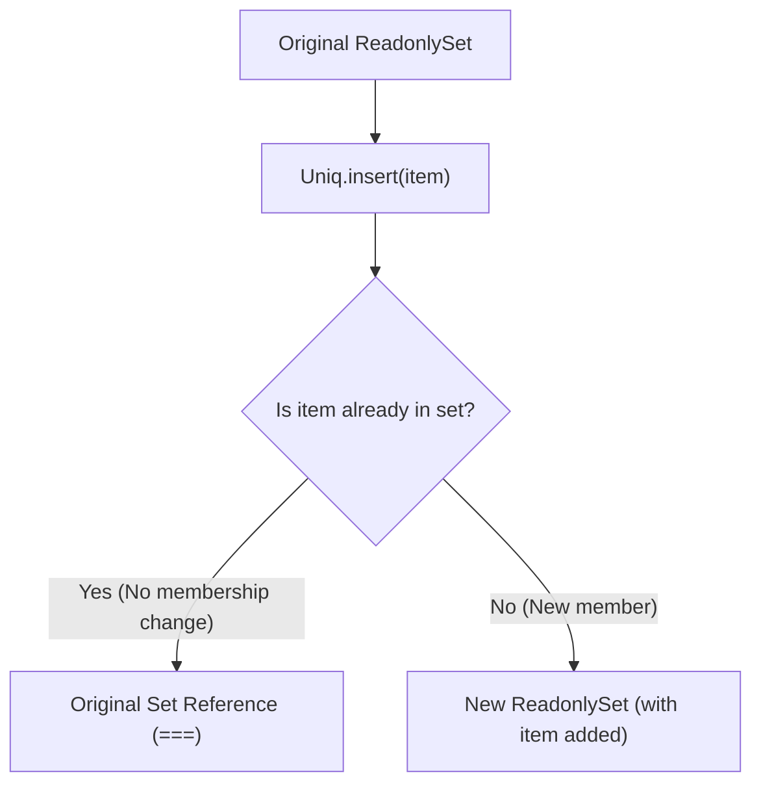

{/* BUNDLE_SIZE:START */}

> 2.04 kB minified + gzipped

{/* BUNDLE_SIZE:END */}

import { Aside } from '@astrojs/starlight/components'

JavaScript's native `Set` is the standard data structure for storing unique values and performing
O(1) membership checks. However, using native `Set` instances in TypeScript pipelines and
state management introduces two recurring pitfalls:

1. **In-place mutation**: Calling `.add()` or `.delete()` mutates the `Set` directly. If you forget
   to clone the set (`new Set(existing)`) before modifying it, you silently mutate shared state
   across function boundaries and break reference-equality checks in UI frameworks.
2. **No pipeline combinators**: Native `Set` lacks `.map()`, `.filter()`, and `.reduce()`, forcing
   you to spread sets into temporary arrays (`new Set([...items].map(fn))`) whenever you need to
   transform or filter elements.

```ts
const userPermissions = new Set(["read", "write"]);

// Forgetting to copy mutates the shared userPermissions set permanently:
const elevatedPermissions = userPermissions.add("admin");
```

`Uniq` solves this by providing pure, curried, **data-last** operations over standard
`ReadonlySet<A>` instances. Every modification returns a new set when membership changes — or returns
the original set reference unchanged when inserting an existing item or removing an absent one.



---


## Creating Collections

You can construct an immutable `ReadonlySet<A>` from an array, a single item, or an empty seed:

```ts
import { Uniq } from "@nlozgachev/pipelined/data";

// Create a unique collection from an array, automatically discarding duplicates:
const tags = Uniq.from.array(["typescript", "functional", "typescript", "pipe"]);
// ReadonlySet { "typescript", "functional", "pipe" }

// Create a collection with a single starting value:
const adminRole = Uniq.singleton("admin");

// Create an empty collection:
const emptyFlags = Uniq.empty<string>();
```

---

## Checking Membership and Size

To inspect the contents of a set inside a pipeline, use `Uniq.has`, `Uniq.size`, `Uniq.is.empty`,
`Uniq.is.nonEmpty`, and `Uniq.is.subsetOf`:

```ts
import { pipe } from "@nlozgachev/pipelined/composition";
import { Uniq } from "@nlozgachev/pipelined/data";

const permissions = Uniq.from.array(["read", "write"]);

// Test for element membership:
const canWrite = pipe(permissions, Uniq.has("write"));   // true
const canDelete = pipe(permissions, Uniq.has("delete")); // false

// Inspect cardinality and emptiness:
Uniq.size(permissions);        // 2
Uniq.is.empty(permissions);    // false
Uniq.is.nonEmpty(permissions); // true (narrows to Uniq.NonEmpty<string>)

// Test if one set is completely contained within another:
const requiredScopes = Uniq.from.array(["read", "write"]);
const hasAllRequired = pipe(requiredScopes, Uniq.is.subsetOf(permissions)); // true
```

---

## Adding, Removing, and Toggling Items

`Uniq.insert` adds an element, `Uniq.remove` deletes an element, and `Uniq.toggle` adds the element
if absent or removes it if already present (ideal for multi-select UI filters and tag pickers). When
`insert` or `remove` results in no change to the set, `Uniq` returns the exact same `ReadonlySet`
reference to avoid unnecessary allocations:

```ts
const roles = Uniq.from.array(["editor", "viewer"]);

// Inserting a new item returns a fresh ReadonlySet:
const withAdmin = pipe(roles, Uniq.insert("admin"));
// ReadonlySet { "editor", "viewer", "admin" }

// Inserting an existing item preserves the original reference:
const unchanged = pipe(roles, Uniq.insert("editor"));
Object.is(roles, unchanged); // true

// Removing an item:
const viewerRemoved = pipe(roles, Uniq.remove("viewer"));
// ReadonlySet { "editor" }

// Toggling selection state on and off:
const toggledOnce = pipe(roles, Uniq.toggle("auditor"));
// ReadonlySet { "editor", "viewer", "auditor" }

const toggledTwice = pipe(toggledOnce, Uniq.toggle("auditor"));
// ReadonlySet { "editor", "viewer" }
```

---

## Transforming and Filtering Collections

`Uniq.map` transforms every element into a new `ReadonlySet<B>` (automatically deduplicating any
colliding outputs), and `Uniq.filter` keeps only elements that satisfy a predicate. When you want to
transform elements and discard invalid ones in a single pass, `Uniq.filterMap` applies a
`Maybe`-returning callback and collects only the unwrapped `Some` values:

```ts
import { Maybe } from "@nlozgachev/pipelined/core";

const rawTags = Uniq.from.array(["TypeScript", "typescript", "CSS", "   "]);

// Normalize all tags to lowercase (automatically deduplicating "TypeScript" and "typescript"):
const normalizedTags = pipe(
  rawTags,
  Uniq.map((tag) => tag.trim().toLowerCase()),
); // ReadonlySet { "typescript", "css", "" }

// Keep only short tags:
const shortTags = pipe(
  normalizedTags,
  Uniq.filter((tag) => tag.length > 0 && tag.length <= 3),
); // ReadonlySet { "css" }

// Parse valid numeric IDs and discard invalid entries in one pass:
const rawUserIds = Uniq.from.array(["101", "invalid", "204", "101"]);
const validUserIds = pipe(
  rawUserIds,
  Uniq.filterMap((raw) => {
    const id = Number(raw);
    return Number.isInteger(id) ? Maybe.make.some(id) : Maybe.make.none();
  }),
); // ReadonlySet { 101, 204 }
```

---

## Classic Set Algebra

`Uniq` provides pure, data-last implementations of `union`, `intersection`, and `difference` for
reconciling permissions, merging feature flags, or computing state diffs.

<Aside title="Runtime Performance">
In modern runtimes (Node.js 22+, Chrome 122+, Safari 17+), `Uniq.union`, `Uniq.intersection`, `Uniq.difference`, and `Uniq.is.subsetOf` delegate directly to native `Set.prototype` set methods, falling back to loop implementations in older environments.
</Aside>

```ts
const backendEngineers = Uniq.from.array(["alice", "bob", "carol"]);
const frontendEngineers = Uniq.from.array(["bob", "carol", "dave"]);

// Union: all engineers across both teams
const allEngineers = pipe(backendEngineers, Uniq.union(frontendEngineers));
// ReadonlySet { "alice", "bob", "carol", "dave" }

// Intersection: engineers who are on both teams
const fullStackEngineers = pipe(backendEngineers, Uniq.intersection(frontendEngineers));
// ReadonlySet { "bob", "carol" }

// Difference: backend engineers who are NOT on the frontend team
const backendOnly = pipe(backendEngineers, Uniq.difference(frontendEngineers));
// ReadonlySet { "alice" }
```

---

## Folding and Converting to Arrays

Use `Uniq.reduce` to fold a set into a single value, and `Uniq.to.array` when you need to serialize
a set to JSON or pass it to an API expecting `readonly A[]`:

```ts
const activeRegions = Uniq.from.array(["us-east", "eu-west"]);

const regionArray = Uniq.to.array(activeRegions);
// ["us-east", "eu-west"]

const totalCharCount = pipe(
  activeRegions,
  Uniq.reduce(0, (sum, region) => sum + region.length),
); // 14
```

---

## Non-Empty Sets: `Uniq.NonEmpty`

When your domain requires a set guaranteed to contain at least one element, use the branded type
`Uniq.NonEmpty<A>`. You can construct one directly with `Uniq.NonEmpty.singleton`, narrow a set with
the `Uniq.is.nonEmpty` type guard, or refine an existing `ReadonlySet<A>` into
`Maybe<Uniq.NonEmpty<A>>` via `Uniq.NonEmpty.from.set`:

```ts
const defaultScope = Uniq.NonEmpty.singleton("profile:read"); // Uniq.NonEmpty<string>

const refinedScopes = Uniq.NonEmpty.from.set(activeRegions);  // Some(Uniq.NonEmpty<string>)
const emptyScopes = Uniq.NonEmpty.from.set(Uniq.empty());     // None
```

With a `Uniq.NonEmpty<A>`, `Uniq.NonEmpty.reduce` folds the set using its first element as the
initial accumulator (requiring no seed value), `Uniq.NonEmpty.map` transforms elements while
preserving the `Uniq.NonEmpty<B>` guarantee, and `Uniq.NonEmpty.to.array` exports an
`Arr.NonEmpty<A>` tuple:

```ts
const grantedScopes = Uniq.NonEmpty.singleton("orders:write");

// Transform while preserving the Uniq.NonEmpty brand:
const prefixedScopes: Uniq.NonEmpty<string> = pipe(
  grantedScopes,
  Uniq.NonEmpty.map((scope) => `api:${scope}`),
);

// Fold without an initial seed value:
const combinedLabel: string = pipe(
  prefixedScopes,
  Uniq.NonEmpty.reduce((acc, scope) => `${acc}, ${scope}`),
); // "api:orders:write"

// Convert directly to a non-empty array (Arr.NonEmpty<string>):
const scopeList = Uniq.NonEmpty.to.array(prefixedScopes);
// ["api:orders:write"]
```

For more details on non-empty collection guarantees, see the
[Non-Empty Collections Guide](../nonempty).

---

## Pipeline Composition

Here is an end-to-end access-control pipeline that normalizes raw scope strings from an OAuth token,
adds a default baseline scope, strips revoked scopes, and exports the effective permission list as
an array:

```ts
import { pipe } from "@nlozgachev/pipelined/composition";
import { Maybe } from "@nlozgachev/pipelined/core";
import { Str, Uniq } from "@nlozgachev/pipelined/data";

const rawTokenScopes = ["  READ:ORDERS ", "write:orders", "read:orders", "   ", "admin:billing"];
const revokedScopes = Uniq.from.array(["admin:billing"]);

const parseScope = (raw: string): Maybe<string> => {
  const cleaned = pipe(raw, Str.trim, Str.toLowerCase);
  return Str.is.nonEmpty(cleaned) ? Maybe.make.some(cleaned) : Maybe.make.none();
};

const effectiveScopes = pipe(
  Uniq.from.array(rawTokenScopes),
  Uniq.filterMap(parseScope),
  Uniq.insert("read:profile"),
  Uniq.difference(revokedScopes),
  Uniq.to.array,
);
// ["read:orders", "write:orders", "read:profile"]
```

---

## Problems it solves

- **Managing unique collections in immutable state trees**: In React, Vue, or Zustand state models,
  mutating native `Set` objects in place bypasses change detection and causes UI rendering bugs.
  `Uniq` enforces structural immutability, returning fresh references on updates while reusing
  existing references when operations produce no changes.
- **Permission algebra and role reconciliation**: In role-based access control (RBAC), applications
  frequently need to compute missing permissions (`Uniq.difference`), combine group privileges
  (`Uniq.union`), or find overlapping scopes (`Uniq.intersection`). `Uniq` provides immutable, data-last
  set algebra operations.
- **Entitlement and prerequisite checks (`Uniq.is.subsetOf`)**: Verifying that a user's permission
  set covers all required scopes for an API endpoint or that a cart's tags meet promotional
  prerequisites in a single declarative comparison.
- **Interactive multi-select and tag toggling (`Uniq.toggle`, `Uniq.insert`, `Uniq.remove`)**: In
  search filter components and tag editors, toggling or updating selected items inside `pipe`
  pipelines without managing temporary arrays or mutable set instances.
- **Pipeline set mapping and filtering (`Uniq.map`, `Uniq.filter`, `Uniq.filterMap`,
  `Uniq.reduce`)**: Transforming or filtering unique collections while maintaining uniqueness and
  non-emptiness (`Uniq.NonEmpty`) without spreading sets into intermediate arrays.
