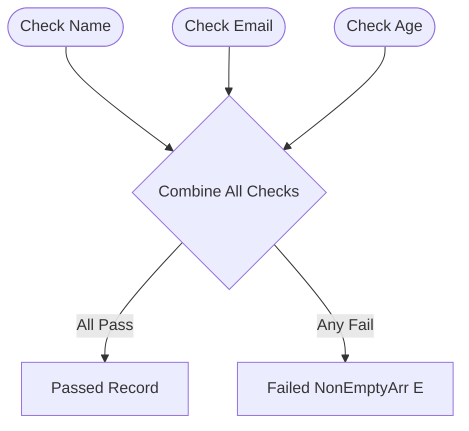

Using fail-fast error structures (`Result`, `try/catch`) for form or schema validation
short-circuits on the first failure, hiding subsequent field errors until previous ones are
corrected.

`Validation<E, A>` models validation outcomes as a discriminated union: `Passed<A>` (valid value) or
`Failed<E>` (accumulated non-empty list of errors). Instead of short-circuiting, it evaluates
independent checks and merges all failures together.



```ts
import { pipe } from "@nlozgachev/pipelined/composition";
import { Validation } from "@nlozgachev/pipelined/core";

export type Validation<E, A> = Validation.Passed<A> | Validation.Failed<E>;
```

---

## Creating Validations

To begin validating, we wrap our data checks into the `Validation` context:

```ts
import { Validation } from "@nlozgachev/pipelined/core";

// Representing a successful validation check
const pass = Validation.make.passed("Alice"); // Validation<never, string>

// Representing a single failure
const fail = Validation.make.failed("Username must be at least 3 characters"); // Validation<string, never>
```

Under the hood, all failures in `Validation` are collected inside an `Arr.NonEmpty` (a type-safe
array guaranteed to contain at least one element). When you call `Validation.make.failed(err)`, the
library automatically wraps your error in an array container.

If you already have an array of errors and want to wrap it directly, you can use `failedAll`:

```ts
const multipleFails = Validation.make.failedAll([
  "Email is malformed",
  "Email domain is not allowed",
]);
```

### Constructing checks with `from.Predicate`, `from.nullable`, and `tryCatch`

You can build reusable, rule-specific validation checkers using `from.Predicate`:

```ts
const validatePasswordLength = Validation.from.Predicate(
  (s: string) => s.length >= 8,
  (s) => `Password of length ${s.length} is too short (minimum 8 characters)`,
);
```

The second argument receives the original input, allowing you to format descriptive, clear feedback
for your users.

To validate that a nullable input is present, use `Validation.from.nullable`:

```ts
const requireTaxId = Validation.from.nullable(() => "Tax ID is required");

requireTaxId("XX-12345"); // Passed("XX-12345")
requireTaxId(null); // Failed(["Tax ID is required"])
```

When a validation step involves calling a synchronous parser that throws on invalid input (such as
`new URL(...)` or `JSON.parse`), use `Validation.tryCatch`:

```ts
const validateWebhookUrl = (raw: string): Validation<string, URL> =>
  Validation.tryCatch(
    () => new URL(raw),
    { onError: () => `Invalid webhook URL: ${raw}` },
  );
```

### Inspecting with type guards: `is.passed` and `is.failed`

When you need to check a `Validation` outcome imperatively, use `Validation.is.passed` and
`Validation.is.failed`:

```ts
const check = validatePasswordLength("secret123");

if (Validation.is.passed(check)) {
  console.log("Valid password:", check.value);
}

if (Validation.is.failed(check)) {
  console.error("Validation errors:", check.errors);
}
```

---

## The Accumulation Pattern: apply

What makes `Validation` structurally different from `Result` is how we combine multiple independent
checks.

The primary tool for this is `apply`. The pattern begins by wrapping a curried constructor function
in `passed`, and then applying each validated argument one-by-one:

```ts
import { pipe } from "@nlozgachev/pipelined/composition";

// A constructor function representing our valid target structure
const createUser = (name: string) => (email: string) => (age: number) => ({
  name,
  email,
  age,
});

const result = pipe(
  Validation.make.passed(createUser),
  Validation.apply(validateName(form.name)), // Applies name check
  Validation.apply(validateEmail(form.email)), // Applies email check
  Validation.apply(validateAge(form.age)), // Applies age check
);
```

Let's dissect what happens when this pipeline executes. Each `apply` step inspects both sides:

- If both the function and the argument have passed, the argument value is applied to the function.
- If either the function or the argument has failed, the errors are gathered.
- If *both* have failed, their respective error lists are merged (or combined via an optional
  `{ combineErrors }` option).

Because each argument is validated independently before being combined, all validation checks are
guaranteed to run, and every failure is gathered into a single consolidated `Failed` container.

---

## Transforming values and errors

You can transform the success value inside a `Passed` container without worrying about the failure
branch using `map`:

```ts
pipe(
  validateAge(input),
  Validation.map((age) => age * 365), // Converts age in years to age in days
);
```

If the validation has failed, `map` does nothing and lets the accumulated errors propagate.

To transform every error inside a `Failed` container — for example, prefixing field names when
nesting child form validations — use `Validation.mapError`:

```ts
const billingValidation = pipe(
  validateAddress(billingInput),
  Validation.mapError((err) => `[Billing] ${err}`),
);
```

---

## Extracting the value

Once all checks have run and the errors have been accumulated, you must exit the `Validation`
context at the edge of your pipeline.

### Safe fallbacks with `getOrElse`

`getOrElse` extracts the validated value from a `Passed` container, or returns a safe fallback value
if the validations failed:

```ts
pipe(
  formValidation,
  Validation.getOrElse(() => defaultUserData),
);
```

As with other modules in this library, `getOrElse` expects a function (a thunk) to defer evaluating
the fallback value, saving execution costs if the validation checks pass successfully.

### Exhaustive matching with `match`

To drive distinct UI rendering or business branches based on the outcome, use `match`:

```ts
const view = pipe(
  formValidation,
  Validation.match({
    passed: (data) => renderSuccessDashboard(data),
    failed: (errors) => renderErrorList(errors), // errors is Arr.NonEmpty<E>
  }),
);
```

---

## Side effects with tap and tapError

When you want to log or inspect outcomes mid-pipeline without altering the validation flow, use
`tap` for valid values and `tapError` for accumulated errors:

```ts
pipe(
  formValidation,
  Validation.tap((user) => metrics.increment("validation.passed", { role: user.role })),
  Validation.tapError((errors) => {
    logger.warn(`Form validation failed with ${errors.length} errors`, { errors });
  }),
);
```

---

## Fallback strategies: recover and recoverUnless

`recover` provides a fallback `Validation` when validation has failed. It passes the accumulated
error list to your fallback function, allowing you to inspect what went wrong and decide how to
recover dynamically:

```ts
pipe(
  validatePayload(input),
  Validation.recover((errors) => {
    console.warn("Payload validation failed. Using default configuration.", errors);
    return Validation.make.passed(defaultPayload);
  }),
);
```

When certain errors should block recovery (such as a security violation or corrupted schema header),
use `Validation.recoverUnless`. If any accumulated error matches the `isBlocked` predicate, the
failure propagates untouched; otherwise, the fallback runs:

```ts
pipe(
  validateConfig(rawConfig),
  Validation.recoverUnless(
    (err) => err.startsWith("SECURITY_"),
    () => Validation.make.passed(fallbackConfig),
  ),
);
```

---

## Interoperability and Hand-offs

Because software systems use a variety of modeling types, you can translate `Validation` to and from
other modules.

### Converting to and from Maybe

If you only care about obtaining a valid value and do not need to report the reasons for failure,
you can downgrade the `Validation` to a `Maybe` using `to.Maybe`:

```ts
const maybeValidData = Validation.to.Maybe(formValidation); // Some(data) or None
```

Conversely, to convert an optional `Maybe` into a `Validation`, supply an error thunk for the `None`
case using `Validation.from.Maybe`:

```ts
const CouponValidation = pipe(
  findCouponCode(rawCode), // Maybe<Coupon>
  Validation.from.Maybe(() => "Coupon code is invalid or expired"),
);
```

### Bridging from Result

When incorporating an operation that throws or performs fail-fast checks (like a `Result` parser)
into an accumulating validation flow, you can convert it using `from.Result`:

```ts
const emailCheck = Validation.from.Result(parseEmail(input)); // Passed(email) or Failed([err])
```

The single error from the `Err` is wrapped in a type-safe `Arr.NonEmpty` automatically.

### Sequencing actions by converting to Result

`Validation` is designed for running independent checks and collecting all failures. However, once
you have established that the data is 100% valid, you typically need to run sequential steps that
depend on earlier outputs or perform fail-fast operations.

For this, you should hand off execution to a `Result` pipeline using `to.Result`. If you want to
merge accumulated validation errors into a single error string or composite error object, pass a
combiner function to `to.Result`:

```ts
pipe(
  Validation.struct({ name: validateName(form.name), email: validateEmail(form.email) }),
  Validation.to.Result((errors) => errors.join("; ")), // Passed becomes Ok, Failed becomes Err("err1; err2")
  Result.chain((data) => db.saveUser(data)), // Sequential, fail-fast operation
  Result.getOrElse(() => null),
);
```

Calling `Validation.to.Result` without arguments retains the raw `Arr.NonEmpty<E>` error list inside
`Err`.

---

## Why Validation has no chain, bind, or bindTo

A developer familiar with `Result` or `Maybe` might wonder why `Validation` omits `chain`, `bind`,
and `bindTo`.

This omission is a deliberate architectural design choice.

`chain`, `bind`, and `bindTo` sequence dependent steps where Step B requires the successful output
of Step A:

```ts
// Supported in Result, NOT in Validation
pipe(
  getUser(userId),
  Result.bindTo("user"),
  Result.bind("prefs", ({ user }) => getPreferences(user.id)),
);
```

If Step A fails, Step B has no input and cannot run. That sequential dependency conflicts with the
purpose of `Validation`: **independent error accumulation**. When steps depend on prior outputs,
they cannot be evaluated independently to gather all errors at once.

For dependent steps that rely on prior outputs, use `Result`. For independent inputs that can all be
checked simultaneously, validate them with `Validation.struct` or `Validation.apply`, and then hand
off the verified data to `Result` via `Validation.to.Result`.

---

## Combining records: struct

To combine multiple independent validation checks into a single validated object, you can use
`Validation.struct`.

Unlike `Result.struct` or `Maybe.struct` (which short-circuit on the first failure),
`Validation.struct` **accumulates errors from all failed branches** into a single `Failed` list:

```ts
const validatedUser = Validation.struct({
  name: Validation.from.Predicate((s: string) => s.length > 0, () => "Name is required")(""),
  age: Validation.from.Predicate((n: number) => n >= 18, () => "Must be at least 18")(16),
  role: Validation.make.passed("user"),
});
// Failed(["Name is required", "Must be at least 18"])
```

If all validation fields pass successfully, it returns a `Passed` container containing the fully
constructed record:

```ts
const passedUser = Validation.struct({
  name: Validation.make.passed("Alice"),
  age: Validation.make.passed(30),
  role: Validation.make.passed("admin"),
});
// Passed({ name: "Alice", age: 30, role: "admin" })
```

---

## Field-level validation: Validation.keyed

While `Validation.struct` is ideal for producing a single final outcome where all errors merge into
one list, user interfaces often need errors tied directly to their corresponding input fields.
Rendering a form requires knowing specifically whether `username` or `email` failed so an error
message appears next to the exact input.

`Validation.keyed` keeps individual validation results partitioned by key inside a plain JavaScript
object:

```ts
const validateProfile = Validation.keyed.make({
  username: Validation.from.Predicate((s: string) => s.length >= 3, () => "Too short"),
  email: Validation.from.Predicate((s: string) => s.includes("@"), () => "Invalid email"),
  age: Validation.from.Predicate((n: number) => n >= 18, () => "Must be 18+"),
});

const formState = validateProfile({
  username: "al",
  email: "invalid-email",
  age: 25,
});
// {
//   username: Failed(["Too short"]),
//   email: Failed(["Invalid email"]),
//   age: Passed(25),
// }
```

Every property in `formState` is an independent `Validation` container, allowing UI components to
inspect each field in isolation.

### Inspecting field outcomes

You can query the overall status of the keyed object using boolean guards:

```ts
if (Validation.keyed.is.failed(formState)) {
  // At least one field contains errors
}

if (Validation.keyed.is.passed(formState)) {
  // Every field passed — formState properties are narrowed to Passed<A>
}
```

### Extracting values and errors with Maybe

To extract the clean data or the field-level errors without manual property iteration,
`Validation.keyed` provides `getPassed` and `getErrors`, both returning `Maybe`:

```ts
// Some({ username: "alice", email: "alice@example.com", age: 25 }) if all pass, otherwise None
const cleanData = Validation.keyed.getPassed(formState);

// Some({ username: ["Too short"], email: ["Invalid email"] }) if any fail, otherwise None
const fieldErrors = Validation.keyed.getErrors(formState);
```

When you are ready to collapse the keyed object into a single consolidated `Validation<E, T>`, pass
the object directly into `Validation.struct`:

```ts
const singleValidation = Validation.struct(formState);
// Failed(["Too short", "Invalid email"])
```

---

## Asynchronous Validation: Task.Validation

When you need to perform validation checks that require asynchronous operations (such as making a
network request to verify email availability, or querying a database to check if a username is
taken), you can use `Task.Validation<E, A>`.

Under the hood, `Task.Validation` is an alias for `Task<Validation<E, A>>`. Like `Validation`, it
concurrently evaluates independent checks and aggregates all failures into a single list rather than
failing fast.

To run multiple asynchronous validation checks in parallel and accumulate any failures, combine them
using `Task.Validation.struct`:

```ts
import { Task } from "@nlozgachev/pipelined/core";

const validateUserAsync = Task.Validation.struct({
  username: checkUsernameUnique(username), // Task.Validation<string, string>
  email: checkEmailNotBlocked(email), // Task.Validation<string, string>
}); // Task.Validation<string, { username: string; email: string }>
```

If any check fails, the task resolves to a `Failed` variant containing the accumulated list of all
errors.

### Transforming and Inspecting Errors

Because validation processes are designed to accumulate multiple failures, we often need to format
or log these errors mid-pipeline. `Task.Validation` provides dedicated error-mapping combinators for
this:

- **`mapError`**: Transforms all accumulated errors in the list using a function `(e: E) => F`.
- **`tapError`**: Executes a side effect (such as logging warnings) on the accumulated list of
  errors without modifying the pipeline's value.

```ts
import { pipe } from "@nlozgachev/pipelined/composition";
import { Task } from "@nlozgachev/pipelined/core";

const validatedProfile = pipe(
  validateUserAsync,
  Task.Validation.mapError((err) => `Server Validation: ${err}`),
  Task.Validation.tapError((errors) => {
    logger.warn(`Profile validation failed with ${errors.length} errors`, { errors });
  }),
);
```

---

## Problems it solves

- **Multi-field web form validation**: In registration forms, profile editors, and checkout panels,
  users frequently submit multiple invalid fields at once. Short-circuiting error handlers stop on
  the first error, forcing frustrating trial-and-error submissions. `Validation` aggregates all
  field errors into a single collection, allowing UIs to render feedback on every invalid input
  simultaneously.
- **Batch data ingestion and bulk import diagnostics**: When importing CSV spreadsheets, parsing
  configuration files, or validating batch API payloads, systems need a full accounting of all
  invalid records. `Validation.struct` and `Validation.apply` evaluate all checks independently,
  gathering every schema and domain violation into a complete diagnostic report rather than halting
  on the first error.
- **Multi-rule entity policy checks**: When evaluating complex entity constraints (such as password
  strength requirements, credit assessment criteria, or compliance checklists), `Validation` runs
  all checks independently and reports every unmet condition at once for comprehensive user
  feedback.
- **Bridging validation accumulation with fail-fast execution (`Validation.to.Result`,
  `Validation.from.Result`)**: In web endpoints, validating an incoming request body requires
  accumulating all field errors with `Validation`, but subsequent database operations require
  fail-fast sequential chaining with `Result`. `Validation.to.Result` bridges these patterns
  cleanly, preserving all collected errors while transitioning into standard sequential pipelines.
- **Contextual error tagging across nested forms (`Validation.mapError`)**: In nested forms and
  multi-step wizards, child components validate their own sub-fields. `Validation.mapError` allows
  parent forms to namespace child errors (e.g. prefixing `address.zipCode`) before merging, keeping
  error messages structured and localized.
