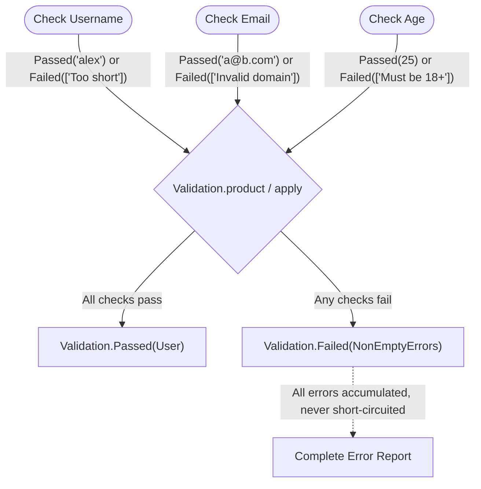

<!-- BUNDLE_SIZE:START -->

> 1.56 kB minified + gzipped

<!-- BUNDLE_SIZE:END -->

When validating incoming data — such as a user registration form, a configuration file, or an API
request body — a payload often contains multiple invalid fields simultaneously. Standard JavaScript
error-handling patterns rely on exceptions or early return statements:

```ts
function validateRegistration(input: { username: string; email: string; age: number }) {
  if (input.username.length < 3) {
    throw new Error("Username must be at least 3 characters");
  }
  if (!input.email.includes("@")) {
    throw new Error("Email must contain an @ symbol");
  }
  if (input.age < 18) {
    throw new Error("User must be at least 18 years old");
  }
  return input;
}
```

This fail-fast approach short-circuits on the first failure. If a user submits a form with an
invalid username, an invalid email, and an invalid age, the function throws immediately on the
username. The caller never discovers the email and age errors until the user corrects the username
and submits again. In web forms, this forces users into a frustrating cycle of submitting, fixing
one field, submitting again, and finding another error.

Developers often attempt to solve this by creating an imperative error array:

```ts
function validateRegistrationImperative(input: { username: string; email: string; age: number }) {
  const errors: string[] = [];
  if (input.username.length < 3) errors.push("Username must be at least 3 characters");
  if (!input.email.includes("@")) errors.push("Email must contain an @ symbol");
  if (input.age < 18) errors.push("User must be at least 18 years old");

  if (errors.length > 0) {
    return { success: false as const, errors };
  }
  return { success: true as const, data: input };
}
```

While this accumulates all errors, it loses composition. Combining checks across multiple functions
requires manually merging arrays, passing error lists through arguments, and handling boilerplate
status checks at every call site.

`Validation<E, A>` models validation outcomes as a discriminated union: `Passed<A>` representing a
valid value, or `Failed<E>` representing an accumulated list of errors. Instead of short-circuiting
on the first failure, it evaluates independent checks and merges all accumulated errors together.



```ts
import { pipe } from "@nlozgachev/pipelined/composition";
import { Validation } from "@nlozgachev/pipelined/core";

export type Validation<E, A> = Validation.Passed<A> | Validation.Failed<E>;
```

Failures in `Validation` are stored inside an `Arr.NonEmpty<E>` (an array guaranteed to hold at
least one element). This prevents empty error states at compile time.

---

## Creating Validations

Validation instances represent either a verified value or an initial failure.

```ts
import { Validation } from "@nlozgachev/pipelined/core";

// Successful validation check
const pass = Validation.make.passed("Alice"); // Validation<never, string>

// Single validation failure
const fail = Validation.make.failed("Username must be at least 3 characters"); // Validation<string, never>
```

When you call `Validation.make.failed(err)`, the library automatically wraps the error in a
single-element `Arr.NonEmpty` array.

If you already have an array of errors, wrap it directly with `failedAll`:

```ts
const multipleFails = Validation.make.failedAll([
  "Email domain is not allowed",
  "Email address has expired",
]);
```

### Constructing checks with `from.Predicate`, `from.nullable`, and `tryCatch`

Build reusable rule checkers from boolean conditions using `from.Predicate`:

```ts
const validatePasswordLength = Validation.from.Predicate(
  (s: string) => s.length >= 8,
  (s) => `Password of length ${s.length} is too short (minimum 8 characters)`,
);

validatePasswordLength("secret123"); // Passed("secret123")
validatePasswordLength("short"); // Failed(["Password of length 5 is too short (minimum 8 characters)"])
```

The second argument receives the original input, allowing you to format descriptive error messages.

To validate that an input is not null or undefined, use `Validation.from.nullable`:

```ts
const requireTaxId = Validation.from.nullable(() => "Tax ID is required");

requireTaxId("XX-12345"); // Passed("XX-12345")
requireTaxId(null); // Failed(["Tax ID is required"])
```

When a validation step calls a parser that throws on invalid input (such as `new URL(...)` or
`JSON.parse`), use `Validation.tryCatch`:

```ts
const validateWebhookUrl = (raw: string): Validation<string, URL> =>
  Validation.tryCatch(
    () => new URL(raw),
    { onError: () => `Invalid webhook URL: ${raw}` },
  );
```

### Inspecting with type guards: `is.passed` and `is.failed`

When inspecting a `Validation` outcome imperatively, use `Validation.is.passed` and
`Validation.is.failed`:

```ts
const check = validatePasswordLength("secret123");

if (Validation.is.passed(check)) {
  console.log("Valid password:", check.value);
}

if (Validation.is.failed(check)) {
  console.error("Validation errors:", check.errors);
}
```

---

## Combining Validations: struct and apply

Combining multiple independent checks is the central capability of `Validation`.

### Combining records with `struct`

`Validation.struct` combines a record of independent validation checks into a single validated
object. Unlike `Result.struct` (which halts on the first error), `Validation.struct` evaluates every
property and accumulates all errors into a unified list:

```ts
const validatedUser = Validation.struct({
  name: Validation.from.Predicate((s: string) => s.length > 0, () => "Name is required")(""),
  age: Validation.from.Predicate((n: number) => n >= 18, () => "Must be at least 18")(16),
  role: Validation.make.passed("user"),
});
// Failed(["Name is required", "Must be at least 18"])
```

When all fields pass, it produces a `Passed` record with the assembled values:

```ts
const passedUser = Validation.struct({
  name: Validation.make.passed("Alice"),
  age: Validation.make.passed(30),
  role: Validation.make.passed("admin"),
});
// Passed({ name: "Alice", age: 30, role: "admin" })
```

### Combining positional arguments with `apply`

When constructing objects from curried functions or assembling tuple arguments, use
`Validation.apply`:

```ts
import { pipe } from "@nlozgachev/pipelined/composition";

const createProfile = (name: string) => (email: string) => (age: number) => ({
  name,
  email,
  age,
});

const result = pipe(
  Validation.make.passed(createProfile),
  Validation.apply(validateName(form.name)),
  Validation.apply(validateEmail(form.email)),
  Validation.apply(validateAge(form.age)),
);
```

Each `apply` step checks both sides:

- If both the function and argument pass, the argument is applied.
- If either side fails, the errors are gathered into `Failed`.
- If both sides fail, their error lists are concatenated together.

---

## Transforming values and errors

You can transform the success value inside a `Passed` container without altering failure branches
using `map`:

```ts
pipe(
  validateAge(input),
  Validation.map((age) => age * 365), // Converts age in years to age in days
);
```

If the validation fails, `map` does nothing and lets accumulated errors flow through.

To transform accumulated errors — such as prefixing field names when nesting child validations — use
`Validation.mapError`:

```ts
const billingValidation = pipe(
  validateAddress(billingInput),
  Validation.mapError((err) => `[Billing] ${err}`),
);
```

---

## Extracting the value

Once all checks have run and errors are collected, extract the value at the edge of your pipeline.

### Safe fallbacks with `getOrElse`

`getOrElse` extracts the validated value from a `Passed` container, or evaluates a fallback thunk if
the validation failed:

```ts
pipe(
  formValidation,
  Validation.getOrElse(() => defaultUserData),
);
```

`getOrElse` expects a thunk to avoid computing the fallback value when checks pass.

### Exhaustive matching with `match`

To handle both outcomes explicitly, use `match`:

```ts
const view = pipe(
  formValidation,
  Validation.match({
    passed: (data) => renderSuccessDashboard(data),
    failed: (errors) => renderErrorList(errors), // errors is Arr.NonEmpty<E>
  }),
);
```

`match` enforces exhaustive handling with named cases. Positional fold callbacks are not supported.

---

## Side effects with tap and tapError

To log or inspect outcomes mid-pipeline without altering the validation flow, use `tap` for valid
values and `tapError` for accumulated errors:

```ts
pipe(
  formValidation,
  Validation.tap((user) => metrics.increment("validation.passed", { role: user.role })),
  Validation.tapError((errors) => {
    logger.warn(`Form validation failed with ${errors.length} errors`, { errors });
  }),
);
```

---

## Fallback strategies: recover and recoverUnless

`recover` provides an alternative `Validation` when validation has failed. It passes the accumulated
error list to your fallback function:

```ts
pipe(
  validatePayload(input),
  Validation.recover((errors) => {
    logger.warn("Payload validation failed. Falling back to default payload.", { errors });
    return Validation.make.passed(defaultPayload);
  }),
);
```

When specific errors should prevent recovery (such as security violations or invalid credentials),
use `Validation.recoverUnless`. If any accumulated error matches the `isBlocked` predicate, the
failure propagates untouched:

```ts
pipe(
  validateConfig(rawConfig),
  Validation.recoverUnless(
    (err) => err.startsWith("SECURITY_"),
    () => Validation.make.passed(fallbackConfig),
  ),
);
```

---

## Interoperability and Hand-offs

`Validation` translates cleanly to and from other containers in the library.

### Converting to and from Maybe

To discard error details and retain only success or failure, convert `Validation` to `Maybe` using
`to.Maybe`:

```ts
const maybeValidData = Validation.to.Maybe(formValidation); // Some(data) or None
```

To convert an optional `Maybe` into a `Validation`, supply an error generator for the `None` case
using `Validation.from.Maybe`:

```ts
const couponValidation = pipe(
  findCouponCode(rawCode), // Maybe<Coupon>
  Validation.from.Maybe(() => "Coupon code is invalid or expired"),
);
```

### Bridging from Result

When incorporating a fail-fast parser into an accumulating validation flow, convert it using
`from.Result`:

```ts
const emailCheck = Validation.from.Result(parseEmail(input)); // Passed(email) or Failed([err])
```

The error from the `Err` variant is wrapped in an `Arr.NonEmpty` array automatically.

### Sequencing actions by converting to Result

`Validation` evaluates independent checks simultaneously. Once all inputs are verified, subsequent
steps (such as database writes or API calls) often depend on earlier outputs and must execute
sequentially.

To transition from parallel validation into sequential execution, convert to `Result` using
`to.Result`:

```ts
pipe(
  Validation.struct({ name: validateName(form.name), email: validateEmail(form.email) }),
  Validation.to.Result((errors) => errors.join("; ")), // Passed becomes Ok, Failed becomes Err
  Result.chain((data) => db.saveUser(data)), // Sequential, fail-fast operation
  Result.getOrElse(() => null),
);
```

Calling `Validation.to.Result` without arguments retains the raw `Arr.NonEmpty<E>` error list inside
`Err`.

---

## Why Validation omits chain, assign, and assignTo

Developers familiar with `Result` or `Maybe` often ask why `Validation` lacks `chain`, `assign`, and
`assignTo`.

`chain` and `assign` sequence dependent operations where Step B requires the output of Step A:

```ts
// Supported in Result, NOT in Validation
pipe(
  getUser(userId),
  Result.assignTo("user"),
  Result.assign("prefs", ({ user }) => getPreferences(user.id)),
);
```

If Step A fails, Step B cannot run because it lacks an input. This sequential dependency directly
contradicts error accumulation: you cannot run checks in parallel if one check requires the value of
another.

For dependent steps that rely on prior results, use `Result`. For independent inputs that can all be
evaluated at once, validate them with `Validation.struct` or `Validation.apply`, and then hand off
the verified record to `Result` using `Validation.to.Result`.

---

## Field-level validation: Validation.keyed

While `Validation.struct` combines all errors into a single list, user interfaces often require
errors partitioned by input field so an error message renders next to the matching input.

`Validation.keyed` keeps individual validation results partitioned by key inside an object:

```ts
const validateProfile = Validation.keyed.make({
  username: Validation.from.Predicate((s: string) => s.length >= 3, () => "Too short"),
  email: Validation.from.Predicate((s: string) => s.includes("@"), () => "Invalid email"),
  age: Validation.from.Predicate((n: number) => n >= 18, () => "Must be 18+"),
});

const formState = validateProfile({
  username: "al",
  email: "invalid-email",
  age: 25,
});
// {
//   username: Failed(["Too short"]),
//   email: Failed(["Invalid email"]),
//   age: Passed(25),
// }
```

Every property in `formState` is an independent `Validation` container, allowing UI components to
render field errors independently.

### Inspecting field outcomes

Query the overall status of the keyed object using boolean guards:

```ts
if (Validation.keyed.is.failed(formState)) {
  // At least one field contains errors
}

if (Validation.keyed.is.passed(formState)) {
  // Every field passed — formState properties are narrowed to Passed<A>
}
```

### Extracting values and errors with Maybe

To extract the clean data or the field-level errors, use `getPassed` and `getErrors`:

```ts
// Some({ username: "alice", email: "alice@example.com", age: 25 }) if all pass, otherwise None
const cleanData = Validation.keyed.getPassed(formState);

// Some({ username: ["Too short"], email: ["Invalid email"] }) if any fail, otherwise None
const fieldErrors = Validation.keyed.getErrors(formState);
```

To collapse the keyed object into a single consolidated `Validation<E, T>`, pass the object directly
into `Validation.struct`:

```ts
const singleValidation = Validation.struct(formState);
// Failed(["Too short", "Invalid email"])
```

---

## Asynchronous Validation: Task.Validation

When validation checks require asynchronous operations — such as checking username availability in a
database or verifying an address against an external postal API — use `Task.Validation<E, A>`.

`Task.Validation` is an alias for `Task<Validation<E, A>>`. It runs independent asynchronous checks
concurrently and aggregates all failures into a single list:

```ts
import { Task } from "@nlozgachev/pipelined/core";

const validateUserAsync = Task.Validation.struct({
  username: checkUsernameUnique(username), // Task.Validation<string, string>
  email: checkEmailNotBlocked(email), // Task.Validation<string, string>
}); // Task.Validation<string, { username: string; email: string }>
```

If any check fails, the task resolves to a `Failed` variant containing the accumulated list of all
errors.

### Transforming and inspecting errors in tasks

Format or log asynchronous validation errors mid-pipeline using dedicated combinators:

```ts
import { pipe } from "@nlozgachev/pipelined/composition";
import { Task } from "@nlozgachev/pipelined/core";

const validatedProfile = pipe(
  validateUserAsync,
  Task.Validation.mapError((err) => `Server Validation: ${err}`),
  Task.Validation.tapError((errors) => {
    logger.warn(`Profile validation failed with ${errors.length} errors`, { errors });
  }),
);
```

---

## Pipeline composition

Here is an end-to-end user registration endpoint pipeline. It validates input fields independently,
namespaces errors, hands off the verified record to a sequential `Result` pipeline for database
persistence, and formats the final HTTP response:

```ts
import { pipe } from "@nlozgachev/pipelined/composition";
import { Result, Validation } from "@nlozgachev/pipelined/core";

interface RegistrationInput {
  username: string;
  email: string;
  age: number;
}

interface UserRecord {
  id: string;
  username: string;
  email: string;
  age: number;
}

const validateUsername = Validation.from.Predicate(
  (s: string) => s.length >= 3,
  () => "Username must be at least 3 characters",
);

const validateEmail = Validation.from.Predicate(
  (s: string) => s.includes("@") && s.includes("."),
  () => "Email address must be valid",
);

const validateAge = Validation.from.Predicate(
  (n: number) => n >= 18,
  () => "Registrant must be at least 18 years old",
);

const saveUserToDb = (data: { username: string; email: string; age: number }): Result<string, UserRecord> =>
  Result.make.ok({ id: "usr_101", ...data });

const registerUser = (input: RegistrationInput): { status: number; body: string } =>
  pipe(
    Validation.struct({
      username: validateUsername(input.username),
      email: validateEmail(input.email),
      age: validateAge(input.age),
    }),
    Validation.mapError((err) => `[Registration] ${err}`),
    Validation.to.Result((errors) => errors.join("; ")),
    Result.chain((validData) => saveUserToDb(validData)),
    Result.match({
      ok: (user) => ({ status: 201, body: `Created user ${user.username} (${user.id})` }),
      err: (errorMessage) => ({ status: 400, body: errorMessage }),
    }),
  );
```

---

## Problems it solves

- **Multi-field web form validation**: Web forms frequently receive multiple invalid fields in a
  single submission. Short-circuiting error handlers stop on the first error, forcing repetitive
  submit-fix cycles. `Validation` aggregates all field errors into a single collection, allowing
  user interfaces to render feedback on every invalid input at once.
- **Batch data ingestion and bulk import diagnostics**: When importing spreadsheets, configuration
  files, or batch API payloads, operators need an exhaustive report of all invalid rows.
  `Validation.struct` and `Validation.apply` evaluate all checks independently, gathering every
  schema and domain violation into a single diagnostic list rather than halting on row one.
- **Multi-rule entity policy checks**: When evaluating complex entity constraints — such as password
  strength requirements, credit assessment rules, or compliance checklists — `Validation` evaluates
  all criteria independently and reports every unmet condition simultaneously.
- **Bridging validation accumulation with fail-fast execution (`Validation.to.Result`)**: In web
  endpoints, validating an incoming request body requires accumulating all field errors with
  `Validation`, while subsequent database operations require fail-fast sequential chaining with
  `Result`. `Validation.to.Result` transitions between these patterns cleanly, preserving all
  collected errors while entering standard sequential pipelines.
- **Contextual error tagging across nested forms (`Validation.mapError`)**: In nested forms and
  multi-step wizards, child components validate their own sub-fields. `Validation.mapError` allows
  parent forms to namespace child errors (e.g. prefixing `address.zipCode`) before merging, keeping
  error messages structured and localized.
